# Evolution of Mobile Networks: 1G to 6G

> A research-oriented guide to cellular network generations, their technologies, architectures, and evolution.

## Contents

- [Overview](#overview)
- [Visual timeline: 1G to 6G](#visual-timeline-1g-to-6g)
- [Comparison at a glance](#comparison-at-a-glance)
- [Common architecture concepts](#common-architecture-concepts)
- [1G — Analog cellular](#1g--analog-cellular)
- [2G — Digital cellular](#2g--digital-cellular)
- [3G — Mobile internet](#3g--mobile-internet)
- [4G — All-IP broadband](#4g--all-ip-broadband)
- [5G — Service-based architecture](#5g--service-based-architecture)
- [6G — IMT-2030 research](#6g--imt-2030-research)
- [5G Components and Roles](#5g-components-and-roles)
- [6G Candidate Components and Roles](#6g-candidate-components-and-roles)
- [FCAPS and OSS management](#fcaps-and-oss-management)
- [Telecommunications Standards](#telecommunications-standards)
- [Performance Management Standards](#performance-management-standards)
- [Architecture evolution](#architecture-evolution)
- [Research directions](#research-directions)
- [References](#references)

## Overview

The **G** in 1G–6G stands for **generation**. Each new generation changes wireless radio technology, the types of services networks support, and often the design of the radio access network (RAN) and core network.

- **1G:** Analog mobile voice.
- **2G:** Digital voice, SMS, and later packet data.
- **3G:** More practical mobile internet and multimedia.
- **4G:** High-speed, all-IP mobile broadband.
- **5G:** Enhanced broadband, low-latency capabilities, massive IoT, and service-based core networking.
- **6G:** A future generation under development, with research into AI integration, sensing, and ubiquitous connectivity.

> **Status note (October 2026):** 1G–5G are historical or deployed generations. 6G is not yet a finalized commercial cellular architecture. The diagrams below distinguish standardized implementations from proposed research concepts.

## Visual timeline: 1G to 6G

The following graphic is rendered directly by GitHub using **Mermaid** (no external image hosting required).

**Reading the graphic:** Solid arrows show the progression of deployed generations; the dashed arrow marks 6G as an emerging, not-yet-finalized generation. Each generation's detailed network architecture appears below.

## Comparison at a glance

| Generation | Approx. introduction | Representative standards | Access / radio techniques | Core / network approach | Main use cases |
|---|---|---|---|---|---|
| **1G** | 1980s | AMPS, NMT, TACS | Analog FM, FDMA | Circuit-switched | Mobile voice |
| **2G** | 1990s | GSM, IS-95; GPRS/EDGE enhancements | TDMA or CDMA | Circuit-switched voice; later packet-data overlay | Voice, SMS, basic data |
| **3G** | 2000s | UMTS/WCDMA, CDMA2000; HSPA | Wideband CDMA / CDMA | Circuit- and packet-switched domains | Web, video calling, multimedia |
| **4G** | 2010s | LTE, LTE-Advanced | OFDMA downlink, SC-FDMA uplink (LTE), MIMO | Evolved Packet Core (EPC), all-IP | Streaming, broadband, VoLTE |
| **5G** | 2019 onward | 5G NR, 5G Core | OFDM-based NR, massive MIMO, beamforming | 5G Core (5GC), service-based control plane | eMBB, URLLC, mMTC |
| **6G** | ~2030 target | IMT-2030 framework; specifications in development | Candidate advanced radio and spectrum technologies | **Not finalized**; AI-integrated and distributed designs under study | Immersive services, integrated sensing, ubiquitous coverage |

*These are broad generational summaries; standards and deployments vary across operators and regions.*

## Common architecture concepts

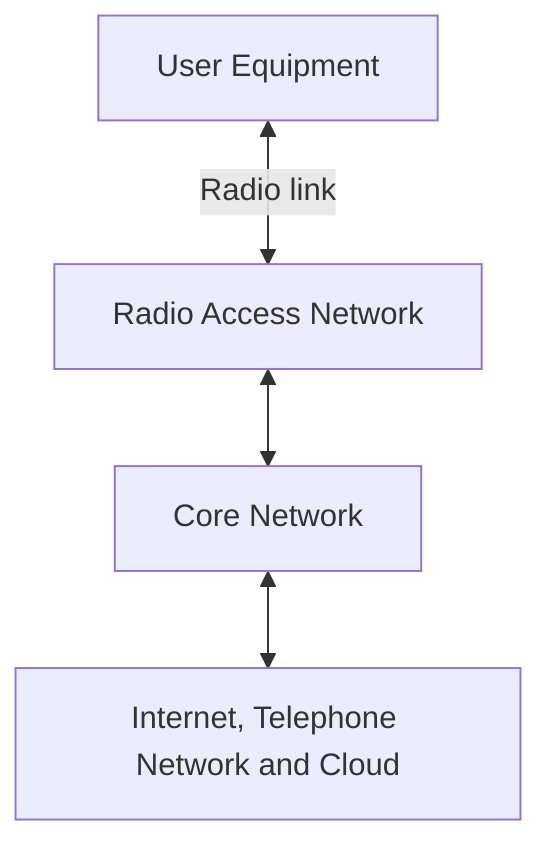

- **User Equipment (UE):** Phones, modems, sensors, vehicles, or other connected devices.
- **Radio Access Network (RAN):** The antennas, base stations, and radio-control functions that connect devices to the network.
- **Core Network:** Authentication, mobility, call or session control, policy, and routing to other networks.
- **Circuit switching:** Reserves a connection for a call, as in classic telephone systems.
- **Packet switching:** Transfers data as packets, enabling IP-based services.

## 1G — Analog cellular

**Core idea:** The earliest cellular systems carried voice as an analog radio signal.

**Representative systems:** AMPS, NMT, and TACS.

### Simplified 1G architecture

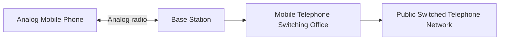

**Architecture:** A phone communicated with a base station, while a mobile switching office set up calls, handled mobility, and connected calls to the public telephone network.

**Key characteristics:** Analog FM, FDMA, circuit switching.

**Limitations:** Weak privacy, limited capacity, and little to no general-purpose mobile data.

## 2G — Digital cellular

**Core idea:** Digital communication enabled clearer voice, SMS, better spectral efficiency, and improved security. GPRS later added packet data to GSM networks.

**Representative systems:** GSM and IS-95 (cdmaOne); GPRS and EDGE are commonly described as 2.5G/2.75G enhancements.

### Simplified GSM/GPRS architecture

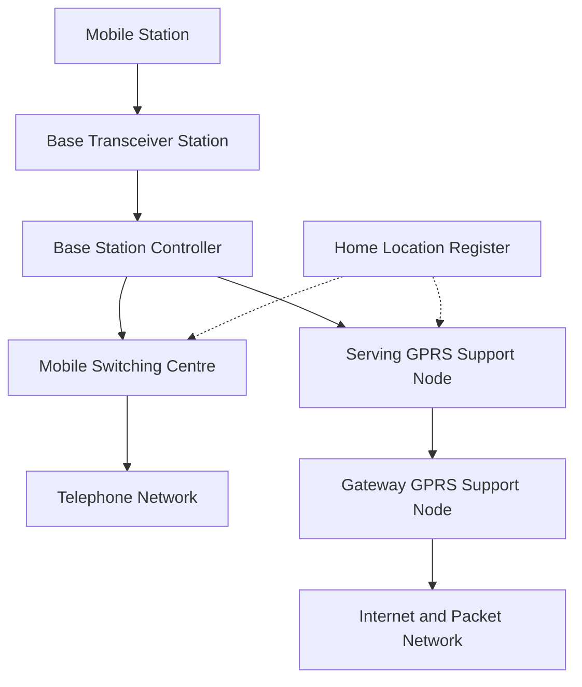

| Component | Role |
|---|---|
| BTS | Transmits and receives radio signals |
| BSC | Controls multiple BTS sites and radio resources |
| MSC | Switches circuit-based voice calls |
| HLR / VLR | Maintains subscription and location information |
| SGSN | Handles packet-data mobility and sessions |
| GGSN | Provides packet-data connectivity to external networks |

**Architectural change from 1G:** Digital radio and, with GPRS, a separate packet-data path alongside circuit-switched voice.

## 3G — Mobile internet

**Core idea:** Higher-capacity radio access made web browsing, multimedia, and video calls more practical.

**Representative systems:** UMTS/WCDMA, CDMA2000, HSPA/HSPA+.

### Simplified UMTS architecture

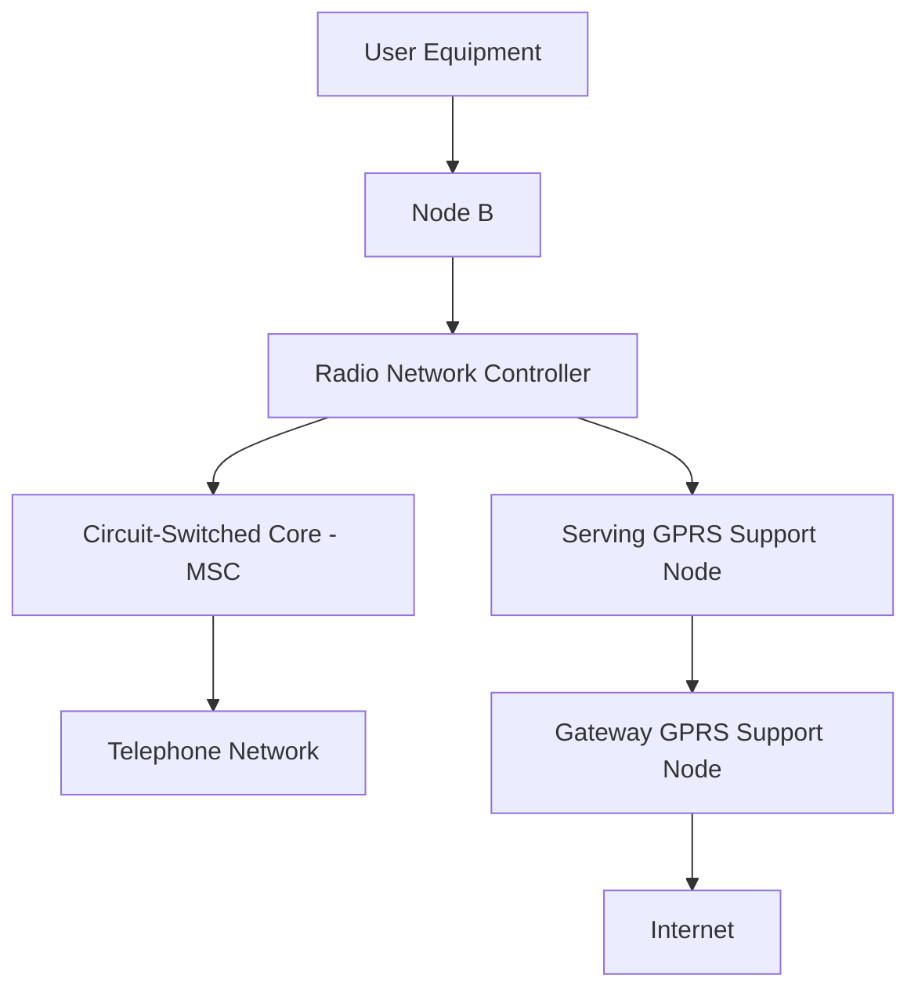

| Component | Role |
|---|---|
| Node B | 3G radio base station |
| RNC | Controls multiple Node Bs, radio resources, and handovers |
| MSC | Supports circuit-switched voice |
| SGSN / GGSN | Support packet-data services |

**Architectural change from 2G:** New wideband radio technologies and higher mobile data rates, while UMTS retained both circuit- and packet-switched core domains.

## 4G — All-IP broadband

**Core idea:** LTE introduced a flatter radio network and an all-IP packet core. Voice can be delivered over IMS as VoLTE.

**Representative systems:** LTE and LTE-Advanced.

### Simplified LTE / EPC architecture

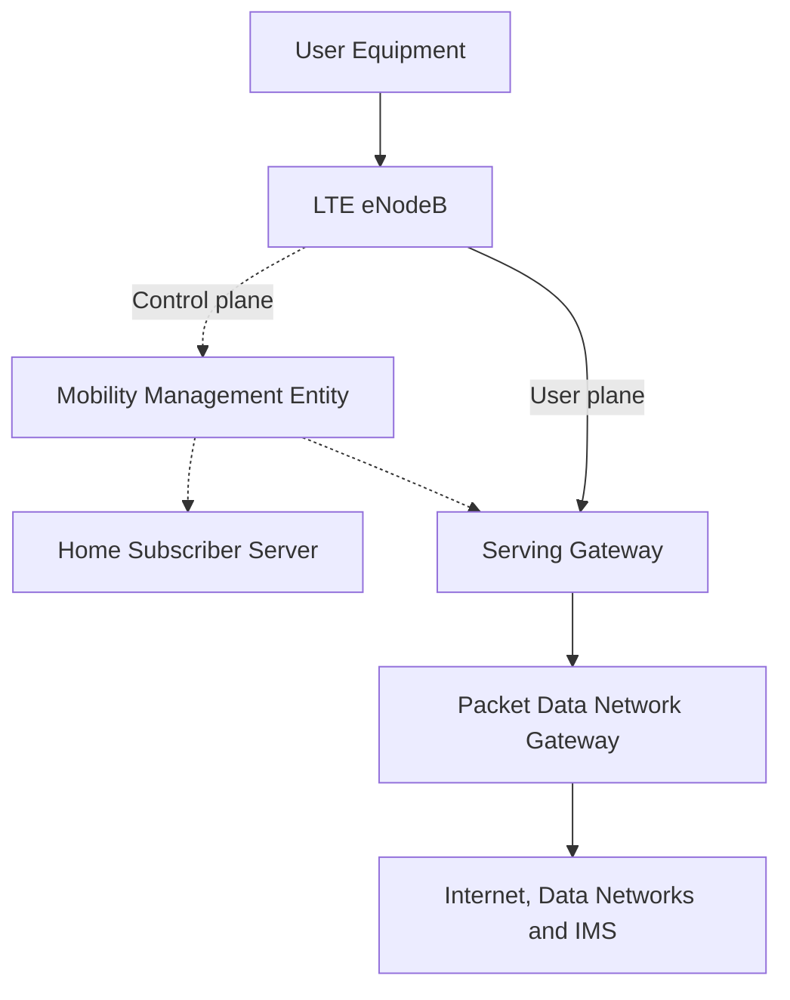

| Component | Role |
|---|---|
| eNodeB | LTE radio access, scheduling, and radio mobility functions |
| MME | Control-plane mobility and signaling |
| S-GW | User-packet forwarding and mobility anchor |
| P-GW | Connectivity to external packet networks |
| HSS | Subscriber data and authentication support |
| PCRF | Policy and charging decisions |
| IMS | IP multimedia services, including VoLTE |

**Architectural change from 3G:** No separate RNC in LTE; a flatter RAN, packet-only core, and standardized control-/user-plane functions.

## 5G — Service-based architecture

**Core idea:** 5G combines **New Radio (NR)** with a flexible core, especially in **Standalone (SA)** deployments. A **Non-Standalone (NSA)** deployment can use LTE/EPC as its anchor; the diagram below focuses on 5G SA.

### Simplified 5G Standalone architecture

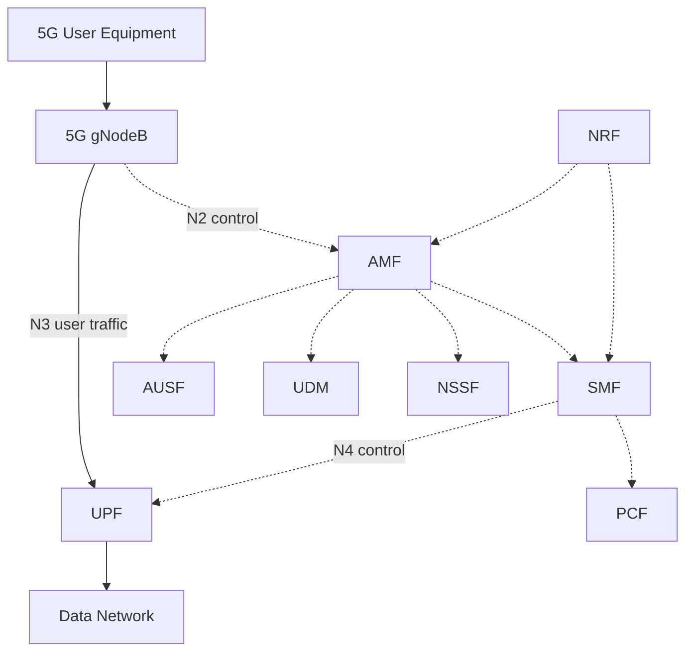

*Dotted lines represent simplified logical control/service relationships, not a complete set of standardized reference points.*

| 5G function | Meaning | Primary responsibility |
|---|---|---|
| AMF | Access and Mobility Management Function | Registration and mobility signaling |
| SMF | Session Management Function | PDU session management |
| UPF | User Plane Function | Packet forwarding and data-network connectivity |
| AUSF | Authentication Server Function | Authentication |
| UDM | Unified Data Management | Subscriber data management |
| PCF | Policy Control Function | Policy decisions |
| NRF | Network Repository Function | Network-function discovery |
| NSSF | Network Slice Selection Function | Slice selection support |
| NEF | Network Exposure Function | Controlled exposure of network capabilities |

### Main 5G service categories

- **eMBB (Enhanced Mobile Broadband):** High-throughput multimedia and broadband.
- **URLLC (Ultra-Reliable Low-Latency Communications):** Time-critical communications with strict reliability requirements.
- **mMTC (Massive Machine-Type Communications):** Very large numbers of connected devices.

**Architectural change from 4G:** A service-based 5G core, more flexible software/cloud deployments, network slicing, and stronger separation of control and user functions. Network slicing is a logical feature of the overall system; it is not equivalent to deploying a physically separate network for each customer.

## 6G — IMT-2030 research

**Core idea:** 6G is under research and standardization. The ITU's name for the next IMT generation is **IMT-2030**. Its scope includes enhanced communications, sensing, AI-related capabilities, and broader coverage.

> **Important:** The following is an **illustrative research concept**, **not an official or finalized 6G reference architecture**. Specific network functions, interfaces, and deployment choices will depend on future standards.

### Illustrative 6G research architecture

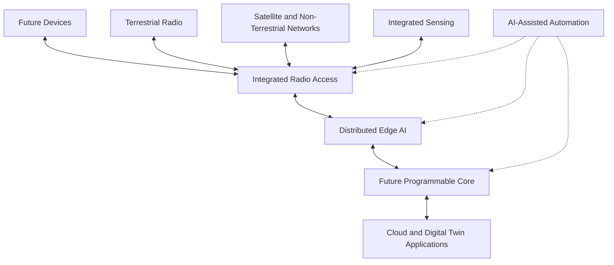

### Candidate research areas

- **AI-integrated networking:** AI for resource allocation, management, and possibly protocol design.
- **Integrated Sensing and Communication (ISAC):** Radio systems that support both connectivity and sensing functions.
- **Terrestrial/non-terrestrial integration:** Coordinated ground networks and satellite links.
- **Advanced spectrum:** Research on new high-frequency bands, including sub-THz candidates.
- **Distributed / cell-free MIMO:** Coordinated radio transmission from distributed sites.
- **Edge intelligence:** Computation and machine learning close to devices.
- **Network digital twins:** Simulation and monitoring of network behavior.

### ITU IMT-2030 usage scenarios

1. Immersive Communication (IC)
2. Hyper-Reliable and Low-Latency Communication (HRLLC)
3. Massive Communication (MC)
4. Ubiquitous Connectivity (UC)
5. Artificial Intelligence and Communication (AIAC)
6. Integrated Sensing and Communication (ISAC)

The IMT-2030 framework discusses ambitious capability ranges. They are **research objectives**, not guaranteed field performance or requirements already delivered by commercial 6G systems.

## 5G Components and Roles

The components below correspond to **3GPP 5G Standalone (SA)**, except where noted as optional or deployment-dependent. Functions are logical: vendors may implement them as software services on shared infrastructure.

| Component | Role |
|---|---|
| **UE** | User Equipment connecting to the mobile network, such as a phone, modem, or IoT device. |
| **gNB (gNodeB)** | 5G NR base station providing radio access, scheduling, radio-resource management, and mobility support. |
| **gNB-CU-CP** | Central Unit control-plane function for RRC and signaling in a split gNB. |
| **gNB-CU-UP** | Central Unit user-plane function for higher-layer user-data processing in a split gNB. |
| **gNB-DU** | Distributed Unit for lower-layer radio processing and scheduling in a split gNB. |
| **RU (Radio Unit)** | Radio-frequency and antenna-side processing; exact functional split is deployment-specific. |
| **AMF** | Access and Mobility Management Function for registration, access, and mobility signaling. |
| **SMF** | Session Management Function for PDU sessions, addressing, and UPF control. |
| **UPF** | User Plane Function for packet forwarding, routing, and user-plane policy/QoS enforcement. |
| **AUSF** | Authentication Server Function for network authentication procedures. |
| **UDM** | Unified Data Management for subscriber and authentication-related data management. |
| **UDR** | Unified Data Repository for structured subscription and other data used by network functions. |
| **PCF** | Policy Control Function for policy decisions, including QoS policy. |
| **NRF** | Network Repository Function for registration and discovery of network functions. |
| **NSSF** | Network Slice Selection Function for assisting network slice selection. |
| **NEF** | Network Exposure Function for secure exposure of selected capabilities to applications. |
| **NWDAF** | Network Data Analytics Function for network analytics and insights. |
| **IMS** | IP Multimedia Subsystem supporting IP multimedia and voice services such as VoNR; a service subsystem, not a 5GC network function. |
| **DN** | External Data Network, such as the Internet, enterprise services, or application networks. |

**Primary standards:** [3GPP TS 23.501](https://www.3gpp.org/dynareport/23501.htm) (5G system architecture), [TS 23.502](https://www.3gpp.org/dynareport/23502.htm) (procedures), [TS 38.300](https://www.3gpp.org/dynareport/38300.htm) (NR overview), and [TS 38.401](https://www.3gpp.org/dynareport/38401.htm) (NG-RAN architecture).

### Detailed layers and interfaces

> **Status:** The 5G components below are standardized 3GPP concepts. The main diagram describes **5G Standalone (SA)**, not a 5G NSA deployment anchored on LTE/EPC.

### 5G Standalone reference architecture (simplified)

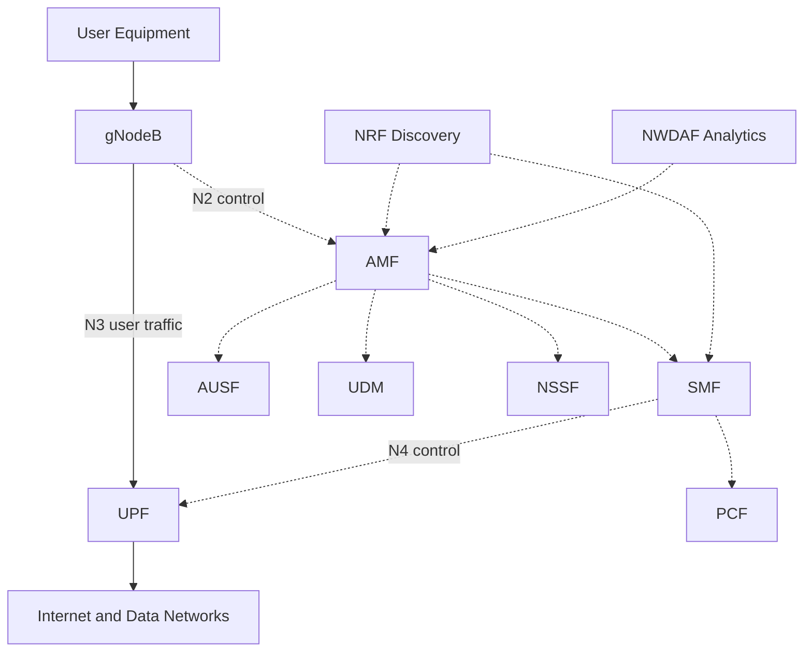

*This diagram is conceptual: actual 5GC uses a service-based control plane with standardized services and interfaces, not a single linear chain.*

### Example split gNodeB architecture

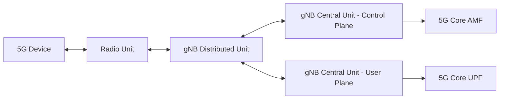

*The split architecture is one deployment option; not every 5G site uses separate CU, DU and RU equipment.*

### 5G interfaces and protocols

| Interface | Between | Role |
|---|---|---|
| **Uu** | UE and gNB | 5G NR radio interface |
| **N2** | NG-RAN and AMF | Control plane |
| **N3** | NG-RAN and UPF | User plane |
| **N4** | SMF and UPF | Session/user-plane control |
| **N6** | UPF and Data Network | External data connectivity |
| **Xn** | NG-RAN nodes | Coordination and mobility |
| **F1** | gNB-CU and gNB-DU | Split RAN connectivity |
| **E1** | gNB-CU-CP and gNB-CU-UP | CU control / user split |

**Principal standards:** [3GPP TS 23.501](https://www.3gpp.org/dynareport/23501.htm) (5GS architecture), [TS 38.300](https://www.3gpp.org/dynareport/38300.htm) (NR/NG-RAN overview), [TS 38.401](https://www.3gpp.org/dynareport/38401.htm) (NG-RAN architecture).

## 6G Candidate Components and Roles

> **Research-only conceptual architecture, October 2026:** **No finalized 3GPP 6G network-function inventory or normative 6G core reference architecture is established here.** Terms below describe research directions, **not guaranteed 6G nodes or interfaces**. ITU-R IMT-2030 is the framework used to guide the future radio technology evaluation.

| Candidate component / subsystem | Proposed role | Standardization status |
|---|---|---|
| **Intelligent User Devices** | XR headsets, robots, vehicles, and sensing/AI-enabled terminals. | Potential use cases, not a required device class. |
| **Advanced Terrestrial RAN** | Explore advanced waveforms, antennas, spectrum use and radio coordination. | Radio research, not a finalized node specification. |
| **NTN Integration** | Coordinate terrestrial systems with satellites or aerial platforms for broader coverage. | 6G integration research; some NTN capabilities already exist in 5G. |
| **ISAC** | Jointly support wireless communication and environmental sensing or positioning. | ITU IMT-2030 usage scenario; implementation architecture remains open. |
| **AI-Enabled RAN Control** | Use AI models to assist scheduling, mobility, power control and network optimization. | Research direction; not a fixed 6G network-function name. |
| **Distributed Edge Intelligence** | Execute inference and computation near users and radio infrastructure. | Deployment and research concept. |
| **Future Programmable Core** | Coordinate sessions, policies and services with flexible software architecture. | No finalized normative 6G core inventory. |
| **Network Digital Twin** | Simulate network behavior, investigate faults and evaluate configuration changes. | Research and operations concept. |
| **Semantic Communication** | Explore conveying task-relevant information rather than reconstructing every bit. | Experimental research topic, not a required 6G component. |
| **AI Orchestration** | Coordinate analytics, automated optimization, model lifecycle and network operations. | Research concept; specific functions not finalized. |
| **Security and Trust** | Provide privacy, resilient operation, authentication and secure AI interactions. | Cross-cutting requirements and research. |
| **Cloud and Application Platforms** | Host services, digital twins, edge/cloud applications and AI workloads. | Generic infrastructure, not a 6G-specific standardized node. |

**Framework, not a component specification:** [ITU-R Recommendation M.2160](https://www.itu.int/rec/R-REC-M.2160/en) defines the IMT-2030 framework and usage scenarios. Future 3GPP 6G architecture work must not be confused with finalized 5G specifications.

### Illustrative 6G system concept — not a formal 3GPP architecture

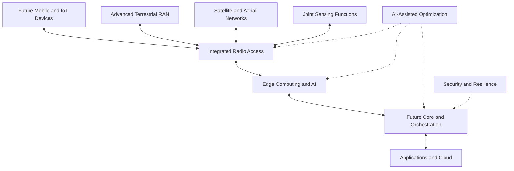

ITU-R M.2160 identifies **immersive communication, hyper-reliable low-latency communication, massive communication, ubiquitous connectivity, AI and communication, and integrated sensing and communication** as IMT-2030 usage scenarios. It does **not** prescribe the named nodes in the diagram above.

## FCAPS and OSS management

**FCAPS** is the classic ITU-T TMN taxonomy for network operations: **Fault, Configuration, Accounting, Performance and Security Management**. The main foundational reference is [ITU-T M.3400](https://www.itu.int/rec/T-REC-M.3400-200002-I/en).

| FCAPS area | 5G example | Relevant operational data |
|---|---|---|
| **Fault** | gNB transport link failure; UPF unreachable | Alarms, severity, probable cause, timestamps |
| **Configuration** | Modify cell parameters; provision network resources | Managed objects, configuration and change records |
| **Accounting** | Account for subscriber/service consumption | Charging and usage records |
| **Performance** | Track 5G accessibility, throughput and handovers | Counters, measurements, KPI time series |
| **Security** | Detect unauthorized management access | Audit logs, identity, access and security events |

### 5G FCAPS / performance management architecture

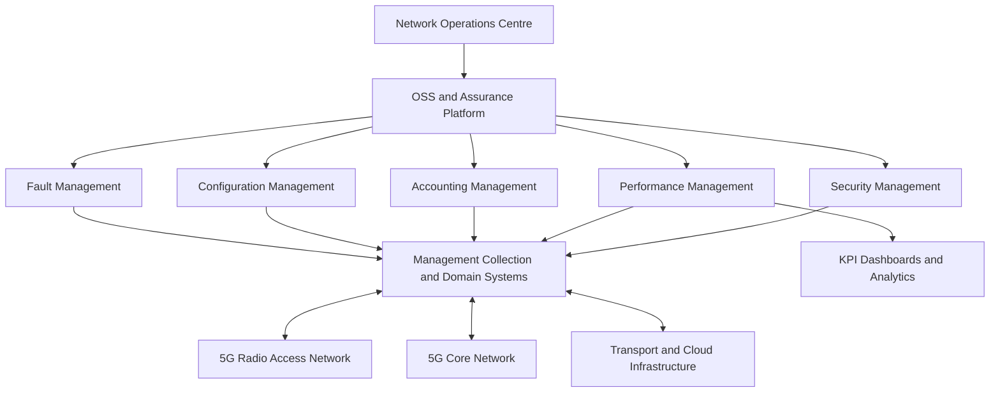

**Performance management workflow:** network elements create measurements → collectors receive and validate them → a PM platform aggregates counters → KPI formulas produce comparable indicators → engineers monitor trends and investigate anomalies. **Vendor-specific counters require definition mapping; 3GPP standardization alone does not guarantee identical exports from every vendor.**

## Telecommunications Standards

| Body | What it standardizes or coordinates | Examples |
|---|---|---|
| **ITU / ITU-R / ITU-T** | IMT frameworks, spectrum coordination, TMN management functions | ITU-R M.2160; ITU-T M.3400 |
| **3GPP** | Cellular radio, core, protocols, management, orchestration | TS 23.501; TS 38.300; TS 28.552 |
| **ETSI and other 3GPP partners** | Publication/adoption of telecom specifications | ETSI publication of 3GPP TS |
| **TM Forum** | OSS/BSS process and API frameworks | eTOM, Open APIs |
| **IETF** | IP/network management and data modeling protocols | SNMP, NETCONF, YANG |

## Performance Management Standards

These standards provide PM concepts, measurement definitions and KPI frameworks. Always use a specified **release and version** for engineering comparisons.

### Primary performance management documents

| Specification | Official scope | Why it matters |
|---|---|---|
| [3GPP TS 32.401](https://www.3gpp.org/dynareport/32401.htm) | PM concepts and requirements | Foundation for PM data collection |
| [3GPP TS 32.404](https://www.3gpp.org/dynareport/32404.htm) | PM measurement definitions and template | Rules for defining counters |
| [3GPP TS 32.425](https://www.3gpp.org/dynareport/32425.htm) | E-UTRAN performance measurements | LTE RAN measurements |
| [3GPP TS 32.450](https://www.3gpp.org/dynareport/32450.htm) | E-UTRAN KPI definitions | LTE KPI calculations |
| [3GPP TS 28.541](https://www.3gpp.org/dynareport/28541.htm) | 5G Network Resource Model | Managed 5G resources |
| [3GPP TS 28.550](https://www.3gpp.org/dynareport/28550.htm) | Performance assurance | Assurance architecture and functions |
| [3GPP TS 28.552](https://www.3gpp.org/dynareport/28552.htm) | 5G performance measurements | Standard 5G RAN/core counters |
| [3GPP TS 28.554](https://www.3gpp.org/dynareport/28554.htm) | 5G end-to-end KPIs | E2E performance evaluation |

**Additional architecture and network management standards**

| Document | Scope |
|---|---|
| [ITU-T M.3400](https://www.itu.int/rec/T-REC-M.3400-200002-I/en) | TMN management functions / FCAPS foundation. |
| [3GPP TS 28.541](https://www.3gpp.org/dynareport/28541.htm) | 5G Network Resource Model for management. |
| [3GPP TS 28.552](https://www.3gpp.org/dynareport/28552.htm) | 5G performance measurements. |
| [3GPP TS 28.554](https://www.3gpp.org/dynareport/28554.htm) | 5G end-to-end KPIs. |
| [3GPP TS 38.401](https://www.3gpp.org/dynareport/38401.htm) | NG-RAN architecture and functional split. |
| [ITU-R M.2160](https://www.itu.int/rec/R-REC-M.2160/en) | IMT-2030 framework and objectives; not a finalized 6G core design. |

**Practical KPI dimensions:** availability, accessibility, retainability, mobility, latency, traffic volume, throughput, resource utilization, reliability and energy efficiency. Specific formulas, scopes and counter definitions must be taken from the **selected 3GPP release and specification version** rather than assumed from KPI labels.

**6G management note:** AI-assisted assurance, sensing-related KPIs and intelligent management are research areas. Do not label proposed 6G counters or core functions as already standardized.

## Architecture evolution

| Dimension | 1G | 2G | 3G | 4G | 5G | 6G (research) |
|---|---|---|---|---|---|---|
| Voice | Analog circuit | Digital circuit | Mainly circuit | IP/IMS (VoLTE) | IMS / VoNR and interworking | To be defined |
| Data | Minimal | GPRS/EDGE | Packet core / HSPA | All-IP EPC | 5GC packet sessions | Future architecture TBD |
| Radio node | Base station | BTS | Node B | eNodeB | gNodeB | Not finalized |
| Core model | Switching office | MSC; SGSN/GGSN | MSC; SGSN/GGSN | EPC | 5GC | Under development |
| Main innovation | Mobility | Digital cellular | Mobile internet | Broadband IP | Flexible service-based architecture | Intelligent connectivity and sensing research |

## Research directions

Areas well suited to a technical paper or thesis include:

1. **4G EPC vs. 5G Core:** Compare MME/HSS/S-GW/P-GW against AMF/SMF/UPF/UDM and the service-based control plane.
2. **RAN evolution:** Compare BTS+BSC, Node B+RNC, eNodeB, and gNodeB; explore disaggregation and cloud RAN.
3. **Network slicing:** Isolation, orchestration, reliability, and resource guarantees.
4. **Energy-efficient radio networks:** Power consumption versus coverage, capacity, and traffic demand.
5. **AI in 5G-Advanced and future 6G:** Model deployment, reliability, explainability, and security.
6. **ISAC and terrestrial/non-terrestrial integration:** Trade-offs in coverage, spectrum, and coordination.

## References

For management and 5G/6G architecture, also consult 3GPP TS 28.552, TS 28.554, TS 38.401, ITU-T M.3400 and ITU-R M.2160 (linked in the sections above).

Primary and standards-oriented resources:

1. **ITU-R M.2160**, *Framework and overall objectives of the future development of IMT for 2030 and beyond*. [ITU IMT-2030 overview](https://www.itu.int/en/ITU-R/study-groups/rsg5/rwp5d/imt-2030/Pages/default.aspx).
2. **3GPP TS 23.501**, *System Architecture for the 5G System (5GS)*. [3GPP specification portal](https://www.3gpp.org/dynareport/23501.htm).
3. **3GPP TS 23.502**, *Procedures for the 5G System (5GS)*. [3GPP specification portal](https://www.3gpp.org/dynareport/23502.htm).
4. **3GPP TS 23.002**, *Network architecture* (GSM/UMTS and related systems). [3GPP specification portal](https://www.3gpp.org/dynareport/23002.htm).
5. **3GPP TS 23.401**, *GPRS enhancements for E-UTRAN access* (LTE/EPC). [3GPP specification portal](https://www.3gpp.org/dynareport/23401.htm).
6. **3GPP TS 38.300**, *NR and NG-RAN Overall Description*. [3GPP specification portal](https://www.3gpp.org/dynareport/38300.htm).
7. **ITU**, [International Mobile Telecommunications (IMT)](https://www.itu.int/en/ITU-R/Pages/default.aspx) — background on global mobile radio frameworks.

> **Research note:** These diagrams deliberately simplify real networks and omit some interfaces, security functions, roaming architectures, and deployment variants. For rigorous implementation work, refer to the cited specification releases and their exact versions.

---

**Suggested repository topics:** `telecommunications`, `mobile-networks`, `1g`, `2g`, `3g`, `4g`, `5g`, `6g`, `network-architecture`, `wireless-communication`, `research`.
