# Mobile Network Generations and Architecture

**A step-by-step learning guide from 1G to 6G**

This README is designed for beginners, students, and telecom learners who want to understand **mobile network generations**, their **main components**, the **role of each component**, and the **architecture flow** from **1G to 6G**.

> **Note:** 1G to 5G are historical or deployed generations. **6G is still under research and standardisation**, so its architecture is conceptual.

---

## Learning Cover

This infographic shows the learning path from **1G → 2G → 3G → 4G → 5G → 6G**, highlighting the evolution from **voice communication** to **AI-native and space-connected networks**.

---

> **Diagram tip:** GitHub renders `mermaid` code blocks as flowcharts. In VS Code, use a Mermaid-capable Markdown preview extension if your built-in preview displays code instead of a diagram.

## Learning Objectives

By the end of this guide, you should be able to:

- Explain what **1G, 2G, 3G, 4G, 5G, and 6G** mean.
- Identify the **main components** in each generation.
- Describe the **role** of each component.
- Understand the **network architecture** for every mobile generation.
- Compare how mobile networks evolved from **analogue voice** to **cloud-native and AI-driven systems**.

---

## Basic Idea of Mobile Network Architecture

A mobile network usually has three broad parts:

1. **User Device / User Equipment (UE)**  
   The mobile phone, modem, tablet, IoT sensor, or any connected device.

2. **Radio Access Network (RAN)**  
   The radio towers and controllers that connect devices wirelessly.

3. **Core Network**  
   The central network that handles switching, routing, authentication, mobility, voice, and data services.

### Generic architecture

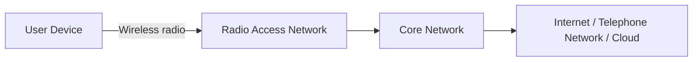

---

# 1G — First Generation

## Main Idea
**1G** was the first generation of mobile communication. It was designed mainly for **analogue voice calls**.

## Main Components
- **Mobile Phone (1G handset)**
- **Cell Tower / Base Station (Analogue)**
- **Telephone Network / Mobile Switching Network**
- **PSTN / Landline Network**

## Role of Each Component
- **Mobile Phone:** sends and receives analogue voice.
- **Cell Tower:** receives radio signals from the phone and forwards them into the network.
- **Telephone Network / Switching Network:** connects the call to another user.
- **PSTN:** allows calls to landline phones.

## 1G Architecture

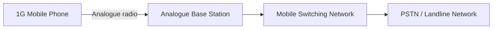

## What 1G Did Well
- Introduced **wireless voice calling**.

## Limitations
- Analogue only
- Poor security
- Low capacity
- No SMS or internet

---

# 2G — Second Generation

## Main Idea
**2G** introduced **digital communication**, improving voice quality and enabling **SMS**. Later enhancements like **GPRS/EDGE** added basic mobile data.

## Main Components
- **Mobile Phone (2G)**
- **BTS (Base Transceiver Station)**
- **BSC (Base Station Controller)**
- **MSC (Mobile Switching Center)**
- **PSTN / Telecom Network**
- **SMS system**
- **GPRS/EDGE packet nodes** (in data-capable 2G networks)

## Role of Each Component
- **Mobile Phone:** communicates digitally with the network.
- **BTS:** handles radio communication with the phone.
- **BSC:** controls multiple BTS sites and manages radio resources.
- **MSC:** switches voice calls and supports mobility management.
- **PSTN / Telecom Network:** connects external calls.
- **SMS system:** handles text messages.
- **GPRS/EDGE nodes:** provide basic packet data service.

## 2G Architecture

### Voice path

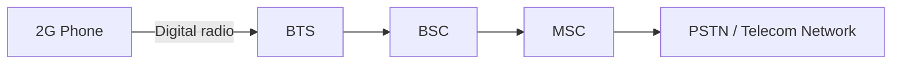

### Basic data path

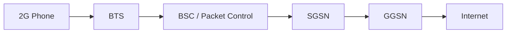

## Key Improvement Over 1G
- Digital voice
- SMS
- Better capacity and security

---

# 3G — Third Generation

## Main Idea
**3G** brought **mobile internet** into mainstream use. It supported web browsing, multimedia, email, and video calling.

## Main Components
- **Mobile Phone (3G)**
- **NodeB**
- **RNC (Radio Network Controller)**
- **Core Network**
- **Internet / Multimedia Services**

## Role of Each Component
- **Mobile Phone:** uses mobile internet and multimedia services.
- **NodeB:** acts as the 3G base station.
- **RNC:** controls NodeBs, radio resources, and handovers.
- **Core Network:** manages voice and data sessions.
- **Internet / Multimedia Services:** provide web and media connectivity.

## 3G Architecture

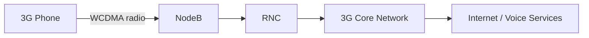

## Key Improvement Over 2G
- Faster mobile data
- Video calls
- Better support for multimedia and internet access

---

# 4G — Fourth Generation

## Main Idea
**4G** introduced **high-speed broadband data** and an **all-IP architecture**. It enabled streaming, mobile apps, online gaming, and better video experiences.

## Main Components
- **Smartphone**
- **eNodeB (LTE base station)**
- **EPC (Evolved Packet Core)**
- **Internet / Cloud**
- **IMS / VoLTE services** (in many deployments)

## Role of Each Component
- **Smartphone:** uses apps, streaming, and broadband services.
- **eNodeB:** provides LTE radio access and handles major base-station functions.
- **EPC:** manages mobility, session control, policy, and packet routing.
- **Internet / Cloud:** delivers online services and applications.
- **IMS / VoLTE:** enables voice over LTE in packet-based form.

## 4G Architecture

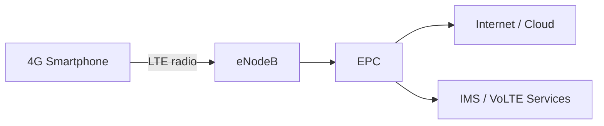

## Key Improvement Over 3G
- Much faster internet
- Better video streaming
- Mobile app ecosystem growth
- Lower latency than 3G

---

# 5G — Fifth Generation

## Main Idea
**5G** focuses on **ultra-fast speed**, **low latency**, and **massive connectivity** for smartphones, industry, and IoT.

## Main Components
- **Devices (Smartphone / IoT)**
- **gNodeB (5G NR)**
- **5G Core (5GC)**
- **Edge Cloud**
- **IoT / Enterprise / Cloud services**

## Role of Each Component
- **Devices:** include phones, sensors, vehicles, cameras, and industrial systems.
- **gNodeB:** provides 5G radio access.
- **5G Core:** manages sessions, policy, mobility, authentication, and service-based functions.
- **Edge Cloud:** processes data closer to the user for lower latency.
- **IoT / Enterprise / Cloud services:** consume the connectivity for real-time and large-scale applications.

## 5G Architecture

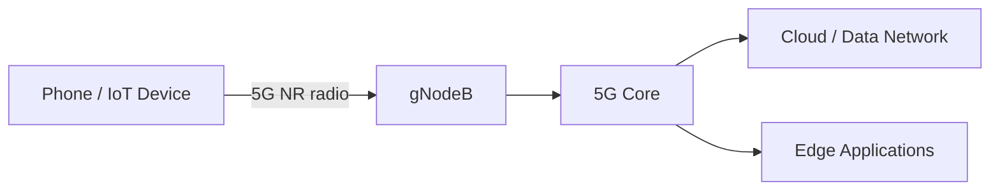

## Key Improvement Over 4G
- Higher throughput
- Lower latency
- Massive IoT support
- Network slicing and service flexibility

## 5G Modes
- **NSA (Non-Standalone):** 5G radio with some reliance on 4G core infrastructure.
- **SA (Standalone):** full 5G core and 5G radio architecture.

---

# 6G — Sixth Generation

## Main Idea
**6G** is expected to go beyond 5G with **AI-native networking**, **integrated sensing**, **holographic communication**, and **space-air-ground integration**.

## Main Components
- **Intelligent Device**
- **Smart Radio Access (AI-driven)**
- **AI Core (Network + AI)**
- **Cloud / Satellite / Holographic Connectivity**
- **Integrated sensing and communication systems**

## Role of Each Component
- **Intelligent Device:** future device with advanced sensing, AI, AR/VR, and immersive capabilities.
- **Smart Radio Access:** dynamically adapts radio resources using AI.
- **AI Core:** combines networking and intelligence for automated operation.
- **Cloud / Satellite / Holographic Connectivity:** extends coverage and supports rich future services.
- **Integrated sensing systems:** may allow communication and environmental sensing together.

## 6G Architecture (Conceptual)

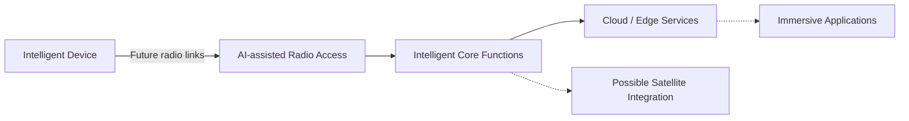

## Expected Improvement Over 5G
- More intelligence and automation
- Better integration with satellite and non-terrestrial networks
- Stronger support for immersive applications
- Ubiquitous connectivity

> **Important:** 6G is still under development, so this is a **learning model**, not a final standard deployment diagram.

---

# Quick Comparison Table

| Generation | Main Service | Main Components | Main Architecture Style |
|---|---|---|---|
| **1G** | Analogue voice | Mobile Phone, Cell Tower, PSTN | Analogue voice switching |
| **2G** | Digital voice + SMS | BTS, BSC, MSC | Digital circuit-switched with basic data extensions |
| **3G** | Mobile internet | NodeB, RNC, Core Network | Voice + packet data architecture |
| **4G** | Broadband data | eNodeB, EPC, IMS | All-IP mobile broadband |
| **5G** | High speed + low latency + IoT | gNodeB, 5G Core, Edge Cloud | Cloud-ready, service-based architecture |
| **6G** | AI-native future networks | Smart Radio Access, AI Core, Satellite/Cloud | Conceptual intelligent and integrated architecture |

---

# Evolution Summary

- **1G:** Voice
- **2G:** Voice + SMS
- **3G:** Web / Mobile Internet
- **4G:** Streaming / Mobile Apps
- **5G:** IoT / Low Latency / Massive Connectivity
- **6G:** AI + Space + Ubiquitous Intelligent Connectivity

---

---

# Mobile Network Technologies and Standards: 1G to 6G

## Learning Objectives

In this section, you will learn:

1. What FDMA, GSM, IS-95 CDMA, UMTS, WCDMA, CDMA2000, LTE, OFDMA, MIMO, and ISAC mean.
2. Which mobile generations use these technologies.
3. How each technology works.
4. The difference between network standards, multiple-access methods, and antenna technologies.
5. How radio communication evolved from 1G to 6G.

---

## 1. FDMA — Frequency Division Multiple Access

**Generation:** Mainly 1G  
**Category:** Multiple-access technique  
**Purpose:** Allow multiple users to share available radio spectrum.

### What is FDMA?

FDMA divides the available frequency spectrum into separate channels.

Different users are assigned different frequency channels, allowing them to communicate simultaneously.

### How FDMA Works

1. The mobile operator has an allocated frequency band.
2. The band is divided into smaller frequency channels.
3. Each active call is assigned a channel.
4. Users communicate on different frequencies.

### Example

- User A → Frequency Channel 1
- User B → Frequency Channel 2
- User C → Frequency Channel 3

### FDMA Architecture

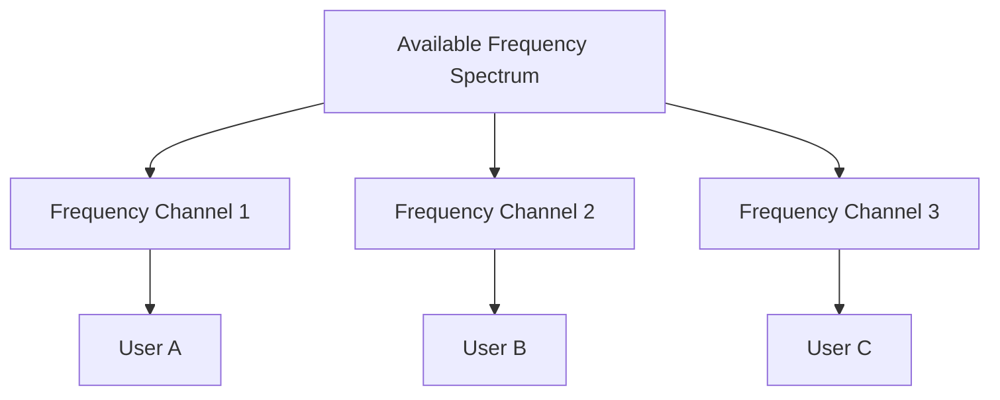

### Advantages

- Simple implementation
- Supports simultaneous calls on different channels

### Limitations

- Limited spectral efficiency
- Fixed channel allocation can waste capacity
- Requires separation between adjacent channels

---

## 2. GSM — Global System for Mobile Communications

**Generation:** 2G  
**Category:** Mobile network standard  
**Purpose:** Digital voice communication and SMS.

### What is GSM?

GSM is a digital cellular network standard that became widely used around the world.

It introduced digital voice services and SMS, with later enhancements supporting basic internet connectivity.

### Main Components

| Component | Full Form | Role |
|---|---|---|
| MS | Mobile Station | User's mobile phone and SIM |
| BTS | Base Transceiver Station | Radio communication |
| BSC | Base Station Controller | Controls multiple BTS sites |
| MSC | Mobile Switching Centre | Switches voice calls |
| HLR | Home Location Register | Stores subscriber records |
| VLR | Visitor Location Register | Holds temporary subscriber information |

### GSM Architecture

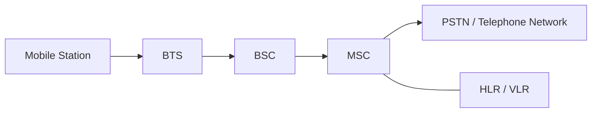

### How GSM Works

1. The mobile phone connects to a BTS.
2. The BTS forwards signals to the BSC.
3. The BSC manages radio resources.
4. The MSC handles call switching.
5. The telephone network connects the call.

### Key Features

- Digital voice
- SMS
- Subscriber authentication
- International roaming
- GPRS and EDGE extensions for data

---

## 3. IS-95 CDMA — Interim Standard 95

**Generation:** 2G  
**Other Name:** cdmaOne  
**Category:** Mobile network standard  
**Purpose:** Digital cellular communication using CDMA.

### What is IS-95?

IS-95 is a digital cellular standard based on Code Division Multiple Access.

Unlike FDMA, CDMA allows multiple users to share the same frequency band using different spreading codes.

### How CDMA Works

1. Multiple users share a radio frequency band.
2. Each user's signal is spread using a code.
3. The receiver uses the corresponding code to recover the intended signal.
4. Power control helps manage interference.

### Conceptual Diagram

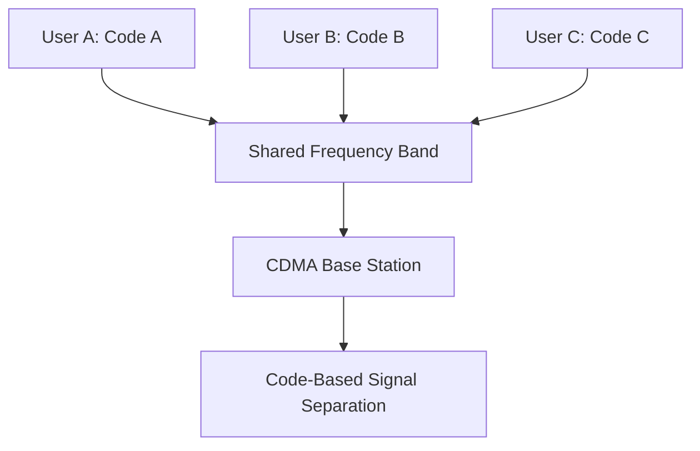

### Key Features

- Spread-spectrum communication
- Multiple users on a shared frequency band
- Power control
- Soft handoff support

---

## 4. UMTS — Universal Mobile Telecommunications System

**Generation:** 3G  
**Category:** Mobile network system  
**Purpose:** Mobile internet, multimedia, and digital voice.

### What is UMTS?

UMTS is a third-generation mobile communications system developed within the 3GPP standards family.

It supports voice, packet data, web browsing, email, and multimedia applications.

### Main Components

| Component | Role |
|---|---|
| UE | User Equipment |
| NodeB | 3G radio base station |
| RNC | Radio Network Controller |
| MSC | Circuit-switched voice services |
| SGSN | Packet mobility and session support |
| GGSN | Gateway to external packet networks |

### UMTS Architecture

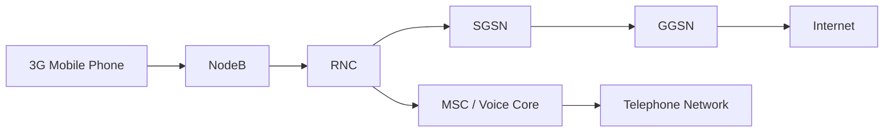

### How UMTS Works

1. The phone communicates with NodeB.
2. NodeB connects to the RNC.
3. The RNC controls radio resources.
4. The core network handles voice and data.
5. Users access telephone or internet services.

---

## 5. WCDMA — Wideband Code Division Multiple Access

**Generation:** 3G  
**Category:** Radio access technology  
**Purpose:** Support multiple users and higher data rates.

### What is WCDMA?

WCDMA is the main radio interface technology used by conventional UMTS networks.

It uses wideband channels and spreading codes to support simultaneous users.

### How WCDMA Works

1. Data is encoded and spread across a wideband radio channel.
2. Multiple users can transmit using different codes.
3. The receiver processes the appropriate code to recover data.
4. Radio resource and power control help maintain communication quality.

### Relationship Between UMTS and WCDMA

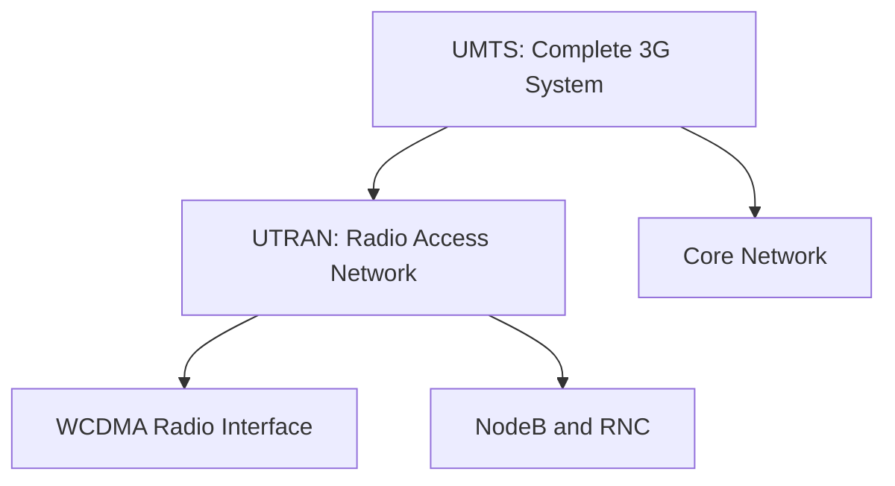

**Remember:** UMTS is the complete mobile system, while WCDMA is its radio access technology.

---

## 6. CDMA2000 — Code Division Multiple Access 2000

**Generation:** 3G  
**Category:** Mobile network standards family  
**Purpose:** Improved digital voice and mobile packet data.

### What is CDMA2000?

CDMA2000 is a 3G family of standards that evolved from IS-95.

It was an alternative evolution path to UMTS/WCDMA.

### Major Technologies

- **CDMA2000 1x:** Voice and packet data
- **EV-DO:** Higher-speed mobile packet data
- **Spread-spectrum CDMA:** Shared radio channels using spreading codes

### Simplified Architecture

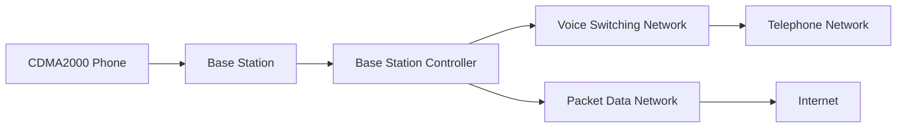

### Key Features

- Improved voice capacity
- Mobile internet access
- Packet data services
- Compatibility evolution from IS-95

---

## 7. LTE — Long Term Evolution

**Generation:** 4G  
**Category:** Mobile network technology  
**Purpose:** High-speed mobile broadband and all-IP communication.

### What is LTE?

LTE is a mobile communication technology developed by 3GPP.

It uses an all-IP packet core and efficient radio techniques to provide high-speed mobile connectivity.

### Main Components

| Component | Full Form | Role |
|---|---|---|
| UE | User Equipment | Mobile device |
| eNodeB | Evolved NodeB | LTE radio base station |
| MME | Mobility Management Entity | Control-plane mobility and signalling |
| SGW | Serving Gateway | User-data forwarding |
| PGW | Packet Data Network Gateway | External data-network connectivity |
| HSS | Home Subscriber Server | Subscriber information |
| IMS | IP Multimedia Subsystem | IP-based multimedia and voice services |

### LTE Architecture

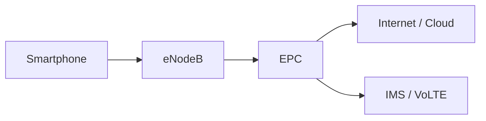

### How LTE Works

1. The smartphone connects to an eNodeB.
2. The eNodeB communicates with the EPC.
3. The EPC manages connectivity, mobility, and routing.
4. Data reaches the internet through the packet gateway.
5. Voice services can be provided through IMS/VoLTE.

### Key Technologies

- OFDMA downlink
- SC-FDMA uplink in conventional LTE
- MIMO
- All-IP packet network

---

## 8. OFDMA — Orthogonal Frequency Division Multiple Access

**Generation:** 4G and 5G  
**Category:** Multiple-access technique  
**Purpose:** Efficiently share radio resources among users.

### What is OFDMA?

OFDMA divides a radio channel into multiple orthogonal subcarriers.

Groups of subcarriers can be allocated to different users.

### How OFDMA Works

1. The frequency channel is divided into many subcarriers.
2. Orthogonal subcarriers are used to minimise mutual interference.
3. The base station assigns radio resources to different users.
4. Multiple users transmit or receive through allocated resources.

### OFDMA Diagram

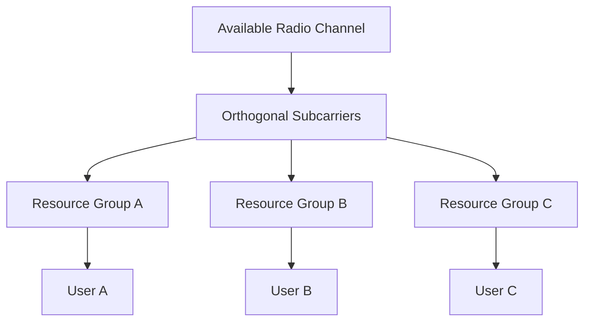

### Advantages

- Efficient spectrum usage
- Flexible resource scheduling
- Supports high data rates
- Suitable for broadband mobile systems

---

## 9. MIMO — Multiple Input Multiple Output

**Generation:** 4G and 5G  
**Category:** Antenna technology  
**Purpose:** Improve throughput, reliability, and radio performance.

### What is MIMO?

MIMO uses multiple transmitting and receiving antennas.

It can improve communication through spatial multiplexing, diversity, and beamforming techniques.

### Example: 4×4 MIMO

A 4×4 MIMO configuration uses:

- Four transmitting antennas
- Four receiving antennas

### MIMO Concept

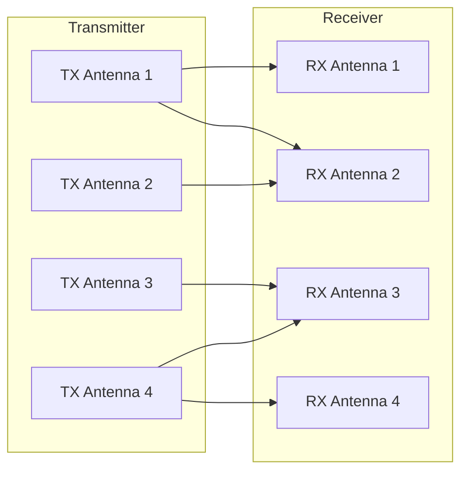

### Key Benefits

- Higher potential throughput
- Better link reliability
- Improved spectral efficiency
- Support for advanced beamforming

**Important:** The number of antennas does not always equal the number of independent data streams.

---

## 10. ISAC — Integrated Sensing and Communication

**Generation:** 6G research and future networks  
**Category:** Integrated radio technology  
**Purpose:** Combine wireless communication and environmental sensing.

### What is ISAC?

ISAC is a research area where wireless systems support both communication and sensing.

Future radio networks may exchange user data while also estimating information about nearby objects, movement, distance, or environments.

### How ISAC Could Work

1. A radio system transmits wireless signals.
2. Devices receive signals for communication.
3. The system also analyses radio propagation or reflections.
4. Signal processing estimates environmental information.
5. Communication and sensing functions can share resources.

### Conceptual ISAC Architecture

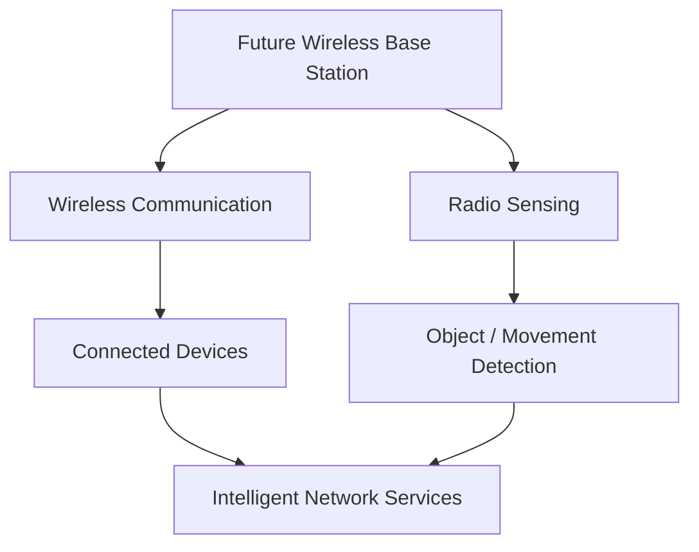

### Potential Applications

- Connected vehicles
- Smart cities
- Industrial automation
- Environmental monitoring
- Robotics
- Next-generation intelligent networks

**Note:** ISAC is an emerging research and standardisation topic. Specific capabilities and architectures are not finalised for 6G.

---

# Technology Comparison Table

| Technology | Full Form | Generation | Category | Main Purpose |
|---|---|---|---|---|
| FDMA | Frequency Division Multiple Access | 1G | Multiple access | Separate frequency channels |
| GSM | Global System for Mobile Communications | 2G | Mobile standard | Digital voice and SMS |
| IS-95 CDMA | Interim Standard 95 | 2G | Mobile standard | Code-based digital access |
| UMTS | Universal Mobile Telecommunications System | 3G | Mobile system | Mobile internet and multimedia |
| WCDMA | Wideband Code Division Multiple Access | 3G | Radio technology | Wideband code-based communication |
| CDMA2000 | Code Division Multiple Access 2000 | 3G | Standards family | Voice and mobile data |
| LTE | Long Term Evolution | 4G | Mobile technology | High-speed all-IP mobile broadband |
| OFDMA | Orthogonal Frequency Division Multiple Access | 4G / 5G | Multiple access | Flexible subcarrier allocation |
| MIMO | Multiple Input Multiple Output | 4G / 5G | Antenna technology | Higher throughput and reliability |
| ISAC | Integrated Sensing and Communication | 6G research | Integrated technology | Communication and radio sensing |

---

# Technology Evolution: 1G to 6G

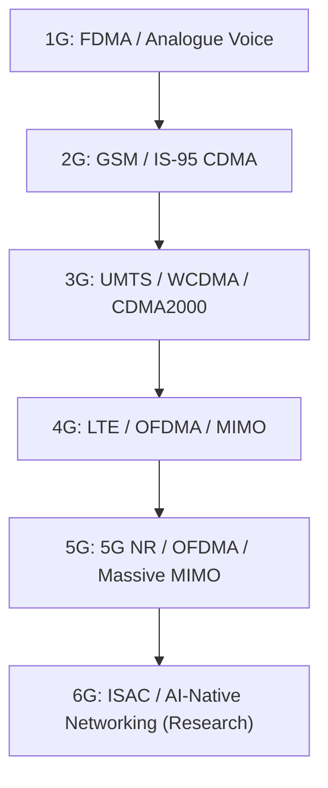

