# Mobile Network Generations and Architecture

**A step-by-step learning guide from 1G to 6G**

This README is designed for beginners, students, and telecom learners who want to understand **mobile network generations**, their **main components**, the **role of each component**, and the **architecture flow** from **1G to 6G**.

> **Note:** 1G to 5G are historical or deployed generations. **6G is still under research and standardisation**, so its architecture is conceptual.

---

## Learning Cover


This infographic shows the learning path from **1G → 2G → 3G → 4G → 5G → 6G**, highlighting the evolution from **voice communication** to **AI-native and space-connected networks**.

---

> **Diagram tip:** GitHub renders `mermaid` code blocks as flowcharts. In VS Code, use a Mermaid-capable Markdown preview extension if your built-in preview displays code instead of a diagram.

## Learning Objectives

By the end of this guide, you should be able to:

- Explain what **1G, 2G, 3G, 4G, 5G, and 6G** mean.
- Identify the **main components** in each generation.
- Describe the **role** of each component.
- Understand the **network architecture** for every mobile generation.
- Compare how mobile networks evolved from **analogue voice** to **cloud-native and AI-driven systems**.

---

## Basic Idea of Mobile Network Architecture

A mobile network usually has three broad parts:

1. **User Device / User Equipment (UE)**  
   The mobile phone, modem, tablet, IoT sensor, or any connected device.

2. **Radio Access Network (RAN)**  
   The radio towers and controllers that connect devices wirelessly.

3. **Core Network**  
   The central network that handles switching, routing, authentication, mobility, voice, and data services.

### Generic architecture


---

# 1G — First Generation

## Main Idea
**1G** was the first generation of mobile communication. It was designed mainly for **analogue voice calls**.

## Main Components
- **Mobile Phone (1G handset)**
- **Cell Tower / Base Station (Analogue)**
- **Telephone Network / Mobile Switching Network**
- **PSTN / Landline Network**

## Role of Each Component
- **Mobile Phone:** sends and receives analogue voice.
- **Cell Tower:** receives radio signals from the phone and forwards them into the network.
- **Telephone Network / Switching Network:** connects the call to another user.
- **PSTN:** allows calls to landline phones.

## 1G Architecture


## What 1G Did Well
- Introduced **wireless voice calling**.

## Limitations
- Analogue only
- Poor security
- Low capacity
- No SMS or internet

---

# 2G — Second Generation

## Main Idea
**2G** introduced **digital communication**, improving voice quality and enabling **SMS**. Later enhancements like **GPRS/EDGE** added basic mobile data.

## Main Components
- **Mobile Phone (2G)**
- **BTS (Base Transceiver Station)**
- **BSC (Base Station Controller)**
- **MSC (Mobile Switching Center)**
- **PSTN / Telecom Network**
- **SMS system**
- **GPRS/EDGE packet nodes** (in data-capable 2G networks)

## Role of Each Component
- **Mobile Phone:** communicates digitally with the network.
- **BTS:** handles radio communication with the phone.
- **BSC:** controls multiple BTS sites and manages radio resources.
- **MSC:** switches voice calls and supports mobility management.
- **PSTN / Telecom Network:** connects external calls.
- **SMS system:** handles text messages.
- **GPRS/EDGE nodes:** provide basic packet data service.

## 2G Architecture

### Voice path

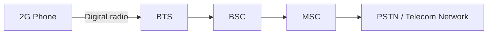

### Basic data path

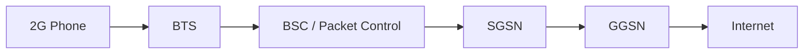

## Key Improvement Over 1G
- Digital voice
- SMS
- Better capacity and security

---

# 3G — Third Generation

## Main Idea
**3G** brought **mobile internet** into mainstream use. It supported web browsing, multimedia, email, and video calling.

## Main Components
- **Mobile Phone (3G)**
- **NodeB**
- **RNC (Radio Network Controller)**
- **Core Network**
- **Internet / Multimedia Services**

## Role of Each Component
- **Mobile Phone:** uses mobile internet and multimedia services.
- **NodeB:** acts as the 3G base station.
- **RNC:** controls NodeBs, radio resources, and handovers.
- **Core Network:** manages voice and data sessions.
- **Internet / Multimedia Services:** provide web and media connectivity.

## 3G Architecture


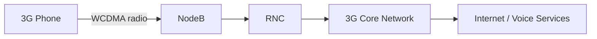

## Key Improvement Over 2G
- Faster mobile data
- Video calls
- Better support for multimedia and internet access

---

# 4G — Fourth Generation

## Main Idea
**4G** introduced **high-speed broadband data** and an **all-IP architecture**. It enabled streaming, mobile apps, online gaming, and better video experiences.

## Main Components
- **Smartphone**
- **eNodeB (LTE base station)**
- **EPC (Evolved Packet Core)**
- **Internet / Cloud**
- **IMS / VoLTE services** (in many deployments)

## Role of Each Component
- **Smartphone:** uses apps, streaming, and broadband services.
- **eNodeB:** provides LTE radio access and handles major base-station functions.
- **EPC:** manages mobility, session control, policy, and packet routing.
- **Internet / Cloud:** delivers online services and applications.
- **IMS / VoLTE:** enables voice over LTE in packet-based form.

## 4G Architecture


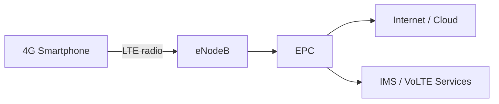

## Key Improvement Over 3G
- Much faster internet
- Better video streaming
- Mobile app ecosystem growth
- Lower latency than 3G

---

# 5G — Fifth Generation

## Main Idea
**5G** focuses on **ultra-fast speed**, **low latency**, and **massive connectivity** for smartphones, industry, and IoT.

## Main Components
- **Devices (Smartphone / IoT)**
- **gNodeB (5G NR)**
- **5G Core (5GC)**
- **Edge Cloud**
- **IoT / Enterprise / Cloud services**

## Role of Each Component
- **Devices:** include phones, sensors, vehicles, cameras, and industrial systems.
- **gNodeB:** provides 5G radio access.
- **5G Core:** manages sessions, policy, mobility, authentication, and service-based functions.
- **Edge Cloud:** processes data closer to the user for lower latency.
- **IoT / Enterprise / Cloud services:** consume the connectivity for real-time and large-scale applications.

## 5G Architecture


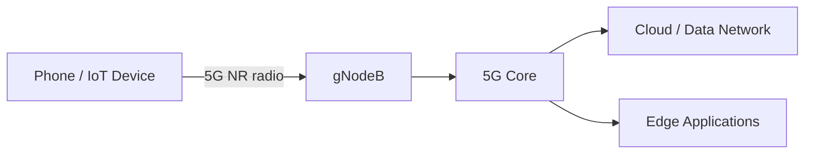

## Key Improvement Over 4G
- Higher throughput
- Lower latency
- Massive IoT support
- Network slicing and service flexibility

## 5G Modes
- **NSA (Non-Standalone):** 5G radio with some reliance on 4G core infrastructure.
- **SA (Standalone):** full 5G core and 5G radio architecture.

---

# 6G — Sixth Generation

## Main Idea
**6G** is expected to go beyond 5G with **AI-native networking**, **integrated sensing**, **holographic communication**, and **space-air-ground integration**.

## Main Components
- **Intelligent Device**
- **Smart Radio Access (AI-driven)**
- **AI Core (Network + AI)**
- **Cloud / Satellite / Holographic Connectivity**
- **Integrated sensing and communication systems**

## Role of Each Component
- **Intelligent Device:** future device with advanced sensing, AI, AR/VR, and immersive capabilities.
- **Smart Radio Access:** dynamically adapts radio resources using AI.
- **AI Core:** combines networking and intelligence for automated operation.
- **Cloud / Satellite / Holographic Connectivity:** extends coverage and supports rich future services.
- **Integrated sensing systems:** may allow communication and environmental sensing together.

## 6G Architecture (Conceptual)


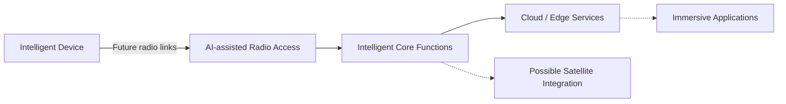

## Expected Improvement Over 5G
- More intelligence and automation
- Better integration with satellite and non-terrestrial networks
- Stronger support for immersive applications
- Ubiquitous connectivity

> **Important:** 6G is still under development, so this is a **learning model**, not a final standard deployment diagram.

---

# Quick Comparison Table

| Generation | Main Service | Main Components | Main Architecture Style |
|---|---|---|---|
| **1G** | Analogue voice | Mobile Phone, Cell Tower, PSTN | Analogue voice switching |
| **2G** | Digital voice + SMS | BTS, BSC, MSC | Digital circuit-switched with basic data extensions |
| **3G** | Mobile internet | NodeB, RNC, Core Network | Voice + packet data architecture |
| **4G** | Broadband data | eNodeB, EPC, IMS | All-IP mobile broadband |
| **5G** | High speed + low latency + IoT | gNodeB, 5G Core, Edge Cloud | Cloud-ready, service-based architecture |
| **6G** | AI-native future networks | Smart Radio Access, AI Core, Satellite/Cloud | Conceptual intelligent and integrated architecture |

---

# Evolution Summary

- **1G:** Voice
- **2G:** Voice + SMS
- **3G:** Web / Mobile Internet
- **4G:** Streaming / Mobile Apps
- **5G:** IoT / Low Latency / Massive Connectivity
- **6G:** AI + Space + Ubiquitous Intelligent Connectivity

---


---

# Mobile Network Technologies and Standards: 1G to 6G

## Learning Objectives

In this section, you will learn:

1. What FDMA, GSM, IS-95 CDMA, UMTS, WCDMA, CDMA2000, LTE, OFDMA, MIMO, and ISAC mean.
2. Which mobile generations use these technologies.
3. How each technology works.
4. The difference between network standards, multiple-access methods, and antenna technologies.
5. How radio communication evolved from 1G to 6G.

---

## 1. FDMA — Frequency Division Multiple Access

**Generation:** Mainly 1G  
**Category:** Multiple-access technique  
**Purpose:** Allow multiple users to share available radio spectrum.

### What is FDMA?

FDMA divides the available frequency spectrum into separate channels.

Different users are assigned different frequency channels, allowing them to communicate simultaneously.

### How FDMA Works

1. The mobile operator has an allocated frequency band.
2. The band is divided into smaller frequency channels.
3. Each active call is assigned a channel.
4. Users communicate on different frequencies.

### Example

- User A → Frequency Channel 1
- User B → Frequency Channel 2
- User C → Frequency Channel 3

### FDMA Architecture

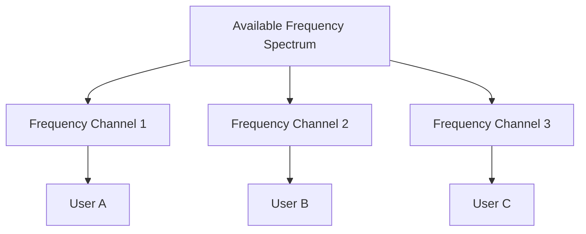

### Advantages

- Simple implementation
- Supports simultaneous calls on different channels

### Limitations

- Limited spectral efficiency
- Fixed channel allocation can waste capacity
- Requires separation between adjacent channels

---

## 2. GSM — Global System for Mobile Communications

**Generation:** 2G  
**Category:** Mobile network standard  
**Purpose:** Digital voice communication and SMS.

### What is GSM?

GSM is a digital cellular network standard that became widely used around the world.

It introduced digital voice services and SMS, with later enhancements supporting basic internet connectivity.

### Main Components

| Component | Full Form | Role |
|---|---|---|
| MS | Mobile Station | User's mobile phone and SIM |
| BTS | Base Transceiver Station | Radio communication |
| BSC | Base Station Controller | Controls multiple BTS sites |
| MSC | Mobile Switching Centre | Switches voice calls |
| HLR | Home Location Register | Stores subscriber records |
| VLR | Visitor Location Register | Holds temporary subscriber information |

### GSM Architecture

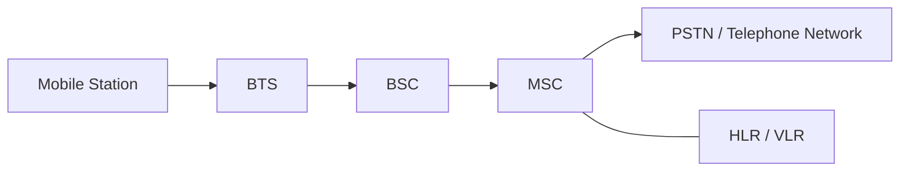

### How GSM Works

1. The mobile phone connects to a BTS.
2. The BTS forwards signals to the BSC.
3. The BSC manages radio resources.
4. The MSC handles call switching.
5. The telephone network connects the call.

### Key Features

- Digital voice
- SMS
- Subscriber authentication
- International roaming
- GPRS and EDGE extensions for data

---

## 3. IS-95 CDMA — Interim Standard 95

**Generation:** 2G  
**Other Name:** cdmaOne  
**Category:** Mobile network standard  
**Purpose:** Digital cellular communication using CDMA.

### What is IS-95?

IS-95 is a digital cellular standard based on Code Division Multiple Access.

Unlike FDMA, CDMA allows multiple users to share the same frequency band using different spreading codes.

### How CDMA Works

1. Multiple users share a radio frequency band.
2. Each user's signal is spread using a code.
3. The receiver uses the corresponding code to recover the intended signal.
4. Power control helps manage interference.

### Conceptual Diagram

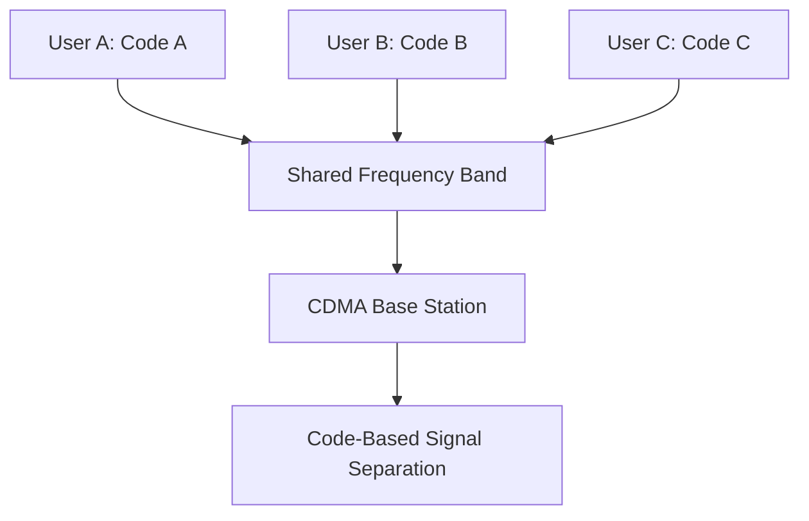

### Key Features

- Spread-spectrum communication
- Multiple users on a shared frequency band
- Power control
- Soft handoff support

---

## 4. UMTS — Universal Mobile Telecommunications System

**Generation:** 3G  
**Category:** Mobile network system  
**Purpose:** Mobile internet, multimedia, and digital voice.

### What is UMTS?

UMTS is a third-generation mobile communications system developed within the 3GPP standards family.

It supports voice, packet data, web browsing, email, and multimedia applications.

### Main Components

| Component | Role |
|---|---|
| UE | User Equipment |
| NodeB | 3G radio base station |
| RNC | Radio Network Controller |
| MSC | Circuit-switched voice services |
| SGSN | Packet mobility and session support |
| GGSN | Gateway to external packet networks |

### UMTS Architecture

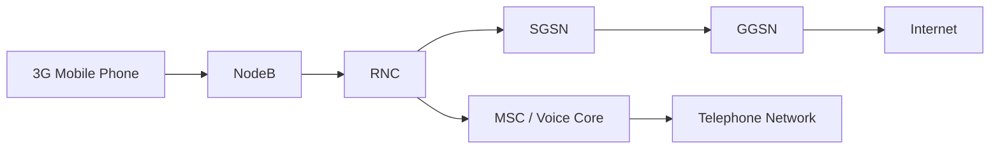

### How UMTS Works

1. The phone communicates with NodeB.
2. NodeB connects to the RNC.
3. The RNC controls radio resources.
4. The core network handles voice and data.
5. Users access telephone or internet services.

---

## 5. WCDMA — Wideband Code Division Multiple Access

**Generation:** 3G  
**Category:** Radio access technology  
**Purpose:** Support multiple users and higher data rates.

### What is WCDMA?

WCDMA is the main radio interface technology used by conventional UMTS networks.

It uses wideband channels and spreading codes to support simultaneous users.

### How WCDMA Works

1. Data is encoded and spread across a wideband radio channel.
2. Multiple users can transmit using different codes.
3. The receiver processes the appropriate code to recover data.
4. Radio resource and power control help maintain communication quality.

### Relationship Between UMTS and WCDMA

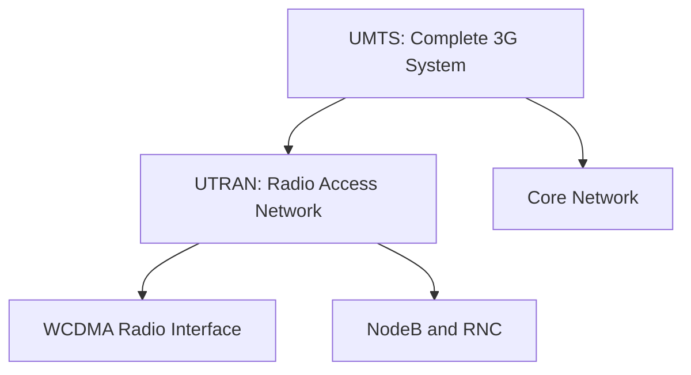

**Remember:** UMTS is the complete mobile system, while WCDMA is its radio access technology.

---

## 6. CDMA2000 — Code Division Multiple Access 2000

**Generation:** 3G  
**Category:** Mobile network standards family  
**Purpose:** Improved digital voice and mobile packet data.

### What is CDMA2000?

CDMA2000 is a 3G family of standards that evolved from IS-95.

It was an alternative evolution path to UMTS/WCDMA.

### Major Technologies

- **CDMA2000 1x:** Voice and packet data
- **EV-DO:** Higher-speed mobile packet data
- **Spread-spectrum CDMA:** Shared radio channels using spreading codes

### Simplified Architecture

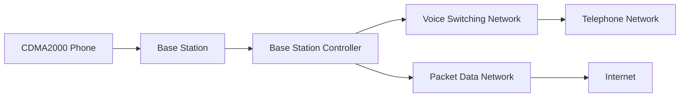

### Key Features

- Improved voice capacity
- Mobile internet access
- Packet data services
- Compatibility evolution from IS-95

---

## 7. LTE — Long Term Evolution

**Generation:** 4G  
**Category:** Mobile network technology  
**Purpose:** High-speed mobile broadband and all-IP communication.

### What is LTE?

LTE is a mobile communication technology developed by 3GPP.

It uses an all-IP packet core and efficient radio techniques to provide high-speed mobile connectivity.

### Main Components

| Component | Full Form | Role |
|---|---|---|
| UE | User Equipment | Mobile device |
| eNodeB | Evolved NodeB | LTE radio base station |
| MME | Mobility Management Entity | Control-plane mobility and signalling |
| SGW | Serving Gateway | User-data forwarding |
| PGW | Packet Data Network Gateway | External data-network connectivity |
| HSS | Home Subscriber Server | Subscriber information |
| IMS | IP Multimedia Subsystem | IP-based multimedia and voice services |

### LTE Architecture

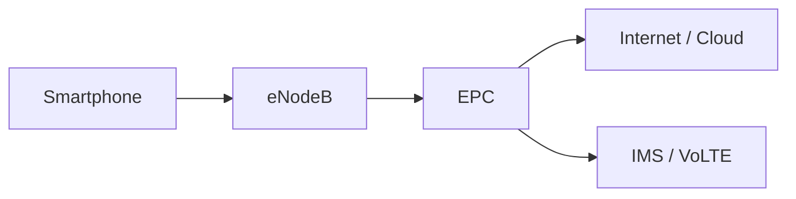

### How LTE Works

1. The smartphone connects to an eNodeB.
2. The eNodeB communicates with the EPC.
3. The EPC manages connectivity, mobility, and routing.
4. Data reaches the internet through the packet gateway.
5. Voice services can be provided through IMS/VoLTE.

### Key Technologies

- OFDMA downlink
- SC-FDMA uplink in conventional LTE
- MIMO
- All-IP packet network

---

## 8. OFDMA — Orthogonal Frequency Division Multiple Access

**Generation:** 4G and 5G  
**Category:** Multiple-access technique  
**Purpose:** Efficiently share radio resources among users.

### What is OFDMA?

OFDMA divides a radio channel into multiple orthogonal subcarriers.

Groups of subcarriers can be allocated to different users.

### How OFDMA Works

1. The frequency channel is divided into many subcarriers.
2. Orthogonal subcarriers are used to minimise mutual interference.
3. The base station assigns radio resources to different users.
4. Multiple users transmit or receive through allocated resources.

### OFDMA Diagram

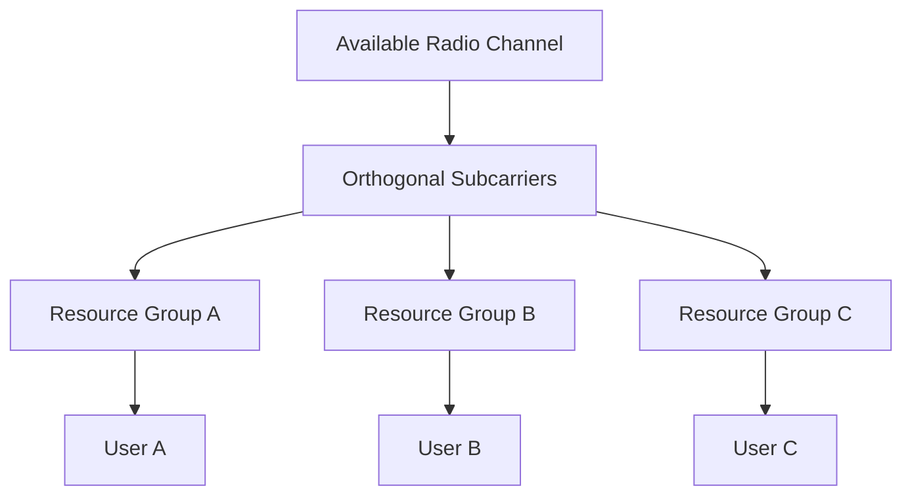

### Advantages

- Efficient spectrum usage
- Flexible resource scheduling
- Supports high data rates
- Suitable for broadband mobile systems

---

## 9. MIMO — Multiple Input Multiple Output

**Generation:** 4G and 5G  
**Category:** Antenna technology  
**Purpose:** Improve throughput, reliability, and radio performance.

### What is MIMO?

MIMO uses multiple transmitting and receiving antennas.

It can improve communication through spatial multiplexing, diversity, and beamforming techniques.

### Example: 4×4 MIMO

A 4×4 MIMO configuration uses:

- Four transmitting antennas
- Four receiving antennas

### MIMO Concept

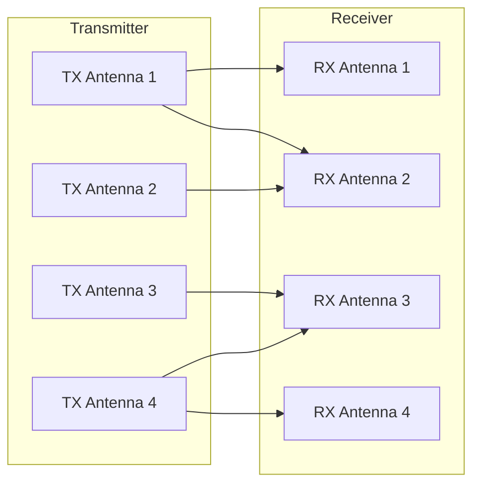

### Key Benefits

- Higher potential throughput
- Better link reliability
- Improved spectral efficiency
- Support for advanced beamforming

**Important:** The number of antennas does not always equal the number of independent data streams.

---

## 10. ISAC — Integrated Sensing and Communication

**Generation:** 6G research and future networks  
**Category:** Integrated radio technology  
**Purpose:** Combine wireless communication and environmental sensing.

### What is ISAC?

ISAC is a research area where wireless systems support both communication and sensing.

Future radio networks may exchange user data while also estimating information about nearby objects, movement, distance, or environments.

### How ISAC Could Work

1. A radio system transmits wireless signals.
2. Devices receive signals for communication.
3. The system also analyses radio propagation or reflections.
4. Signal processing estimates environmental information.
5. Communication and sensing functions can share resources.

### Conceptual ISAC Architecture

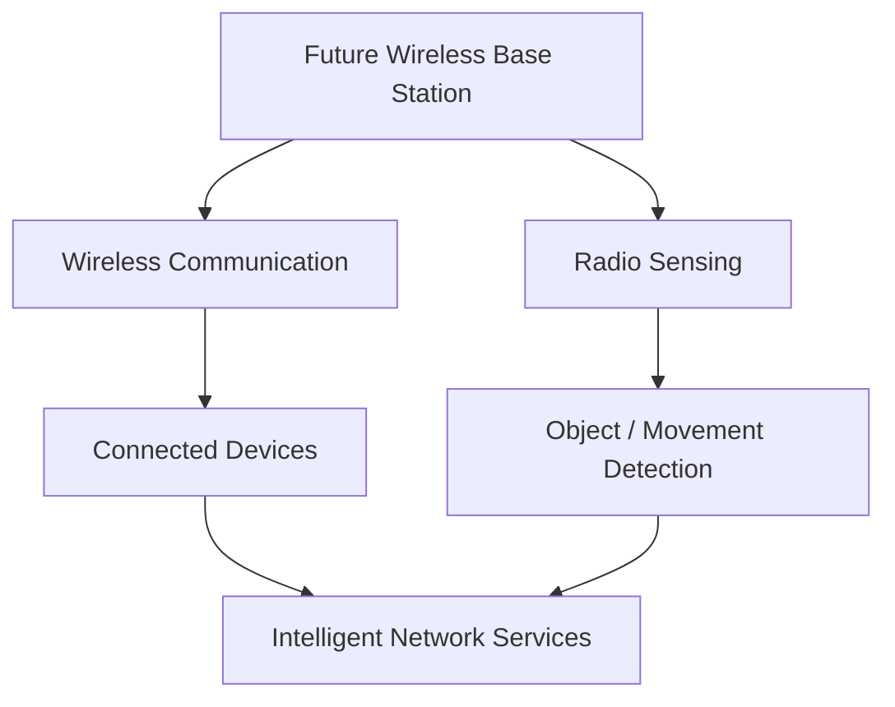

### Potential Applications

- Connected vehicles
- Smart cities
- Industrial automation
- Environmental monitoring
- Robotics
- Next-generation intelligent networks

**Note:** ISAC is an emerging research and standardisation topic. Specific capabilities and architectures are not finalised for 6G.

---

# Technology Comparison Table

| Technology | Full Form | Generation | Category | Main Purpose |
|---|---|---|---|---|
| FDMA | Frequency Division Multiple Access | 1G | Multiple access | Separate frequency channels |
| GSM | Global System for Mobile Communications | 2G | Mobile standard | Digital voice and SMS |
| IS-95 CDMA | Interim Standard 95 | 2G | Mobile standard | Code-based digital access |
| UMTS | Universal Mobile Telecommunications System | 3G | Mobile system | Mobile internet and multimedia |
| WCDMA | Wideband Code Division Multiple Access | 3G | Radio technology | Wideband code-based communication |
| CDMA2000 | Code Division Multiple Access 2000 | 3G | Standards family | Voice and mobile data |
| LTE | Long Term Evolution | 4G | Mobile technology | High-speed all-IP mobile broadband |
| OFDMA | Orthogonal Frequency Division Multiple Access | 4G / 5G | Multiple access | Flexible subcarrier allocation |
| MIMO | Multiple Input Multiple Output | 4G / 5G | Antenna technology | Higher throughput and reliability |
| ISAC | Integrated Sensing and Communication | 6G research | Integrated technology | Communication and radio sensing |

---

# Technology Evolution: 1G to 6G

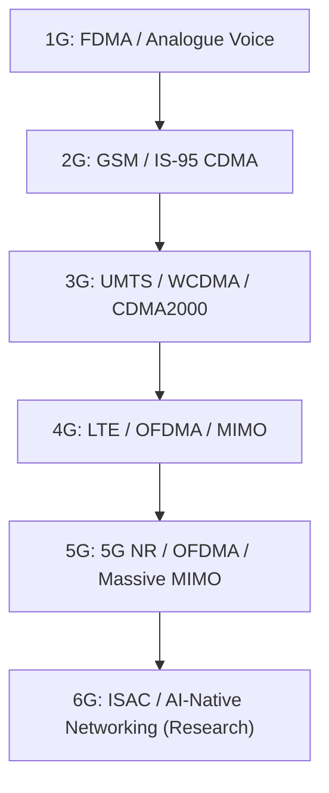

# Mobile Telecommunications Standards

## 1. Introduction

Mobile telecommunications standards are technical specifications and agreed rules that define how mobile devices, base stations, core networks, and other telecommunications systems communicate.

Standards make it possible for network equipment and mobile devices from different manufacturers to work together.

### Why Are Standards Important?

1. **Interoperability:** Devices from different manufacturers can communicate.
2. **Compatibility:** Mobile equipment can operate on supported networks.
3. **Roaming:** Users can access compatible networks in other countries.
4. **Security:** Standards specify authentication and security mechanisms.
5. **Network Performance:** Standards define radio interfaces, protocols, and network functions.
6. **Global Development:** Manufacturers and operators can build interoperable systems.

### Basic Concept


---

## 2. Telecommunications Standardisation Organisations

Different organisations contribute to mobile telecommunications standards.

### Main Organisations

| Organisation | Full Name | Main Responsibility |
|---|---|---|
| ITU | International Telecommunication Union | Global telecom coordination and IMT frameworks |
| 3GPP | 3rd Generation Partnership Project | GSM evolution, UMTS, LTE, 5G and ongoing specifications |
| ETSI | European Telecommunications Standards Institute | European ICT and telecom standards |
| IEEE | Institute of Electrical and Electronics Engineers | Networking standards including Wi-Fi |
| 3GPP2 | 3rd Generation Partnership Project 2 | Historical CDMA2000 specifications |
| IETF | Internet Engineering Task Force | Internet protocols such as IP, TCP and related technologies |

### How Standards Are Developed

```mermaid
flowchart TD
    A["Industry Requirements"]
    B["Research and Technical Proposals"]
    C["Standards Development"]
    D["Technical Specifications"]
    E["Equipment Implementation"]
    F["Testing and Interoperability"]
    G["Commercial Deployment"]

    A --> B
    B --> C
    C --> D
    D --> E
    E --> F
    F --> G
```

### Understanding ITU and 3GPP

**ITU** establishes international frameworks and requirements for mobile telecommunications.

Examples:

- IMT-2000: Third-generation mobile systems
- IMT-Advanced: Advanced fourth-generation mobile systems
- IMT-2020: Fifth-generation mobile systems
- IMT-2030: Framework for future sixth-generation systems

**3GPP** develops detailed technical specifications for mobile networks.

Examples:

- GSM and GPRS/EDGE specifications
- UMTS and HSPA
- LTE and LTE-Advanced
- 5G NR and 5G Core
- Ongoing mobile-network evolution

**Important:** ITU defines broad international IMT frameworks, while 3GPP produces many of the detailed cellular technical specifications.

---

## 3. Mobile Telecommunications Standards by Generation

| Generation | Important Standards | Radio Technologies | Main Services |
|---|---|---|---|
| 1G | AMPS, NMT, TACS | Analogue FM, FDMA | Analogue voice |
| 2G | GSM, IS-95, IS-136 | TDMA, CDMA | Digital voice and SMS |
| 2.5G / 2.75G | GPRS, EDGE | Packet-data enhancements | Basic mobile internet |
| 3G | UMTS, CDMA2000 | WCDMA, CDMA | Mobile internet and multimedia |
| 3G Enhancements | HSPA, HSPA+, EV-DO | Enhanced packet radio | Faster mobile data |
| 4G | LTE, LTE-Advanced | OFDMA, SC-FDMA, MIMO | Mobile broadband |
| 5G | 5G NR, 5G Core | OFDM-based radio, Massive MIMO | Broadband, IoT, low-latency services |
| 6G | IMT-2030 framework; standards under development | Advanced radio, AI and sensing research | Future intelligent connectivity |

---

# 4. First Generation (1G) Standards

## 4.1 AMPS — Advanced Mobile Phone System

**Generation:** 1G  
**Type:** Analogue cellular standard  
**Main Market:** Initially North America

### What Is AMPS?

AMPS was an early analogue cellular telephone system.

It used frequency-division multiple access and supported voice calls.

### Main Components

| Component | Role |
|---|---|
| Mobile Station | User's analogue mobile phone |
| Base Station | Radio communication with the phone |
| Mobile Switching Centre | Call switching and mobility support |
| PSTN | Connection to telephone networks |

### AMPS Architecture

```mermaid
flowchart LR
    A["Mobile Phone"]
    B["Analogue Base Station"]
    C["Mobile Switching Centre"]
    D["PSTN"]

    A <-->|"Analogue Radio"| B
    B <--> C
    C <--> D
```

### Key Technologies

- Analogue frequency modulation
- FDMA
- Circuit-switched voice communication

---

## 4.2 NMT — Nordic Mobile Telephone

**Generation:** 1G

NMT was an analogue cellular system introduced in Nordic countries.

### Features

- Analogue voice calls
- Cellular coverage and roaming
- Frequency-based channel allocation

---

## 4.3 TACS — Total Access Communication System

**Generation:** 1G

TACS was an analogue mobile telephone standard derived from AMPS and used in several markets, including the United Kingdom.

### Features

- Analogue voice
- FDMA
- Cellular handover
- Circuit-switched communication

---

# 5. Second Generation (2G) Standards

## 5.1 GSM — Global System for Mobile Communications

**Generation:** 2G  
**Standard Family:** GSM  
**Main Technology:** FDMA and TDMA

### What Is GSM?

GSM is a digital cellular communication standard.

It supports:

- Digital voice calls
- SMS
- Subscriber authentication
- International roaming
- Basic data services through extensions

### Main Components

| Component | Full Form | Role |
|---|---|---|
| MS | Mobile Station | User's device |
| BTS | Base Transceiver Station | Radio transmission |
| BSC | Base Station Controller | Radio resource management |
| MSC | Mobile Switching Centre | Voice call switching |
| HLR | Home Location Register | Subscriber database |
| VLR | Visitor Location Register | Temporary subscriber information |
| AuC | Authentication Centre | Authentication support |

### GSM Architecture

```mermaid
flowchart LR
    A["Mobile Station"]
    B["BTS"]
    C["BSC"]
    D["MSC"]
    E["PSTN"]
    F["HLR / VLR / AuC"]

    A <-->|"Radio Interface"| B
    B <--> C
    C <--> D
    D <--> E
    D <--> F
```

### How GSM Works

1. The phone connects to a BTS.
2. BTS transfers signalling and user traffic to BSC.
3. BSC manages the radio resources.
4. MSC controls circuit-switched calls.
5. Subscriber databases support authentication and mobility.
6. Calls connect to internal or external telephone networks.

---

## 5.2 IS-95 — Interim Standard 95

**Generation:** 2G  
**Also Known As:** cdmaOne  
**Technology:** CDMA

IS-95 uses code division multiple access to support multiple users within a shared frequency band.

### Main Features

- Digital voice
- Spread-spectrum radio communication
- Power control
- Soft handoff support

### IS-95 Architecture

```mermaid
flowchart LR
    A["CDMA Mobile Phone"]
    B["Base Station"]
    C["Base Station Controller"]
    D["Mobile Switching Centre"]
    E["Telephone Network"]

    A <--> B
    B <--> C
    C <--> D
    D <--> E
```

---

## 5.3 GPRS — General Packet Radio Service

**Generation:** 2G enhancement  
**Purpose:** Packet-switched mobile data

GPRS added packet-based internet connectivity to GSM networks.

### Main Components

- BTS
- BSC / PCU
- SGSN
- GGSN

### GPRS Architecture

```mermaid
flowchart LR
    A["GPRS Phone"]
    B["BTS"]
    C["BSC / PCU"]
    D["SGSN"]
    E["GGSN"]
    F["Internet"]

    A --> B
    B --> C
    C --> D
    D --> E
    E --> F
```

### Component Roles

| Component | Role |
|---|---|
| PCU | Packet Control Unit: handles packet-radio resource functions |
| SGSN | Serving GPRS Support Node: packet mobility and session support |
| GGSN | Gateway GPRS Support Node: external packet-network connectivity |

---

## 5.4 EDGE — Enhanced Data Rates for GSM Evolution

**Generation:** 2G enhancement

EDGE improved data performance through more efficient radio modulation and coding.

### Main Features

- Faster packet data than basic GPRS
- Improved spectral efficiency
- Continued use of evolved GSM infrastructure

---

# 6. Third Generation (3G) Standards

## 6.1 UMTS — Universal Mobile Telecommunications System

**Generation:** 3G  
**Standardisation:** 3GPP  
**Radio Technology:** WCDMA

UMTS supports mobile internet, voice communication, multimedia, and video calls.

### UMTS Architecture

```mermaid
flowchart LR
    A["3G User Equipment"]
    B["NodeB"]
    C["RNC"]
    D["Core Network"]
    E["Internet / PSTN"]

    A <--> B
    B <--> C
    C <--> D
    D <--> E
```

### Main Components

| Component | Role |
|---|---|
| UE | User Equipment |
| NodeB | 3G radio base station |
| RNC | Radio resource management |
| MSC | Circuit-switched voice support |
| SGSN | Packet data mobility management |
| GGSN | Gateway to external data networks |

---

## 6.2 WCDMA — Wideband Code Division Multiple Access

**Generation:** 3G  
**Category:** Radio interface technology

WCDMA is the main radio access technology used by conventional UMTS systems.

### Characteristics

- Wideband spread-spectrum radio interface
- Code-based user separation
- Power control
- Voice and packet data support

---

## 6.3 CDMA2000

**Generation:** 3G  
**Standards Organisation:** Historically 3GPP2

CDMA2000 evolved from IS-95.

### Main Variants

- CDMA2000 1x
- CDMA2000 EV-DO

### Main Services

- Digital voice
- Packet-based mobile data
- Mobile internet

---

## 6.4 HSPA — High Speed Packet Access

**Generation:** 3G enhancement

HSPA improved the packet-data capabilities of UMTS networks.

### Main Technologies

- HSDPA: High Speed Downlink Packet Access
- HSUPA: High Speed Uplink Packet Access
- HSPA+: Evolved High Speed Packet Access

### Purpose

Increase mobile-data performance without replacing the entire UMTS network architecture.

---

# 7. Fourth Generation (4G) Standards

## 7.1 LTE — Long Term Evolution

**Generation:** 4G-era mobile technology  
**Standards Organisation:** 3GPP

LTE was developed for high-speed, packet-based mobile communication.

### LTE Main Components

| Component | Full Form | Role |
|---|---|---|
| UE | User Equipment | User device |
| eNodeB | Evolved NodeB | LTE base station |
| MME | Mobility Management Entity | Control-plane mobility |
| SGW | Serving Gateway | User-plane packet forwarding |
| PGW | Packet Data Network Gateway | External packet-network access |
| HSS | Home Subscriber Server | Subscriber information |

### LTE Architecture

```mermaid
flowchart LR
    A["UE"]
    B["eNodeB"]
    C["MME"]
    D["SGW"]
    E["PGW"]
    F["Internet"]

    A <-->|"LTE Radio"| B
    B -.->|"Control Plane"| C
    B -->|"User Plane"| D
    D --> E
    E --> F
```

### Key Technologies

- OFDMA downlink
- SC-FDMA uplink
- MIMO
- Packet-based EPC architecture

---

## 7.2 LTE-Advanced

**Generation:** 4G  
**Standardisation:** 3GPP

LTE-Advanced enhanced LTE performance and supported capabilities aligned with IMT-Advanced requirements.

### Main Technologies

- Carrier aggregation
- Higher-order MIMO
- Improved radio resource management
- Enhanced spectral efficiency

### What Is Carrier Aggregation?

Carrier aggregation combines multiple component carriers to increase available bandwidth.

```mermaid
flowchart LR
    A["Carrier 1"]
    B["Carrier 2"]
    C["Carrier 3"]
    D["Aggregated Radio Capacity"]
    E["Higher Potential Throughput"]

    A --> D
    B --> D
    C --> D
    D --> E
```

---

# 8. Fifth Generation (5G) Standards

## 8.1 5G NR — Fifth Generation New Radio

**Generation:** 5G  
**Standards Organisation:** 3GPP

5G NR defines the radio access technology used by 5G networks.

### Main Features

- Flexible OFDM-based numerology
- Massive MIMO
- Beamforming
- Enhanced mobile broadband
- Support for low-latency and large-scale IoT scenarios

---

## 8.2 5G Core (5GC)

The 5G Core introduces a service-based architecture for control-plane network functions.

### Important Components

| Component | Full Form | Main Role |
|---|---|---|
| AMF | Access and Mobility Management Function | Registration and mobility |
| SMF | Session Management Function | Session management |
| UPF | User Plane Function | User-data forwarding |
| AUSF | Authentication Server Function | Authentication |
| UDM | Unified Data Management | Subscriber data management |
| PCF | Policy Control Function | Network policies |
| NRF | Network Repository Function | Network-function discovery |

### Simplified 5G Standalone Architecture

```mermaid
flowchart LR
    A["UE"]
    B["gNodeB"]
    C["AMF"]
    D["SMF"]
    E["UPF"]
    F["Internet / Data Network"]
    G["AUSF / UDM / PCF / NRF"]

    A <-->|"5G NR"| B
    B -.->|"Control Plane"| C
    C -.-> D
    C -.-> G
    D -.->|"Controls"| E
    B -->|"User Plane"| E
    E --> F
```

**Note:** This is a simplified learning diagram. Actual 5G Core architecture contains additional interfaces and network functions.

---

## 8.3 5G NSA and SA

### NSA — Non-Standalone

- Uses 5G radio with existing LTE infrastructure.
- Common early deployment approach.
- Often relies on the EPC.

### SA — Standalone

- Uses 5G NR and 5G Core.
- Supports a fuller set of 5G architecture capabilities.
- Enables flexible network slicing and cloud-native deployment approaches.

---

## 8.4 5G-Advanced

**Standards Evolution:** 3GPP Release 18 and later

5G-Advanced introduces further improvements to 5G systems.

### Areas of Development

- AI/ML-supported network optimisation
- Enhanced MIMO
- Improved energy efficiency
- Extended support for non-terrestrial networks
- Advanced positioning and radio performance

---

# 9. Sixth Generation (6G) Standards

## 9.1 IMT-2030

**Generation:** 6G framework  
**Organisation:** ITU-R

IMT-2030 provides a framework for future sixth-generation mobile systems.

As of October 2026, detailed 6G technologies and system specifications are still under development.

### Research Areas

- AI-assisted and AI-native networks
- Integrated Sensing and Communication (ISAC)
- Non-Terrestrial Networks (NTN)
- Advanced antenna systems
- Future radio spectrum technologies
- Immersive connectivity
- Energy-efficient communication

---

## 9.2 Conceptual 6G Architecture

```mermaid
flowchart LR
    A["Intelligent Devices"]
    B["Advanced Radio Access"]
    C["AI-Assisted Network Functions"]
    D["Cloud / Edge Services"]
    E["Non-Terrestrial Networks"]
    F["Integrated Sensing"]

    A <--> B
    B <--> C
    C <--> D
    C <--> E
    B <--> F
```

**Important:** This is a conceptual architecture for learning, not a completed 6G standard.

---

# 10. Mobile Network Standards Evolution

```mermaid
flowchart TD
    A["1G: AMPS / NMT / TACS"]
    B["2G: GSM / IS-95"]
    C["2G Enhancements: GPRS / EDGE"]
    D["3G: UMTS / CDMA2000"]
    E["3G Enhancements: HSPA / EV-DO"]
    F["4G: LTE / LTE-Advanced"]
    G["5G: 5G NR / 5G Core"]
    H["5G-Advanced"]
    I["6G: IMT-2030 / Research"]

    A --> B
    B --> C
    C --> D
    D --> E
    E --> F
    F --> G
    G --> H
    H --> I
```


---

# Mobile Telecommunications Standards

## 1. Introduction

Mobile telecommunications standards are technical specifications and agreed rules that define how mobile devices, base stations, core networks, and other telecommunications systems communicate.

Standards make it possible for network equipment and mobile devices from different manufacturers to work together.

### Why Are Standards Important?

1. **Interoperability:** Devices from different manufacturers can communicate.
2. **Compatibility:** Mobile equipment can operate on supported networks.
3. **Roaming:** Users can access compatible networks in other countries.
4. **Security:** Standards specify authentication and security mechanisms.
5. **Network Performance:** Standards define radio interfaces, protocols, and network functions.
6. **Global Development:** Manufacturers and operators can build interoperable systems.

### Basic Concept

```mermaid
flowchart LR
    A["Mobile Device"]
    B["Radio Access Network"]
    C["Core Network"]
    D["Internet / Telephone Network"]

    A <-->|"Standard Radio Protocols"| B
    B <-->|"Standard Interfaces"| C
    C <-->|"Interconnection Protocols"| D
```

---

## 2. Telecommunications Standardisation Organisations

Different organisations contribute to mobile telecommunications standards.

### Main Organisations

| Organisation | Full Name | Main Responsibility |
|---|---|---|
| ITU | International Telecommunication Union | Global telecom coordination and IMT frameworks |
| 3GPP | 3rd Generation Partnership Project | GSM evolution, UMTS, LTE, 5G and ongoing specifications |
| ETSI | European Telecommunications Standards Institute | European ICT and telecom standards |
| IEEE | Institute of Electrical and Electronics Engineers | Networking standards including Wi-Fi |
| 3GPP2 | 3rd Generation Partnership Project 2 | Historical CDMA2000 specifications |
| IETF | Internet Engineering Task Force | Internet protocols such as IP, TCP and related technologies |

### How Standards Are Developed

```mermaid
flowchart TD
    A["Industry Requirements"]
    B["Research and Technical Proposals"]
    C["Standards Development"]
    D["Technical Specifications"]
    E["Equipment Implementation"]
    F["Testing and Interoperability"]
    G["Commercial Deployment"]

    A --> B
    B --> C
    C --> D
    D --> E
    E --> F
    F --> G
```

### Understanding ITU and 3GPP

**ITU** establishes international frameworks and requirements for mobile telecommunications.

Examples:

- IMT-2000: Third-generation mobile systems
- IMT-Advanced: Advanced fourth-generation mobile systems
- IMT-2020: Fifth-generation mobile systems
- IMT-2030: Framework for future sixth-generation systems

**3GPP** develops detailed technical specifications for mobile networks.

Examples:

- GSM and GPRS/EDGE specifications
- UMTS and HSPA
- LTE and LTE-Advanced
- 5G NR and 5G Core
- Ongoing mobile-network evolution

**Important:** ITU defines broad international IMT frameworks, while 3GPP produces many of the detailed cellular technical specifications.

---

## 3. Mobile Telecommunications Standards by Generation

| Generation | Important Standards | Radio Technologies | Main Services |
|---|---|---|---|
| 1G | AMPS, NMT, TACS | Analogue FM, FDMA | Analogue voice |
| 2G | GSM, IS-95, IS-136 | TDMA, CDMA | Digital voice and SMS |
| 2.5G / 2.75G | GPRS, EDGE | Packet-data enhancements | Basic mobile internet |
| 3G | UMTS, CDMA2000 | WCDMA, CDMA | Mobile internet and multimedia |
| 3G Enhancements | HSPA, HSPA+, EV-DO | Enhanced packet radio | Faster mobile data |
| 4G | LTE, LTE-Advanced | OFDMA, SC-FDMA, MIMO | Mobile broadband |
| 5G | 5G NR, 5G Core | OFDM-based radio, Massive MIMO | Broadband, IoT, low-latency services |
| 6G | IMT-2030 framework; standards under development | Advanced radio, AI and sensing research | Future intelligent connectivity |

---

# 4. First Generation (1G) Standards

## 4.1 AMPS — Advanced Mobile Phone System

**Generation:** 1G  
**Type:** Analogue cellular standard  
**Main Market:** Initially North America

### What Is AMPS?

AMPS was an early analogue cellular telephone system.

It used frequency-division multiple access and supported voice calls.

### Main Components

| Component | Role |
|---|---|
| Mobile Station | User's analogue mobile phone |
| Base Station | Radio communication with the phone |
| Mobile Switching Centre | Call switching and mobility support |
| PSTN | Connection to telephone networks |

### AMPS Architecture

```mermaid
flowchart LR
    A["Mobile Phone"]
    B["Analogue Base Station"]
    C["Mobile Switching Centre"]
    D["PSTN"]

    A <-->|"Analogue Radio"| B
    B <--> C
    C <--> D
```

### Key Technologies

- Analogue frequency modulation
- FDMA
- Circuit-switched voice communication

---

## 4.2 NMT — Nordic Mobile Telephone

**Generation:** 1G

NMT was an analogue cellular system introduced in Nordic countries.

### Features

- Analogue voice calls
- Cellular coverage and roaming
- Frequency-based channel allocation

---

## 4.3 TACS — Total Access Communication System

**Generation:** 1G

TACS was an analogue mobile telephone standard derived from AMPS and used in several markets, including the United Kingdom.

### Features

- Analogue voice
- FDMA
- Cellular handover
- Circuit-switched communication

---

# 5. Second Generation (2G) Standards

## 5.1 GSM — Global System for Mobile Communications

**Generation:** 2G  
**Standard Family:** GSM  
**Main Technology:** FDMA and TDMA

### What Is GSM?

GSM is a digital cellular communication standard.

It supports:

- Digital voice calls
- SMS
- Subscriber authentication
- International roaming
- Basic data services through extensions

### Main Components

| Component | Full Form | Role |
|---|---|---|
| MS | Mobile Station | User's device |
| BTS | Base Transceiver Station | Radio transmission |
| BSC | Base Station Controller | Radio resource management |
| MSC | Mobile Switching Centre | Voice call switching |
| HLR | Home Location Register | Subscriber database |
| VLR | Visitor Location Register | Temporary subscriber information |
| AuC | Authentication Centre | Authentication support |

### GSM Architecture

```mermaid
flowchart LR
    A["Mobile Station"]
    B["BTS"]
    C["BSC"]
    D["MSC"]
    E["PSTN"]
    F["HLR / VLR / AuC"]

    A <-->|"Radio Interface"| B
    B <--> C
    C <--> D
    D <--> E
    D <--> F
```

### How GSM Works

1. The phone connects to a BTS.
2. BTS transfers signalling and user traffic to BSC.
3. BSC manages the radio resources.
4. MSC controls circuit-switched calls.
5. Subscriber databases support authentication and mobility.
6. Calls connect to internal or external telephone networks.

---

## 5.2 IS-95 — Interim Standard 95

**Generation:** 2G  
**Also Known As:** cdmaOne  
**Technology:** CDMA

IS-95 uses code division multiple access to support multiple users within a shared frequency band.

### Main Features

- Digital voice
- Spread-spectrum radio communication
- Power control
- Soft handoff support

### IS-95 Architecture

```mermaid
flowchart LR
    A["CDMA Mobile Phone"]
    B["Base Station"]
    C["Base Station Controller"]
    D["Mobile Switching Centre"]
    E["Telephone Network"]

    A <--> B
    B <--> C
    C <--> D
    D <--> E
```

---

## 5.3 GPRS — General Packet Radio Service

**Generation:** 2G enhancement  
**Purpose:** Packet-switched mobile data

GPRS added packet-based internet connectivity to GSM networks.

### Main Components

- BTS
- BSC / PCU
- SGSN
- GGSN

### GPRS Architecture

```mermaid
flowchart LR
    A["GPRS Phone"]
    B["BTS"]
    C["BSC / PCU"]
    D["SGSN"]
    E["GGSN"]
    F["Internet"]

    A --> B
    B --> C
    C --> D
    D --> E
    E --> F
```

### Component Roles

| Component | Role |
|---|---|
| PCU | Packet Control Unit: handles packet-radio resource functions |
| SGSN | Serving GPRS Support Node: packet mobility and session support |
| GGSN | Gateway GPRS Support Node: external packet-network connectivity |

---

## 5.4 EDGE — Enhanced Data Rates for GSM Evolution

**Generation:** 2G enhancement

EDGE improved data performance through more efficient radio modulation and coding.

### Main Features

- Faster packet data than basic GPRS
- Improved spectral efficiency
- Continued use of evolved GSM infrastructure

---

# 6. Third Generation (3G) Standards

## 6.1 UMTS — Universal Mobile Telecommunications System

**Generation:** 3G  
**Standardisation:** 3GPP  
**Radio Technology:** WCDMA

UMTS supports mobile internet, voice communication, multimedia, and video calls.

### UMTS Architecture

```mermaid
flowchart LR
    A["3G User Equipment"]
    B["NodeB"]
    C["RNC"]
    D["Core Network"]
    E["Internet / PSTN"]

    A <--> B
    B <--> C
    C <--> D
    D <--> E
```

### Main Components

| Component | Role |
|---|---|
| UE | User Equipment |
| NodeB | 3G radio base station |
| RNC | Radio resource management |
| MSC | Circuit-switched voice support |
| SGSN | Packet data mobility management |
| GGSN | Gateway to external data networks |

---

## 6.2 WCDMA — Wideband Code Division Multiple Access

**Generation:** 3G  
**Category:** Radio interface technology

WCDMA is the main radio access technology used by conventional UMTS systems.

### Characteristics

- Wideband spread-spectrum radio interface
- Code-based user separation
- Power control
- Voice and packet data support

---

## 6.3 CDMA2000

**Generation:** 3G  
**Standards Organisation:** Historically 3GPP2

CDMA2000 evolved from IS-95.

### Main Variants

- CDMA2000 1x
- CDMA2000 EV-DO

### Main Services

- Digital voice
- Packet-based mobile data
- Mobile internet

---

## 6.4 HSPA — High Speed Packet Access

**Generation:** 3G enhancement

HSPA improved the packet-data capabilities of UMTS networks.

### Main Technologies

- HSDPA: High Speed Downlink Packet Access
- HSUPA: High Speed Uplink Packet Access
- HSPA+: Evolved High Speed Packet Access

### Purpose

Increase mobile-data performance without replacing the entire UMTS network architecture.

---

# 7. Fourth Generation (4G) Standards

## 7.1 LTE — Long Term Evolution

**Generation:** 4G-era mobile technology  
**Standards Organisation:** 3GPP

LTE was developed for high-speed, packet-based mobile communication.

### LTE Main Components

| Component | Full Form | Role |
|---|---|---|
| UE | User Equipment | User device |
| eNodeB | Evolved NodeB | LTE base station |
| MME | Mobility Management Entity | Control-plane mobility |
| SGW | Serving Gateway | User-plane packet forwarding |
| PGW | Packet Data Network Gateway | External packet-network access |
| HSS | Home Subscriber Server | Subscriber information |

### LTE Architecture

```mermaid
flowchart LR
    A["UE"]
    B["eNodeB"]
    C["MME"]
    D["SGW"]
    E["PGW"]
    F["Internet"]

    A <-->|"LTE Radio"| B
    B -.->|"Control Plane"| C
    B -->|"User Plane"| D
    D --> E
    E --> F
```

### Key Technologies

- OFDMA downlink
- SC-FDMA uplink
- MIMO
- Packet-based EPC architecture

---

## 7.2 LTE-Advanced

**Generation:** 4G  
**Standardisation:** 3GPP

LTE-Advanced enhanced LTE performance and supported capabilities aligned with IMT-Advanced requirements.

### Main Technologies

- Carrier aggregation
- Higher-order MIMO
- Improved radio resource management
- Enhanced spectral efficiency

### What Is Carrier Aggregation?

Carrier aggregation combines multiple component carriers to increase available bandwidth.

```mermaid
flowchart LR
    A["Carrier 1"]
    B["Carrier 2"]
    C["Carrier 3"]
    D["Aggregated Radio Capacity"]
    E["Higher Potential Throughput"]

    A --> D
    B --> D
    C --> D
    D --> E
```

---

# 8. Fifth Generation (5G) Standards

## 8.1 5G NR — Fifth Generation New Radio

**Generation:** 5G  
**Standards Organisation:** 3GPP

5G NR defines the radio access technology used by 5G networks.

### Main Features

- Flexible OFDM-based numerology
- Massive MIMO
- Beamforming
- Enhanced mobile broadband
- Support for low-latency and large-scale IoT scenarios

---

## 8.2 5G Core (5GC)

The 5G Core introduces a service-based architecture for control-plane network functions.

### Important Components

| Component | Full Form | Main Role |
|---|---|---|
| AMF | Access and Mobility Management Function | Registration and mobility |
| SMF | Session Management Function | Session management |
| UPF | User Plane Function | User-data forwarding |
| AUSF | Authentication Server Function | Authentication |
| UDM | Unified Data Management | Subscriber data management |
| PCF | Policy Control Function | Network policies |
| NRF | Network Repository Function | Network-function discovery |

### Simplified 5G Standalone Architecture

```mermaid
flowchart LR
    A["UE"]
    B["gNodeB"]
    C["AMF"]
    D["SMF"]
    E["UPF"]
    F["Internet / Data Network"]
    G["AUSF / UDM / PCF / NRF"]

    A <-->|"5G NR"| B
    B -.->|"Control Plane"| C
    C -.-> D
    C -.-> G
    D -.->|"Controls"| E
    B -->|"User Plane"| E
    E --> F
```

**Note:** This is a simplified learning diagram. Actual 5G Core architecture contains additional interfaces and network functions.

---

## 8.3 5G NSA and SA

### NSA — Non-Standalone

- Uses 5G radio with existing LTE infrastructure.
- Common early deployment approach.
- Often relies on the EPC.

### SA — Standalone

- Uses 5G NR and 5G Core.
- Supports a fuller set of 5G architecture capabilities.
- Enables flexible network slicing and cloud-native deployment approaches.

---

## 8.4 5G-Advanced

**Standards Evolution:** 3GPP Release 18 and later

5G-Advanced introduces further improvements to 5G systems.

### Areas of Development

- AI/ML-supported network optimisation
- Enhanced MIMO
- Improved energy efficiency
- Extended support for non-terrestrial networks
- Advanced positioning and radio performance

---

# 9. Sixth Generation (6G) Standards

## 9.1 IMT-2030

**Generation:** 6G framework  
**Organisation:** ITU-R

IMT-2030 provides a framework for future sixth-generation mobile systems.

As of October 2026, detailed 6G technologies and system specifications are still under development.

### Research Areas

- AI-assisted and AI-native networks
- Integrated Sensing and Communication (ISAC)
- Non-Terrestrial Networks (NTN)
- Advanced antenna systems
- Future radio spectrum technologies
- Immersive connectivity
- Energy-efficient communication

---

## 9.2 Conceptual 6G Architecture

```mermaid
flowchart LR
    A["Intelligent Devices"]
    B["Advanced Radio Access"]
    C["AI-Assisted Network Functions"]
    D["Cloud / Edge Services"]
    E["Non-Terrestrial Networks"]
    F["Integrated Sensing"]

    A <--> B
    B <--> C
    C <--> D
    C <--> E
    B <--> F
```

**Important:** This is a conceptual architecture for learning, not a completed 6G standard.

---

# 10. Mobile Network Standards Evolution

```mermaid
flowchart TD
    A["1G: AMPS / NMT / TACS"]
    B["2G: GSM / IS-95"]
    C["2G Enhancements: GPRS / EDGE"]
    D["3G: UMTS / CDMA2000"]
    E["3G Enhancements: HSPA / EV-DO"]
    F["4G: LTE / LTE-Advanced"]
    G["5G: 5G NR / 5G Core"]
    H["5G-Advanced"]
    I["6G: IMT-2030 / Research"]

    A --> B
    B --> C
    C --> D
    D --> E
    E --> F
    F --> G
    G --> H
    H --> I
```

This is a learning timeline of major standards families and enhancements, not a claim that every technology directly evolved from the previous one.


---

# Why Do We Need Mobile Communication Standards?

## 1. Introduction

Mobile communication standards are agreed technical rules, protocols, and specifications that allow mobile phones, base stations, core networks, and telecommunications equipment to communicate.

Standards are essential because mobile communication involves equipment from different manufacturers, mobile operators, and countries.

**The main purpose of mobile communication standards is to ensure compatibility, interoperability, security, reliability, and efficient wireless communication.**

### Simple Example

Imagine:

- You have a Samsung smartphone.
- Your friend has an Apple iPhone.
- You use one mobile network operator.
- Your friend uses another mobile network operator.

Even though your phones and mobile operators are different, you can still communicate because they use compatible telecommunications standards and interconnected networks.

---

## 2. What Would Happen Without Mobile Communication Standards?

Without common standards, mobile networks would face several problems.

### Main Problems

1. Devices from different manufacturers might not communicate.
2. Phones might work with only one manufacturer's equipment.
3. International roaming would become more difficult.
4. Network equipment would require proprietary integration.
5. Security mechanisms could be inconsistent.
6. Network expansion would become more expensive.
7. Different technologies could create compatibility problems.

### Without Standards

```mermaid
flowchart TD
    A["Mobile Communication Without Standards"]

    A --> B["Incompatible Devices"]
    A --> C["Limited Network Interoperability"]
    A --> D["Difficult International Roaming"]
    A --> E["Higher Deployment Costs"]
    A --> F["Inconsistent Security"]

    B --> G["Poor User Experience"]
    C --> G
    D --> G
    E --> G
    F --> G
```

### With Standards

```mermaid
flowchart TD
    A["Mobile Communication Standards"]

    A --> B["Device Compatibility"]
    A --> C["Network Interoperability"]
    A --> D["International Roaming"]
    A --> E["Common Security Procedures"]
    A --> F["Efficient Network Deployment"]

    B --> G["Reliable Mobile Communication"]
    C --> G
    D --> G
    E --> G
    F --> G
```

---

## 3. Main Reasons We Need Mobile Communication Standards

### 3.1 Interoperability

**Interoperability means different telecommunications systems can work together.**

Mobile networks use equipment from different manufacturers.

For example:

- Ericsson radio equipment
- Nokia network equipment
- Samsung smartphones
- Apple iPhones
- Qualcomm modems

Standards define common interfaces and protocols that allow compatible products to communicate.

#### Example Architecture

```mermaid
flowchart LR
    A["Mobile Device"]
    B["Base Station"]
    C["Core Network"]
    D["External Network"]

    A <-->|"Standard Radio Interface"| B
    B <-->|"Standard Network Interface"| C
    C <-->|"Interconnection Protocols"| D
```

**Why is this important?**

Mobile operators can integrate equipment from multiple manufacturers rather than being completely dependent on one supplier.

---

### 3.2 Device Compatibility

Standards allow compatible mobile devices to connect to mobile networks.

For example, a smartphone supporting the required LTE frequency bands and network features can connect to a compatible LTE network.

#### How It Works

1. The mobile device supports a cellular standard.
2. The base station supports the corresponding radio technology.
3. The device detects a compatible network.
4. The device follows standard access and authentication procedures.
5. The network establishes communication.

**Important:** Supporting the same generation does not automatically guarantee compatibility. Frequency bands, device capabilities, operator policies, and provisioning must also match.

---

### 3.3 International Roaming

International roaming allows mobile subscribers to use compatible mobile networks when travelling abroad.

Standards define procedures that help networks identify, authenticate, and serve roaming subscribers.

#### Simplified Roaming Architecture

```mermaid
flowchart LR
    A["Mobile Phone Abroad"]
    B["Visited Mobile Network"]
    C["Roaming Interconnection"]
    D["Home Mobile Network"]

    A <-->|"Radio Connection"| B
    B <-->|"Roaming Signalling"| C
    C <-->|"Subscriber Authentication and Services"| D
```

#### Example

1. You travel from Ireland to France.
2. Your phone detects a compatible French mobile network.
3. The visited operator exchanges necessary signalling with your home network.
4. Your subscription and roaming permissions are checked.
5. Your phone can use authorised roaming services.

**Note:** Roaming also requires commercial agreements, suitable network support, and appropriate subscriber permissions.

---

### 3.4 Security and Authentication

Mobile communication standards specify security procedures to help protect users and network infrastructure.

#### Main Security Functions

| Security Function | Purpose |
|---|---|
| Authentication | Verify subscriber or network credentials |
| Encryption | Help protect information transmitted over the radio interface |
| Integrity Protection | Detect unauthorised modification of protected signalling |
| Key Management | Establish and manage security keys |
| Subscriber Identity Protection | Reduce unnecessary exposure of subscriber identity |

#### Simplified Security Process

```mermaid
flowchart TD
    A["Mobile Device Requests Access"]
    B["Network Authentication Procedure"]
    C{"Authentication Successful?"}
    D["Establish Security Context"]
    E["Authorised Network Services"]
    F["Access Rejected"]

    A --> B
    B --> C
    C -->|"Yes"| D
    D --> E
    C -->|"No"| F
```

**Why is this important?**

Standards provide a consistent foundation for implementing security across compatible telecommunications equipment.

However, standards alone do not guarantee complete security. Correct implementation, configuration, updates, and operational controls are also necessary.

---

### 3.5 Efficient Use of Radio Spectrum

Radio spectrum is a limited resource.

Mobile standards define radio transmission methods that help operators use allocated spectrum effectively.

#### Examples

| Technology | Spectrum Access Method |
|---|---|
| 1G | FDMA |
| GSM | FDMA and TDMA |
| IS-95 | CDMA |
| UMTS / WCDMA | Wideband CDMA |
| LTE | OFDMA downlink, SC-FDMA uplink |
| 5G NR | OFDM-based radio with flexible resource allocation |

#### Why Does Spectrum Efficiency Matter?

- Supports more users.
- Improves network capacity.
- Enables higher data rates.
- Reduces unnecessary interference through coordinated radio design.
- Helps operators use licensed frequencies effectively.

---

### 3.6 Reliable Communication and Mobility

Mobile users move between different coverage areas.

Standards define procedures that help networks manage mobility, including handovers.

#### Handover Example

```mermaid
flowchart LR
    A["Mobile Phone"]
    B["Serving Cell Tower"]
    C["Target Cell Tower"]
    D["Core Network"]

    A <-->|"Current Connection"| B
    B <-->|"Handover Coordination"| C
    C <-->|"New Radio Connection"| A
    B --- D
    C --- D
```

#### How Handover Works

1. The phone communicates with a serving cell.
2. The phone or network measures radio conditions.
3. The network determines whether a handover is needed.
4. The connection moves to a suitable target cell.
5. Communication continues, ideally with minimal interruption.

The exact handover procedure depends on the cellular generation and radio technology.

---

### 3.7 Lower Costs and Global Innovation

Standards reduce the need for every company to invent completely separate communication protocols.

#### Main Benefits

- Shared technical specifications
- Larger markets for compatible equipment
- Multi-vendor equipment sourcing
- Easier technology development
- More scalable network deployment
- Wider competition and innovation

For example, manufacturers can develop devices based on widely adopted 3GPP specifications rather than producing entirely different products for every operator.

---

## 4. Who Creates Mobile Communication Standards?

Mobile communication standards are developed and coordinated by several organisations.

| Organisation | Responsibility |
|---|---|
| ITU | International telecommunications coordination and IMT frameworks |
| 3GPP | Detailed specifications for GSM evolution, UMTS, LTE, and 5G |
| ETSI | European telecommunications and ICT standards |
| IEEE | Networking and wireless technologies such as Wi-Fi |
| IETF | Internet protocols used by telecommunications networks |
| 3GPP2 | Historical development of CDMA2000 specifications |

### Relationship Between Standards Organisations

```mermaid
flowchart TD
    A["Telecommunications Industry Requirements"]

    A --> B["ITU: Global IMT Frameworks"]
    A --> C["3GPP: Cellular Specifications"]
    A --> D["Other Standards Organisations"]

    C --> E["Radio Access Standards"]
    C --> F["Core Network Specifications"]
    C --> G["Security and Protocol Specifications"]

    E --> H["Equipment Implementation"]
    F --> H
    G --> H

    H --> I["Testing and Deployment"]
```

---

## 5. Why Do Mobile Standards Change From 1G to 6G?

Mobile standards evolve because communication requirements change.

### Evolution of Requirements

| Generation | Main Requirement | Standards / Technologies |
|---|---|---|
| 1G | Mobile voice communication | AMPS, NMT, TACS |
| 2G | Digital voice and SMS | GSM, IS-95 |
| 3G | Mobile internet and multimedia | UMTS, CDMA2000 |
| 4G | High-speed mobile broadband | LTE, LTE-Advanced |
| 5G | Higher capacity, low latency, massive connectivity | 5G NR, 5G Core |
| 6G | Future intelligent and integrated connectivity | IMT-2030 and emerging research |

### Standards Evolution Diagram

```mermaid
flowchart TD
    A["1G: Wireless Voice"]
    B["2G: Digital Voice and SMS"]
    C["3G: Mobile Internet"]
    D["4G: High-Speed Broadband"]
    E["5G: Advanced Wireless Services"]
    F["6G: Intelligent Network Research"]

    A --> B
    B --> C
    C --> D
    D --> E
    E --> F
```

**Important:** The 6G stage represents future research and standardisation. It is not a completed commercial mobile-network generation.

---

## 6. Real-World Example: Making a Mobile Call

Imagine two people using phones from different manufacturers and different mobile operators.

### Communication Process

1. User A initiates a call.
2. The phone connects to a compatible radio network.
3. The network authenticates and authorises the subscriber.
4. Standardised signalling establishes the call.
5. Interconnected networks route the call.
6. User B receives the call.
7. Audio is exchanged through the established communication path.

### Simplified Architecture

```mermaid
flowchart LR
    A["User A Phone"]
    B["Operator A Radio Network"]
    C["Operator A Core"]
    D["Interconnection Network"]
    E["Operator B Core"]
    F["Operator B Radio Network"]
    G["User B Phone"]

    A <--> B
    B <--> C
    C <--> D
    D <--> E
    E <--> F
    F <--> G
```

The actual implementation depends on whether the call uses GSM, UMTS, VoLTE, VoNR, or another supported voice technology.

---

## 7. Summary: Main Benefits of Standards

| Benefit | Explanation |
|---|---|
| Interoperability | Compatible equipment can communicate across vendors |
| Device Compatibility | Supported devices can access compatible networks |
| International Roaming | Subscribers can use supported foreign networks |
| Security | Common authentication and security mechanisms |
| Spectrum Efficiency | More effective use of allocated radio resources |
| Reliability | Defined procedures for signalling, mobility, and communication |
| Scalability | Network operators can expand using common technologies |
| Innovation | Shared standards provide a foundation for new products |
| Competition | Multiple vendors can implement compatible technologies |
| Network Evolution | Technologies can develop through successive generations |

---


### Remember

**Mobile Communication Standards = Common Rules + Compatible Equipment + Reliable Network Communication**

---


---

# Why Do We Need Mobile Communication Standards?

## 1. Introduction

Mobile communication standards are agreed technical rules, protocols, and specifications that allow mobile phones, base stations, core networks, and telecommunications equipment to communicate.

Standards are essential because mobile communication involves equipment from different manufacturers, mobile operators, and countries.

**The main purpose of mobile communication standards is to ensure compatibility, interoperability, security, reliability, and efficient wireless communication.**

### Simple Example

Imagine:

- You have a Samsung smartphone.
- Your friend has an Apple iPhone.
- You use one mobile network operator.
- Your friend uses another mobile network operator.

Even though your phones and mobile operators are different, you can still communicate because they use compatible telecommunications standards and interconnected networks.

---

## 2. What Would Happen Without Mobile Communication Standards?

Without common standards, mobile networks would face several problems.

### Main Problems

1. Devices from different manufacturers might not communicate.
2. Phones might work with only one manufacturer's equipment.
3. International roaming would become more difficult.
4. Network equipment would require proprietary integration.
5. Security mechanisms could be inconsistent.
6. Network expansion would become more expensive.
7. Different technologies could create compatibility problems.

### Without Standards

```mermaid
flowchart TD
    A["Mobile Communication Without Standards"]

    A --> B["Incompatible Devices"]
    A --> C["Limited Network Interoperability"]
    A --> D["Difficult International Roaming"]
    A --> E["Higher Deployment Costs"]
    A --> F["Inconsistent Security"]

    B --> G["Poor User Experience"]
    C --> G
    D --> G
    E --> G
    F --> G
```

### With Standards

```mermaid
flowchart TD
    A["Mobile Communication Standards"]

    A --> B["Device Compatibility"]
    A --> C["Network Interoperability"]
    A --> D["International Roaming"]
    A --> E["Common Security Procedures"]
    A --> F["Efficient Network Deployment"]

    B --> G["Reliable Mobile Communication"]
    C --> G
    D --> G
    E --> G
    F --> G
```

---

## 3. Main Reasons We Need Mobile Communication Standards

### 3.1 Interoperability

**Interoperability means different telecommunications systems can work together.**

Mobile networks use equipment from different manufacturers.

For example:

- Ericsson radio equipment
- Nokia network equipment
- Samsung smartphones
- Apple iPhones
- Qualcomm modems

Standards define common interfaces and protocols that allow compatible products to communicate.

#### Example Architecture

```mermaid
flowchart LR
    A["Mobile Device"]
    B["Base Station"]
    C["Core Network"]
    D["External Network"]

    A <-->|"Standard Radio Interface"| B
    B <-->|"Standard Network Interface"| C
    C <-->|"Interconnection Protocols"| D
```

**Why is this important?**

Mobile operators can integrate equipment from multiple manufacturers rather than being completely dependent on one supplier.

---

### 3.2 Device Compatibility

Standards allow compatible mobile devices to connect to mobile networks.

For example, a smartphone supporting the required LTE frequency bands and network features can connect to a compatible LTE network.

#### How It Works

1. The mobile device supports a cellular standard.
2. The base station supports the corresponding radio technology.
3. The device detects a compatible network.
4. The device follows standard access and authentication procedures.
5. The network establishes communication.

**Important:** Supporting the same generation does not automatically guarantee compatibility. Frequency bands, device capabilities, operator policies, and provisioning must also match.

---

### 3.3 International Roaming

International roaming allows mobile subscribers to use compatible mobile networks when travelling abroad.

Standards define procedures that help networks identify, authenticate, and serve roaming subscribers.

#### Simplified Roaming Architecture

```mermaid
flowchart LR
    A["Mobile Phone Abroad"]
    B["Visited Mobile Network"]
    C["Roaming Interconnection"]
    D["Home Mobile Network"]

    A <-->|"Radio Connection"| B
    B <-->|"Roaming Signalling"| C
    C <-->|"Subscriber Authentication and Services"| D
```

#### Example

1. You travel from Ireland to France.
2. Your phone detects a compatible French mobile network.
3. The visited operator exchanges necessary signalling with your home network.
4. Your subscription and roaming permissions are checked.
5. Your phone can use authorised roaming services.

**Note:** Roaming also requires commercial agreements, suitable network support, and appropriate subscriber permissions.

---

### 3.4 Security and Authentication

Mobile communication standards specify security procedures to help protect users and network infrastructure.

#### Main Security Functions

| Security Function | Purpose |
|---|---|
| Authentication | Verify subscriber or network credentials |
| Encryption | Help protect information transmitted over the radio interface |
| Integrity Protection | Detect unauthorised modification of protected signalling |
| Key Management | Establish and manage security keys |
| Subscriber Identity Protection | Reduce unnecessary exposure of subscriber identity |

#### Simplified Security Process

```mermaid
flowchart TD
    A["Mobile Device Requests Access"]
    B["Network Authentication Procedure"]
    C{"Authentication Successful?"}
    D["Establish Security Context"]
    E["Authorised Network Services"]
    F["Access Rejected"]

    A --> B
    B --> C
    C -->|"Yes"| D
    D --> E
    C -->|"No"| F
```

**Why is this important?**

Standards provide a consistent foundation for implementing security across compatible telecommunications equipment.

However, standards alone do not guarantee complete security. Correct implementation, configuration, updates, and operational controls are also necessary.

---

### 3.5 Efficient Use of Radio Spectrum

Radio spectrum is a limited resource.

Mobile standards define radio transmission methods that help operators use allocated spectrum effectively.

#### Examples

| Technology | Spectrum Access Method |
|---|---|
| 1G | FDMA |
| GSM | FDMA and TDMA |
| IS-95 | CDMA |
| UMTS / WCDMA | Wideband CDMA |
| LTE | OFDMA downlink, SC-FDMA uplink |
| 5G NR | OFDM-based radio with flexible resource allocation |

#### Why Does Spectrum Efficiency Matter?

- Supports more users.
- Improves network capacity.
- Enables higher data rates.
- Reduces unnecessary interference through coordinated radio design.
- Helps operators use licensed frequencies effectively.

---

### 3.6 Reliable Communication and Mobility

Mobile users move between different coverage areas.

Standards define procedures that help networks manage mobility, including handovers.

#### Handover Example

```mermaid
flowchart LR
    A["Mobile Phone"]
    B["Serving Cell Tower"]
    C["Target Cell Tower"]
    D["Core Network"]

    A <-->|"Current Connection"| B
    B <-->|"Handover Coordination"| C
    C <-->|"New Radio Connection"| A
    B --- D
    C --- D
```

#### How Handover Works

1. The phone communicates with a serving cell.
2. The phone or network measures radio conditions.
3. The network determines whether a handover is needed.
4. The connection moves to a suitable target cell.
5. Communication continues, ideally with minimal interruption.

The exact handover procedure depends on the cellular generation and radio technology.

---

### 3.7 Lower Costs and Global Innovation

Standards reduce the need for every company to invent completely separate communication protocols.

#### Main Benefits

- Shared technical specifications
- Larger markets for compatible equipment
- Multi-vendor equipment sourcing
- Easier technology development
- More scalable network deployment
- Wider competition and innovation

For example, manufacturers can develop devices based on widely adopted 3GPP specifications rather than producing entirely different products for every operator.

---

## 4. Who Creates Mobile Communication Standards?

Mobile communication standards are developed and coordinated by several organisations.

| Organisation | Responsibility |
|---|---|
| ITU | International telecommunications coordination and IMT frameworks |
| 3GPP | Detailed specifications for GSM evolution, UMTS, LTE, and 5G |
| ETSI | European telecommunications and ICT standards |
| IEEE | Networking and wireless technologies such as Wi-Fi |
| IETF | Internet protocols used by telecommunications networks |
| 3GPP2 | Historical development of CDMA2000 specifications |

### Relationship Between Standards Organisations

```mermaid
flowchart TD
    A["Telecommunications Industry Requirements"]

    A --> B["ITU: Global IMT Frameworks"]
    A --> C["3GPP: Cellular Specifications"]
    A --> D["Other Standards Organisations"]

    C --> E["Radio Access Standards"]
    C --> F["Core Network Specifications"]
    C --> G["Security and Protocol Specifications"]

    E --> H["Equipment Implementation"]
    F --> H
    G --> H

    H --> I["Testing and Deployment"]
```

---

## 5. Why Do Mobile Standards Change From 1G to 6G?

Mobile standards evolve because communication requirements change.

### Evolution of Requirements

| Generation | Main Requirement | Standards / Technologies |
|---|---|---|
| 1G | Mobile voice communication | AMPS, NMT, TACS |
| 2G | Digital voice and SMS | GSM, IS-95 |
| 3G | Mobile internet and multimedia | UMTS, CDMA2000 |
| 4G | High-speed mobile broadband | LTE, LTE-Advanced |
| 5G | Higher capacity, low latency, massive connectivity | 5G NR, 5G Core |
| 6G | Future intelligent and integrated connectivity | IMT-2030 and emerging research |

### Standards Evolution Diagram

```mermaid
flowchart TD
    A["1G: Wireless Voice"]
    B["2G: Digital Voice and SMS"]
    C["3G: Mobile Internet"]
    D["4G: High-Speed Broadband"]
    E["5G: Advanced Wireless Services"]
    F["6G: Intelligent Network Research"]

    A --> B
    B --> C
    C --> D
    D --> E
    E --> F
```

**Important:** The 6G stage represents future research and standardisation. It is not a completed commercial mobile-network generation.

---

## 6. Real-World Example: Making a Mobile Call

Imagine two people using phones from different manufacturers and different mobile operators.

### Communication Process

1. User A initiates a call.
2. The phone connects to a compatible radio network.
3. The network authenticates and authorises the subscriber.
4. Standardised signalling establishes the call.
5. Interconnected networks route the call.
6. User B receives the call.
7. Audio is exchanged through the established communication path.

### Simplified Architecture

```mermaid
flowchart LR
    A["User A Phone"]
    B["Operator A Radio Network"]
    C["Operator A Core"]
    D["Interconnection Network"]
    E["Operator B Core"]
    F["Operator B Radio Network"]
    G["User B Phone"]

    A <--> B
    B <--> C
    C <--> D
    D <--> E
    E <--> F
    F <--> G
```

The actual implementation depends on whether the call uses GSM, UMTS, VoLTE, VoNR, or another supported voice technology.

---

## 7. Summary: Main Benefits of Standards

| Benefit | Explanation |
|---|---|
| Interoperability | Compatible equipment can communicate across vendors |
| Device Compatibility | Supported devices can access compatible networks |
| International Roaming | Subscribers can use supported foreign networks |
| Security | Common authentication and security mechanisms |
| Spectrum Efficiency | More effective use of allocated radio resources |
| Reliability | Defined procedures for signalling, mobility, and communication |
| Scalability | Network operators can expand using common technologies |
| Innovation | Shared standards provide a foundation for new products |
| Competition | Multiple vendors can implement compatible technologies |
| Network Evolution | Technologies can develop through successive generations |

---

## 8. Practice Questions

### Beginner

1. What is a mobile communication standard?
2. Why are standards necessary?
3. What does interoperability mean?
4. Why do smartphones need compatible radio technologies?
5. What is international roaming?

### Intermediate

6. How do mobile communication standards improve security?
7. Why is spectrum efficiency important?
8. How do standards support handovers?
9. What is the difference between ITU and 3GPP?
10. How do standards help mobile operators reduce costs?

### Advanced

11. Can two devices supporting the same mobile generation always communicate? Explain.
12. How do standardised network interfaces support multi-vendor deployments?
13. Why do mobile networks need both technical standards and regulatory spectrum allocation?
14. What are the limitations of relying only on standards for network security?
15. Why are new standards necessary for future 6G networks?

---

## 9. Final Learning Summary

Mobile communication standards are needed to make wireless telecommunications **compatible, interoperable, secure, scalable, and reliable**.

Without common standards, mobile devices and networks would be harder to connect, international roaming would become more difficult, and equipment costs could increase.

Standards provide the foundation that allows modern mobile networks to evolve from **1G analogue voice** to **5G advanced connectivity** and future **6G research**.

### Remember

**Mobile Communication Standards = Common Rules + Compatible Equipment + Reliable Network Communication**

---


