# Mobile Network Generations and Architecture

**A step-by-step learning guide from 1G to 6G**

This README is designed for beginners, students, and telecom learners who want to understand **mobile network generations**, their **main components**, the **role of each component**, and the **architecture flow** from **1G to 6G**.

> **Note:** 1G to 5G are historical or deployed generations. **6G is still under research and standardisation**, so its architecture is conceptual.

---

## Learning Cover

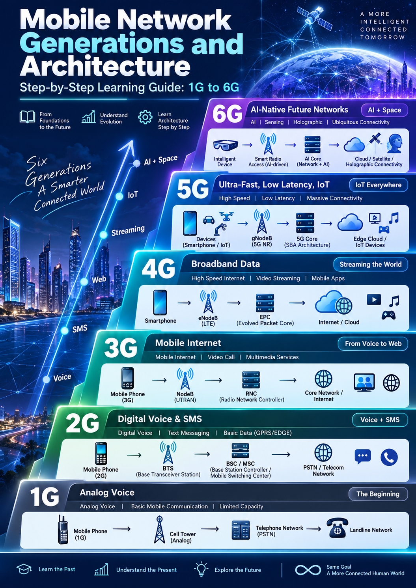

This infographic shows the learning path from **1G → 2G → 3G → 4G → 5G → 6G**, highlighting the evolution from **voice communication** to **AI-native and space-connected networks**.

---

> **Diagram tip:** GitHub renders `mermaid` code blocks as flowcharts. In VS Code, use a Mermaid-capable Markdown preview extension if your built-in preview displays code instead of a diagram.

## Learning Objectives

By the end of this guide, you should be able to:

- Explain what **1G, 2G, 3G, 4G, 5G, and 6G** mean.
- Identify the **main components** in each generation.
- Describe the **role** of each component.
- Understand the **network architecture** for every mobile generation.
- Compare how mobile networks evolved from **analogue voice** to **cloud-native and AI-driven systems**.

---

## Basic Idea of Mobile Network Architecture

A mobile network usually has three broad parts:

1. **User Device / User Equipment (UE)**  
   The mobile phone, modem, tablet, IoT sensor, or any connected device.

2. **Radio Access Network (RAN)**  
   The radio towers and controllers that connect devices wirelessly.

3. **Core Network**  
   The central network that handles switching, routing, authentication, mobility, voice, and data services.

### Generic architecture


---

# 1G — First Generation

## Main Idea
**1G** was the first generation of mobile communication. It was designed mainly for **analogue voice calls**.

## Main Components
- **Mobile Phone (1G handset)**
- **Cell Tower / Base Station (Analogue)**
- **Telephone Network / Mobile Switching Network**
- **PSTN / Landline Network**

## Role of Each Component
- **Mobile Phone:** sends and receives analogue voice.
- **Cell Tower:** receives radio signals from the phone and forwards them into the network.
- **Telephone Network / Switching Network:** connects the call to another user.
- **PSTN:** allows calls to landline phones.

## 1G Architecture


## What 1G Did Well
- Introduced **wireless voice calling**.

## Limitations
- Analogue only
- Poor security
- Low capacity
- No SMS or internet

---

# 2G — Second Generation

## Main Idea
**2G** introduced **digital communication**, improving voice quality and enabling **SMS**. Later enhancements like **GPRS/EDGE** added basic mobile data.

## Main Components
- **Mobile Phone (2G)**
- **BTS (Base Transceiver Station)**
- **BSC (Base Station Controller)**
- **MSC (Mobile Switching Center)**
- **PSTN / Telecom Network**
- **SMS system**
- **GPRS/EDGE packet nodes** (in data-capable 2G networks)

## Role of Each Component
- **Mobile Phone:** communicates digitally with the network.
- **BTS:** handles radio communication with the phone.
- **BSC:** controls multiple BTS sites and manages radio resources.
- **MSC:** switches voice calls and supports mobility management.
- **PSTN / Telecom Network:** connects external calls.
- **SMS system:** handles text messages.
- **GPRS/EDGE nodes:** provide basic packet data service.

## 2G Architecture

### Voice path


### Basic data path

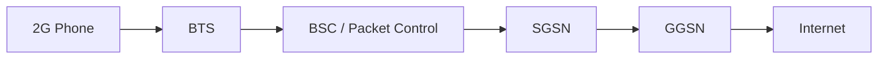

## Key Improvement Over 1G
- Digital voice
- SMS
- Better capacity and security

---

# 3G — Third Generation

## Main Idea
**3G** brought **mobile internet** into mainstream use. It supported web browsing, multimedia, email, and video calling.

## Main Components
- **Mobile Phone (3G)**
- **NodeB**
- **RNC (Radio Network Controller)**
- **Core Network**
- **Internet / Multimedia Services**

## Role of Each Component
- **Mobile Phone:** uses mobile internet and multimedia services.
- **NodeB:** acts as the 3G base station.
- **RNC:** controls NodeBs, radio resources, and handovers.
- **Core Network:** manages voice and data sessions.
- **Internet / Multimedia Services:** provide web and media connectivity.

## 3G Architecture


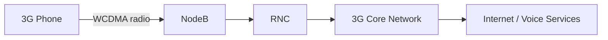

## Key Improvement Over 2G
- Faster mobile data
- Video calls
- Better support for multimedia and internet access

---

# 4G — Fourth Generation

## Main Idea
**4G** introduced **high-speed broadband data** and an **all-IP architecture**. It enabled streaming, mobile apps, online gaming, and better video experiences.

## Main Components
- **Smartphone**
- **eNodeB (LTE base station)**
- **EPC (Evolved Packet Core)**
- **Internet / Cloud**
- **IMS / VoLTE services** (in many deployments)

## Role of Each Component
- **Smartphone:** uses apps, streaming, and broadband services.
- **eNodeB:** provides LTE radio access and handles major base-station functions.
- **EPC:** manages mobility, session control, policy, and packet routing.
- **Internet / Cloud:** delivers online services and applications.
- **IMS / VoLTE:** enables voice over LTE in packet-based form.

## 4G Architecture


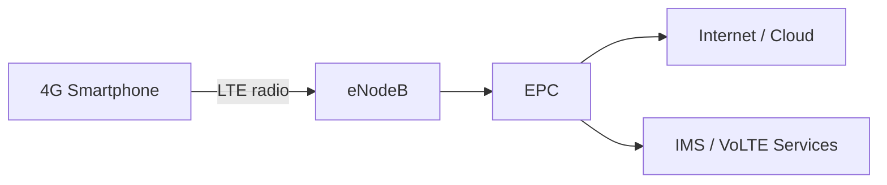

## Key Improvement Over 3G
- Much faster internet
- Better video streaming
- Mobile app ecosystem growth
- Lower latency than 3G

---

# 5G — Fifth Generation

## Main Idea
**5G** focuses on **ultra-fast speed**, **low latency**, and **massive connectivity** for smartphones, industry, and IoT.

## Main Components
- **Devices (Smartphone / IoT)**
- **gNodeB (5G NR)**
- **5G Core (5GC)**
- **Edge Cloud**
- **IoT / Enterprise / Cloud services**

## Role of Each Component
- **Devices:** include phones, sensors, vehicles, cameras, and industrial systems.
- **gNodeB:** provides 5G radio access.
- **5G Core:** manages sessions, policy, mobility, authentication, and service-based functions.
- **Edge Cloud:** processes data closer to the user for lower latency.
- **IoT / Enterprise / Cloud services:** consume the connectivity for real-time and large-scale applications.

## 5G Architecture


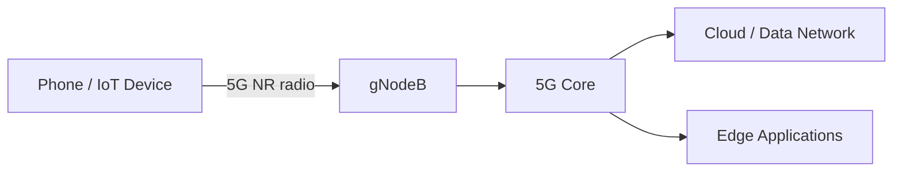

## Key Improvement Over 4G
- Higher throughput
- Lower latency
- Massive IoT support
- Network slicing and service flexibility

## 5G Modes
- **NSA (Non-Standalone):** 5G radio with some reliance on 4G core infrastructure.
- **SA (Standalone):** full 5G core and 5G radio architecture.

---

# 6G — Sixth Generation

## Main Idea
**6G** is expected to go beyond 5G with **AI-native networking**, **integrated sensing**, **holographic communication**, and **space-air-ground integration**.

## Main Components
- **Intelligent Device**
- **Smart Radio Access (AI-driven)**
- **AI Core (Network + AI)**
- **Cloud / Satellite / Holographic Connectivity**
- **Integrated sensing and communication systems**

## Role of Each Component
- **Intelligent Device:** future device with advanced sensing, AI, AR/VR, and immersive capabilities.
- **Smart Radio Access:** dynamically adapts radio resources using AI.
- **AI Core:** combines networking and intelligence for automated operation.
- **Cloud / Satellite / Holographic Connectivity:** extends coverage and supports rich future services.
- **Integrated sensing systems:** may allow communication and environmental sensing together.

## 6G Architecture (Conceptual)


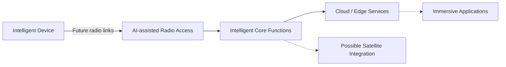

## Expected Improvement Over 5G
- More intelligence and automation
- Better integration with satellite and non-terrestrial networks
- Stronger support for immersive applications
- Ubiquitous connectivity

> **Important:** 6G is still under development, so this is a **learning model**, not a final standard deployment diagram.

---

# Quick Comparison Table

| Generation | Main Service | Main Components | Main Architecture Style |
|---|---|---|---|
| **1G** | Analogue voice | Mobile Phone, Cell Tower, PSTN | Analogue voice switching |
| **2G** | Digital voice + SMS | BTS, BSC, MSC | Digital circuit-switched with basic data extensions |
| **3G** | Mobile internet | NodeB, RNC, Core Network | Voice + packet data architecture |
| **4G** | Broadband data | eNodeB, EPC, IMS | All-IP mobile broadband |
| **5G** | High speed + low latency + IoT | gNodeB, 5G Core, Edge Cloud | Cloud-ready, service-based architecture |
| **6G** | AI-native future networks | Smart Radio Access, AI Core, Satellite/Cloud | Conceptual intelligent and integrated architecture |

---

# Evolution Summary

- **1G:** Voice
- **2G:** Voice + SMS
- **3G:** Web / Mobile Internet
- **4G:** Streaming / Mobile Apps
- **5G:** IoT / Low Latency / Massive Connectivity
- **6G:** AI + Space + Ubiquitous Intelligent Connectivity

---


---

# Mobile Network Technologies and Standards: 1G to 6G

## Learning Objectives

In this section, you will learn:

1. What FDMA, GSM, IS-95 CDMA, UMTS, WCDMA, CDMA2000, LTE, OFDMA, MIMO, and ISAC mean.
2. Which mobile generations use these technologies.
3. How each technology works.
4. The difference between network standards, multiple-access methods, and antenna technologies.
5. How radio communication evolved from 1G to 6G.

---

## 1. FDMA — Frequency Division Multiple Access

**Generation:** Mainly 1G  
**Category:** Multiple-access technique  
**Purpose:** Allow multiple users to share available radio spectrum.

### What is FDMA?

FDMA divides the available frequency spectrum into separate channels.

Different users are assigned different frequency channels, allowing them to communicate simultaneously.

### How FDMA Works

1. The mobile operator has an allocated frequency band.
2. The band is divided into smaller frequency channels.
3. Each active call is assigned a channel.
4. Users communicate on different frequencies.

### Example

- User A → Frequency Channel 1
- User B → Frequency Channel 2
- User C → Frequency Channel 3

### FDMA Architecture

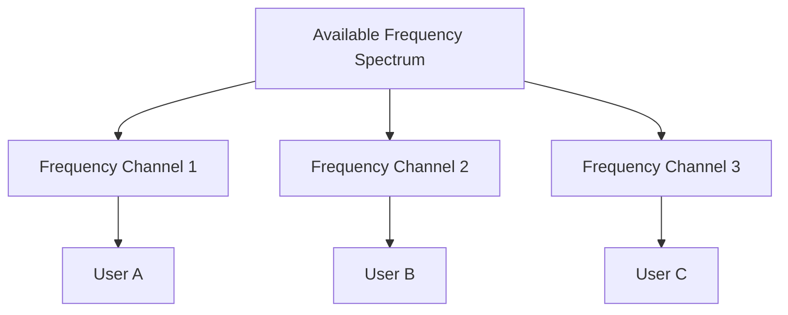

### Advantages

- Simple implementation
- Supports simultaneous calls on different channels

### Limitations

- Limited spectral efficiency
- Fixed channel allocation can waste capacity
- Requires separation between adjacent channels

---

## 2. GSM — Global System for Mobile Communications

**Generation:** 2G  
**Category:** Mobile network standard  
**Purpose:** Digital voice communication and SMS.

### What is GSM?

GSM is a digital cellular network standard that became widely used around the world.

It introduced digital voice services and SMS, with later enhancements supporting basic internet connectivity.

### Main Components

| Component | Full Form | Role |
|---|---|---|
| MS | Mobile Station | User's mobile phone and SIM |
| BTS | Base Transceiver Station | Radio communication |
| BSC | Base Station Controller | Controls multiple BTS sites |
| MSC | Mobile Switching Centre | Switches voice calls |
| HLR | Home Location Register | Stores subscriber records |
| VLR | Visitor Location Register | Holds temporary subscriber information |

### GSM Architecture

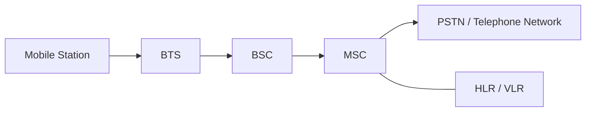

### How GSM Works

1. The mobile phone connects to a BTS.
2. The BTS forwards signals to the BSC.
3. The BSC manages radio resources.
4. The MSC handles call switching.
5. The telephone network connects the call.

### Key Features

- Digital voice
- SMS
- Subscriber authentication
- International roaming
- GPRS and EDGE extensions for data

---

## 3. IS-95 CDMA — Interim Standard 95

**Generation:** 2G  
**Other Name:** cdmaOne  
**Category:** Mobile network standard  
**Purpose:** Digital cellular communication using CDMA.

### What is IS-95?

IS-95 is a digital cellular standard based on Code Division Multiple Access.

Unlike FDMA, CDMA allows multiple users to share the same frequency band using different spreading codes.

### How CDMA Works

1. Multiple users share a radio frequency band.
2. Each user's signal is spread using a code.
3. The receiver uses the corresponding code to recover the intended signal.
4. Power control helps manage interference.

### Conceptual Diagram

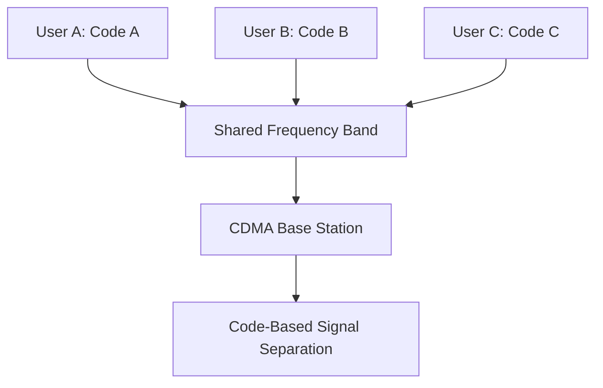

### Key Features

- Spread-spectrum communication
- Multiple users on a shared frequency band
- Power control
- Soft handoff support

---

## 4. UMTS — Universal Mobile Telecommunications System

**Generation:** 3G  
**Category:** Mobile network system  
**Purpose:** Mobile internet, multimedia, and digital voice.

### What is UMTS?

UMTS is a third-generation mobile communications system developed within the 3GPP standards family.

It supports voice, packet data, web browsing, email, and multimedia applications.

### Main Components

| Component | Role |
|---|---|
| UE | User Equipment |
| NodeB | 3G radio base station |
| RNC | Radio Network Controller |
| MSC | Circuit-switched voice services |
| SGSN | Packet mobility and session support |
| GGSN | Gateway to external packet networks |

### UMTS Architecture

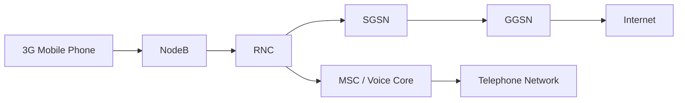

### How UMTS Works

1. The phone communicates with NodeB.
2. NodeB connects to the RNC.
3. The RNC controls radio resources.
4. The core network handles voice and data.
5. Users access telephone or internet services.

---

## 5. WCDMA — Wideband Code Division Multiple Access

**Generation:** 3G  
**Category:** Radio access technology  
**Purpose:** Support multiple users and higher data rates.

### What is WCDMA?

WCDMA is the main radio interface technology used by conventional UMTS networks.

It uses wideband channels and spreading codes to support simultaneous users.

### How WCDMA Works

1. Data is encoded and spread across a wideband radio channel.
2. Multiple users can transmit using different codes.
3. The receiver processes the appropriate code to recover data.
4. Radio resource and power control help maintain communication quality.

### Relationship Between UMTS and WCDMA

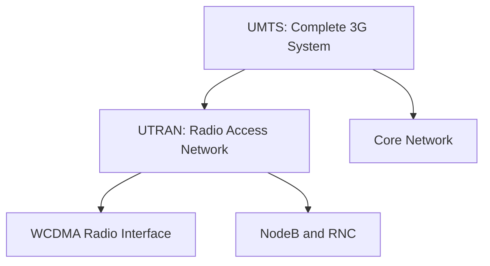

**Remember:** UMTS is the complete mobile system, while WCDMA is its radio access technology.

---

## 6. CDMA2000 — Code Division Multiple Access 2000

**Generation:** 3G  
**Category:** Mobile network standards family  
**Purpose:** Improved digital voice and mobile packet data.

### What is CDMA2000?

CDMA2000 is a 3G family of standards that evolved from IS-95.

It was an alternative evolution path to UMTS/WCDMA.

### Major Technologies

- **CDMA2000 1x:** Voice and packet data
- **EV-DO:** Higher-speed mobile packet data
- **Spread-spectrum CDMA:** Shared radio channels using spreading codes

### Simplified Architecture

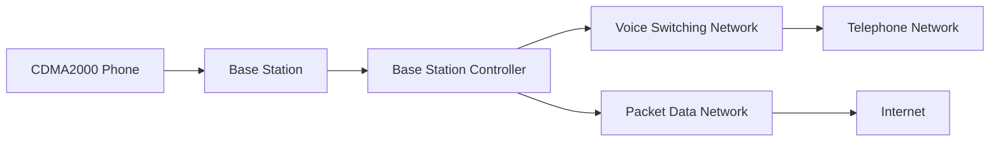

### Key Features

- Improved voice capacity
- Mobile internet access
- Packet data services
- Compatibility evolution from IS-95

---

## 7. LTE — Long Term Evolution

**Generation:** 4G  
**Category:** Mobile network technology  
**Purpose:** High-speed mobile broadband and all-IP communication.

### What is LTE?

LTE is a mobile communication technology developed by 3GPP.

It uses an all-IP packet core and efficient radio techniques to provide high-speed mobile connectivity.

### Main Components

| Component | Full Form | Role |
|---|---|---|
| UE | User Equipment | Mobile device |
| eNodeB | Evolved NodeB | LTE radio base station |
| MME | Mobility Management Entity | Control-plane mobility and signalling |
| SGW | Serving Gateway | User-data forwarding |
| PGW | Packet Data Network Gateway | External data-network connectivity |
| HSS | Home Subscriber Server | Subscriber information |
| IMS | IP Multimedia Subsystem | IP-based multimedia and voice services |

### LTE Architecture

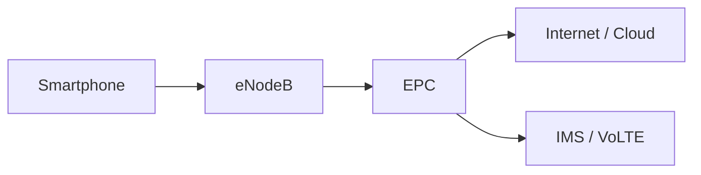

### How LTE Works

1. The smartphone connects to an eNodeB.
2. The eNodeB communicates with the EPC.
3. The EPC manages connectivity, mobility, and routing.
4. Data reaches the internet through the packet gateway.
5. Voice services can be provided through IMS/VoLTE.

### Key Technologies

- OFDMA downlink
- SC-FDMA uplink in conventional LTE
- MIMO
- All-IP packet network

---

## 8. OFDMA — Orthogonal Frequency Division Multiple Access

**Generation:** 4G and 5G  
**Category:** Multiple-access technique  
**Purpose:** Efficiently share radio resources among users.

### What is OFDMA?

OFDMA divides a radio channel into multiple orthogonal subcarriers.

Groups of subcarriers can be allocated to different users.

### How OFDMA Works

1. The frequency channel is divided into many subcarriers.
2. Orthogonal subcarriers are used to minimise mutual interference.
3. The base station assigns radio resources to different users.
4. Multiple users transmit or receive through allocated resources.

### OFDMA Diagram

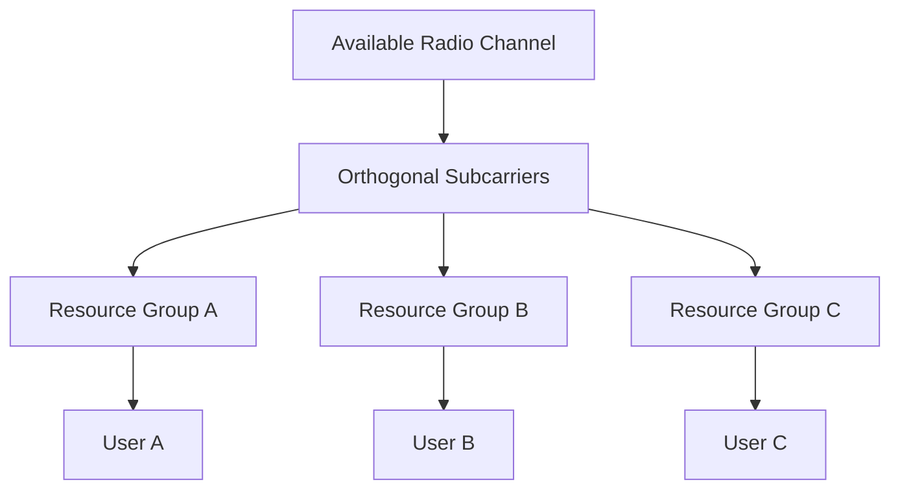

### Advantages

- Efficient spectrum usage
- Flexible resource scheduling
- Supports high data rates
- Suitable for broadband mobile systems

---

## 9. MIMO — Multiple Input Multiple Output

**Generation:** 4G and 5G  
**Category:** Antenna technology  
**Purpose:** Improve throughput, reliability, and radio performance.

### What is MIMO?

MIMO uses multiple transmitting and receiving antennas.

It can improve communication through spatial multiplexing, diversity, and beamforming techniques.

### Example: 4×4 MIMO

A 4×4 MIMO configuration uses:

- Four transmitting antennas
- Four receiving antennas

### MIMO Concept

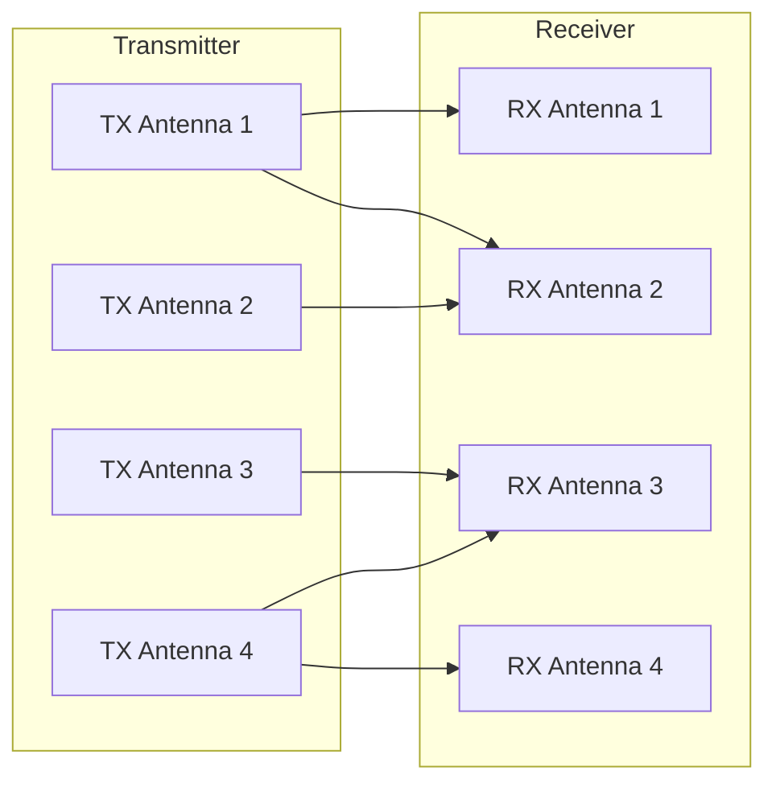

### Key Benefits

- Higher potential throughput
- Better link reliability
- Improved spectral efficiency
- Support for advanced beamforming

**Important:** The number of antennas does not always equal the number of independent data streams.

---

## 10. ISAC — Integrated Sensing and Communication

**Generation:** 6G research and future networks  
**Category:** Integrated radio technology  
**Purpose:** Combine wireless communication and environmental sensing.

### What is ISAC?

ISAC is a research area where wireless systems support both communication and sensing.

Future radio networks may exchange user data while also estimating information about nearby objects, movement, distance, or environments.

### How ISAC Could Work

1. A radio system transmits wireless signals.
2. Devices receive signals for communication.
3. The system also analyses radio propagation or reflections.
4. Signal processing estimates environmental information.
5. Communication and sensing functions can share resources.

### Conceptual ISAC Architecture

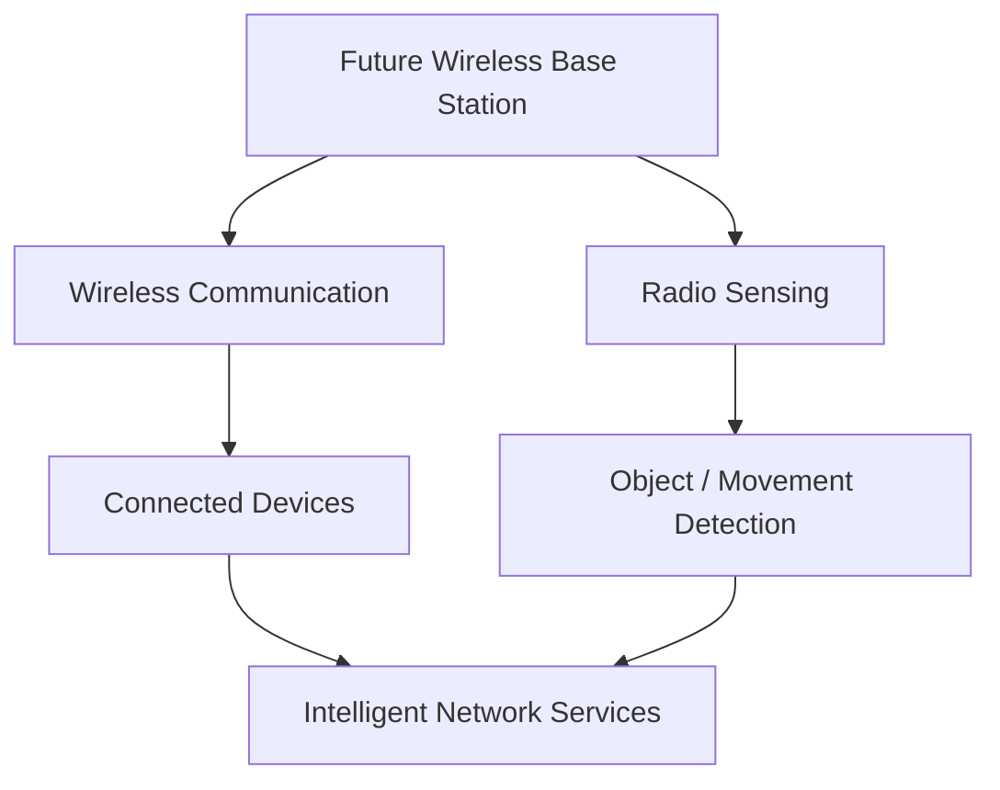

### Potential Applications

- Connected vehicles
- Smart cities
- Industrial automation
- Environmental monitoring
- Robotics
- Next-generation intelligent networks

**Note:** ISAC is an emerging research and standardisation topic. Specific capabilities and architectures are not finalised for 6G.

---

# Technology Comparison Table

| Technology | Full Form | Generation | Category | Main Purpose |
|---|---|---|---|---|
| FDMA | Frequency Division Multiple Access | 1G | Multiple access | Separate frequency channels |
| GSM | Global System for Mobile Communications | 2G | Mobile standard | Digital voice and SMS |
| IS-95 CDMA | Interim Standard 95 | 2G | Mobile standard | Code-based digital access |
| UMTS | Universal Mobile Telecommunications System | 3G | Mobile system | Mobile internet and multimedia |
| WCDMA | Wideband Code Division Multiple Access | 3G | Radio technology | Wideband code-based communication |
| CDMA2000 | Code Division Multiple Access 2000 | 3G | Standards family | Voice and mobile data |
| LTE | Long Term Evolution | 4G | Mobile technology | High-speed all-IP mobile broadband |
| OFDMA | Orthogonal Frequency Division Multiple Access | 4G / 5G | Multiple access | Flexible subcarrier allocation |
| MIMO | Multiple Input Multiple Output | 4G / 5G | Antenna technology | Higher throughput and reliability |
| ISAC | Integrated Sensing and Communication | 6G research | Integrated technology | Communication and radio sensing |

---

# Technology Evolution: 1G to 6G

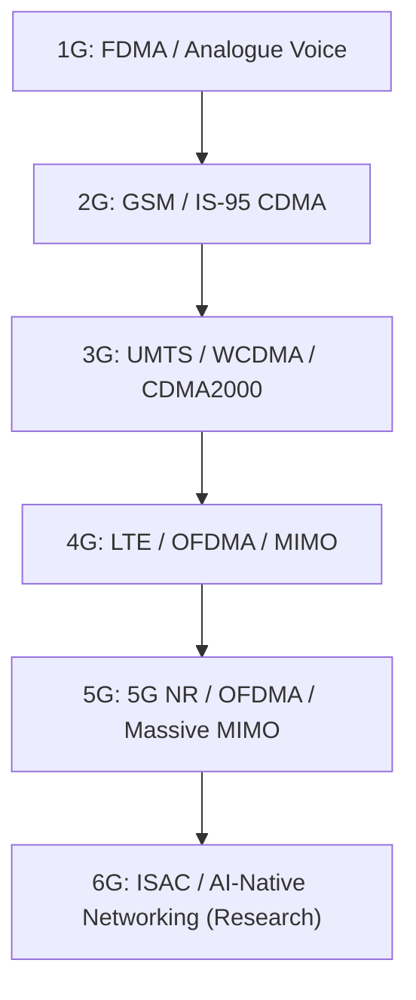

# Mobile Telecommunications Standards

## 1. Introduction

Mobile telecommunications standards are technical specifications and agreed rules that define how mobile devices, base stations, core networks, and other telecommunications systems communicate.

Standards make it possible for network equipment and mobile devices from different manufacturers to work together.

### Why Are Standards Important?

1. **Interoperability:** Devices from different manufacturers can communicate.
2. **Compatibility:** Mobile equipment can operate on supported networks.
3. **Roaming:** Users can access compatible networks in other countries.
4. **Security:** Standards specify authentication and security mechanisms.
5. **Network Performance:** Standards define radio interfaces, protocols, and network functions.
6. **Global Development:** Manufacturers and operators can build interoperable systems.

### Basic Concept


---

## 2. Telecommunications Standardisation Organisations

Different organisations contribute to mobile telecommunications standards.

### Main Organisations

| Organisation | Full Name | Main Responsibility |
|---|---|---|
| ITU | International Telecommunication Union | Global telecom coordination and IMT frameworks |
| 3GPP | 3rd Generation Partnership Project | GSM evolution, UMTS, LTE, 5G and ongoing specifications |
| ETSI | European Telecommunications Standards Institute | European ICT and telecom standards |
| IEEE | Institute of Electrical and Electronics Engineers | Networking standards including Wi-Fi |
| 3GPP2 | 3rd Generation Partnership Project 2 | Historical CDMA2000 specifications |
| IETF | Internet Engineering Task Force | Internet protocols such as IP, TCP and related technologies |

### How Standards Are Developed

```mermaid
flowchart TD
    A["Industry Requirements"]
    B["Research and Technical Proposals"]
    C["Standards Development"]
    D["Technical Specifications"]
    E["Equipment Implementation"]
    F["Testing and Interoperability"]
    G["Commercial Deployment"]

    A --> B
    B --> C
    C --> D
    D --> E
    E --> F
    F --> G
```

### Understanding ITU and 3GPP

**ITU** establishes international frameworks and requirements for mobile telecommunications.

Examples:

- IMT-2000: Third-generation mobile systems
- IMT-Advanced: Advanced fourth-generation mobile systems
- IMT-2020: Fifth-generation mobile systems
- IMT-2030: Framework for future sixth-generation systems

**3GPP** develops detailed technical specifications for mobile networks.

Examples:

- GSM and GPRS/EDGE specifications
- UMTS and HSPA
- LTE and LTE-Advanced
- 5G NR and 5G Core
- Ongoing mobile-network evolution

**Important:** ITU defines broad international IMT frameworks, while 3GPP produces many of the detailed cellular technical specifications.

---

## 3. Mobile Telecommunications Standards by Generation

| Generation | Important Standards | Radio Technologies | Main Services |
|---|---|---|---|
| 1G | AMPS, NMT, TACS | Analogue FM, FDMA | Analogue voice |
| 2G | GSM, IS-95, IS-136 | TDMA, CDMA | Digital voice and SMS |
| 2.5G / 2.75G | GPRS, EDGE | Packet-data enhancements | Basic mobile internet |
| 3G | UMTS, CDMA2000 | WCDMA, CDMA | Mobile internet and multimedia |
| 3G Enhancements | HSPA, HSPA+, EV-DO | Enhanced packet radio | Faster mobile data |
| 4G | LTE, LTE-Advanced | OFDMA, SC-FDMA, MIMO | Mobile broadband |
| 5G | 5G NR, 5G Core | OFDM-based radio, Massive MIMO | Broadband, IoT, low-latency services |
| 6G | IMT-2030 framework; standards under development | Advanced radio, AI and sensing research | Future intelligent connectivity |

---

# 4. First Generation (1G) Standards

## 4.1 AMPS — Advanced Mobile Phone System

**Generation:** 1G  
**Type:** Analogue cellular standard  
**Main Market:** Initially North America

### What Is AMPS?

AMPS was an early analogue cellular telephone system.

It used frequency-division multiple access and supported voice calls.

### Main Components

| Component | Role |
|---|---|
| Mobile Station | User's analogue mobile phone |
| Base Station | Radio communication with the phone |
| Mobile Switching Centre | Call switching and mobility support |
| PSTN | Connection to telephone networks |

### AMPS Architecture

```mermaid
flowchart LR
    A["Mobile Phone"]
    B["Analogue Base Station"]
    C["Mobile Switching Centre"]
    D["PSTN"]

    A <-->|"Analogue Radio"| B
    B <--> C
    C <--> D
```

### Key Technologies

- Analogue frequency modulation
- FDMA
- Circuit-switched voice communication

---

## 4.2 NMT — Nordic Mobile Telephone

**Generation:** 1G

NMT was an analogue cellular system introduced in Nordic countries.

### Features

- Analogue voice calls
- Cellular coverage and roaming
- Frequency-based channel allocation

---

## 4.3 TACS — Total Access Communication System

**Generation:** 1G

TACS was an analogue mobile telephone standard derived from AMPS and used in several markets, including the United Kingdom.

### Features

- Analogue voice
- FDMA
- Cellular handover
- Circuit-switched communication

---

# 5. Second Generation (2G) Standards

## 5.1 GSM — Global System for Mobile Communications

**Generation:** 2G  
**Standard Family:** GSM  
**Main Technology:** FDMA and TDMA

### What Is GSM?

GSM is a digital cellular communication standard.

It supports:

- Digital voice calls
- SMS
- Subscriber authentication
- International roaming
- Basic data services through extensions

### Main Components

| Component | Full Form | Role |
|---|---|---|
| MS | Mobile Station | User's device |
| BTS | Base Transceiver Station | Radio transmission |
| BSC | Base Station Controller | Radio resource management |
| MSC | Mobile Switching Centre | Voice call switching |
| HLR | Home Location Register | Subscriber database |
| VLR | Visitor Location Register | Temporary subscriber information |
| AuC | Authentication Centre | Authentication support |

### GSM Architecture

```mermaid
flowchart LR
    A["Mobile Station"]
    B["BTS"]
    C["BSC"]
    D["MSC"]
    E["PSTN"]
    F["HLR / VLR / AuC"]

    A <-->|"Radio Interface"| B
    B <--> C
    C <--> D
    D <--> E
    D <--> F
```

### How GSM Works

1. The phone connects to a BTS.
2. BTS transfers signalling and user traffic to BSC.
3. BSC manages the radio resources.
4. MSC controls circuit-switched calls.
5. Subscriber databases support authentication and mobility.
6. Calls connect to internal or external telephone networks.

---

## 5.2 IS-95 — Interim Standard 95

**Generation:** 2G  
**Also Known As:** cdmaOne  
**Technology:** CDMA

IS-95 uses code division multiple access to support multiple users within a shared frequency band.

### Main Features

- Digital voice
- Spread-spectrum radio communication
- Power control
- Soft handoff support

### IS-95 Architecture

```mermaid
flowchart LR
    A["CDMA Mobile Phone"]
    B["Base Station"]
    C["Base Station Controller"]
    D["Mobile Switching Centre"]
    E["Telephone Network"]

    A <--> B
    B <--> C
    C <--> D
    D <--> E
```

---

## 5.3 GPRS — General Packet Radio Service

**Generation:** 2G enhancement  
**Purpose:** Packet-switched mobile data

GPRS added packet-based internet connectivity to GSM networks.

### Main Components

- BTS
- BSC / PCU
- SGSN
- GGSN

### GPRS Architecture

```mermaid
flowchart LR
    A["GPRS Phone"]
    B["BTS"]
    C["BSC / PCU"]
    D["SGSN"]
    E["GGSN"]
    F["Internet"]

    A --> B
    B --> C
    C --> D
    D --> E
    E --> F
```

### Component Roles

| Component | Role |
|---|---|
| PCU | Packet Control Unit: handles packet-radio resource functions |
| SGSN | Serving GPRS Support Node: packet mobility and session support |
| GGSN | Gateway GPRS Support Node: external packet-network connectivity |

---

## 5.4 EDGE — Enhanced Data Rates for GSM Evolution

**Generation:** 2G enhancement

EDGE improved data performance through more efficient radio modulation and coding.

### Main Features

- Faster packet data than basic GPRS
- Improved spectral efficiency
- Continued use of evolved GSM infrastructure

---

# 6. Third Generation (3G) Standards

## 6.1 UMTS — Universal Mobile Telecommunications System

**Generation:** 3G  
**Standardisation:** 3GPP  
**Radio Technology:** WCDMA

UMTS supports mobile internet, voice communication, multimedia, and video calls.

### UMTS Architecture

```mermaid
flowchart LR
    A["3G User Equipment"]
    B["NodeB"]
    C["RNC"]
    D["Core Network"]
    E["Internet / PSTN"]

    A <--> B
    B <--> C
    C <--> D
    D <--> E
```

### Main Components

| Component | Role |
|---|---|
| UE | User Equipment |
| NodeB | 3G radio base station |
| RNC | Radio resource management |
| MSC | Circuit-switched voice support |
| SGSN | Packet data mobility management |
| GGSN | Gateway to external data networks |

---

## 6.2 WCDMA — Wideband Code Division Multiple Access

**Generation:** 3G  
**Category:** Radio interface technology

WCDMA is the main radio access technology used by conventional UMTS systems.

### Characteristics

- Wideband spread-spectrum radio interface
- Code-based user separation
- Power control
- Voice and packet data support

---

## 6.3 CDMA2000

**Generation:** 3G  
**Standards Organisation:** Historically 3GPP2

CDMA2000 evolved from IS-95.

### Main Variants

- CDMA2000 1x
- CDMA2000 EV-DO

### Main Services

- Digital voice
- Packet-based mobile data
- Mobile internet

---

## 6.4 HSPA — High Speed Packet Access

**Generation:** 3G enhancement

HSPA improved the packet-data capabilities of UMTS networks.

### Main Technologies

- HSDPA: High Speed Downlink Packet Access
- HSUPA: High Speed Uplink Packet Access
- HSPA+: Evolved High Speed Packet Access

### Purpose

Increase mobile-data performance without replacing the entire UMTS network architecture.

---

# 7. Fourth Generation (4G) Standards

## 7.1 LTE — Long Term Evolution

**Generation:** 4G-era mobile technology  
**Standards Organisation:** 3GPP

LTE was developed for high-speed, packet-based mobile communication.

### LTE Main Components

| Component | Full Form | Role |
|---|---|---|
| UE | User Equipment | User device |
| eNodeB | Evolved NodeB | LTE base station |
| MME | Mobility Management Entity | Control-plane mobility |
| SGW | Serving Gateway | User-plane packet forwarding |
| PGW | Packet Data Network Gateway | External packet-network access |
| HSS | Home Subscriber Server | Subscriber information |

### LTE Architecture

```mermaid
flowchart LR
    A["UE"]
    B["eNodeB"]
    C["MME"]
    D["SGW"]
    E["PGW"]
    F["Internet"]

    A <-->|"LTE Radio"| B
    B -.->|"Control Plane"| C
    B -->|"User Plane"| D
    D --> E
    E --> F
```

### Key Technologies

- OFDMA downlink
- SC-FDMA uplink
- MIMO
- Packet-based EPC architecture

---

## 7.2 LTE-Advanced

**Generation:** 4G  
**Standardisation:** 3GPP

LTE-Advanced enhanced LTE performance and supported capabilities aligned with IMT-Advanced requirements.

### Main Technologies

- Carrier aggregation
- Higher-order MIMO
- Improved radio resource management
- Enhanced spectral efficiency

### What Is Carrier Aggregation?

Carrier aggregation combines multiple component carriers to increase available bandwidth.

```mermaid
flowchart LR
    A["Carrier 1"]
    B["Carrier 2"]
    C["Carrier 3"]
    D["Aggregated Radio Capacity"]
    E["Higher Potential Throughput"]

    A --> D
    B --> D
    C --> D
    D --> E
```

---

# 8. Fifth Generation (5G) Standards

## 8.1 5G NR — Fifth Generation New Radio

**Generation:** 5G  
**Standards Organisation:** 3GPP

5G NR defines the radio access technology used by 5G networks.

### Main Features

- Flexible OFDM-based numerology
- Massive MIMO
- Beamforming
- Enhanced mobile broadband
- Support for low-latency and large-scale IoT scenarios

---

## 8.2 5G Core (5GC)

The 5G Core introduces a service-based architecture for control-plane network functions.

### Important Components

| Component | Full Form | Main Role |
|---|---|---|
| AMF | Access and Mobility Management Function | Registration and mobility |
| SMF | Session Management Function | Session management |
| UPF | User Plane Function | User-data forwarding |
| AUSF | Authentication Server Function | Authentication |
| UDM | Unified Data Management | Subscriber data management |
| PCF | Policy Control Function | Network policies |
| NRF | Network Repository Function | Network-function discovery |

### Simplified 5G Standalone Architecture

```mermaid
flowchart LR
    A["UE"]
    B["gNodeB"]
    C["AMF"]
    D["SMF"]
    E["UPF"]
    F["Internet / Data Network"]
    G["AUSF / UDM / PCF / NRF"]

    A <-->|"5G NR"| B
    B -.->|"Control Plane"| C
    C -.-> D
    C -.-> G
    D -.->|"Controls"| E
    B -->|"User Plane"| E
    E --> F
```

**Note:** This is a simplified learning diagram. Actual 5G Core architecture contains additional interfaces and network functions.

---

## 8.3 5G NSA and SA

### NSA — Non-Standalone

- Uses 5G radio with existing LTE infrastructure.
- Common early deployment approach.
- Often relies on the EPC.

### SA — Standalone

- Uses 5G NR and 5G Core.
- Supports a fuller set of 5G architecture capabilities.
- Enables flexible network slicing and cloud-native deployment approaches.

---

## 8.4 5G-Advanced

**Standards Evolution:** 3GPP Release 18 and later

5G-Advanced introduces further improvements to 5G systems.

### Areas of Development

- AI/ML-supported network optimisation
- Enhanced MIMO
- Improved energy efficiency
- Extended support for non-terrestrial networks
- Advanced positioning and radio performance

---

# 9. Sixth Generation (6G) Standards

## 9.1 IMT-2030

**Generation:** 6G framework  
**Organisation:** ITU-R

IMT-2030 provides a framework for future sixth-generation mobile systems.

As of October 2026, detailed 6G technologies and system specifications are still under development.

### Research Areas

- AI-assisted and AI-native networks
- Integrated Sensing and Communication (ISAC)
- Non-Terrestrial Networks (NTN)
- Advanced antenna systems
- Future radio spectrum technologies
- Immersive connectivity
- Energy-efficient communication

---

## 9.2 Conceptual 6G Architecture

```mermaid
flowchart LR
    A["Intelligent Devices"]
    B["Advanced Radio Access"]
    C["AI-Assisted Network Functions"]
    D["Cloud / Edge Services"]
    E["Non-Terrestrial Networks"]
    F["Integrated Sensing"]

    A <--> B
    B <--> C
    C <--> D
    C <--> E
    B <--> F
```

**Important:** This is a conceptual architecture for learning, not a completed 6G standard.

---

# 10. Mobile Network Standards Evolution

```mermaid
flowchart TD
    A["1G: AMPS / NMT / TACS"]
    B["2G: GSM / IS-95"]
    C["2G Enhancements: GPRS / EDGE"]
    D["3G: UMTS / CDMA2000"]
    E["3G Enhancements: HSPA / EV-DO"]
    F["4G: LTE / LTE-Advanced"]
    G["5G: 5G NR / 5G Core"]
    H["5G-Advanced"]
    I["6G: IMT-2030 / Research"]

    A --> B
    B --> C
    C --> D
    D --> E
    E --> F
    F --> G
    G --> H
    H --> I
```


---

# Mobile Telecommunications Standards

## 1. Introduction

Mobile telecommunications standards are technical specifications and agreed rules that define how mobile devices, base stations, core networks, and other telecommunications systems communicate.

Standards make it possible for network equipment and mobile devices from different manufacturers to work together.

### Why Are Standards Important?

1. **Interoperability:** Devices from different manufacturers can communicate.
2. **Compatibility:** Mobile equipment can operate on supported networks.
3. **Roaming:** Users can access compatible networks in other countries.
4. **Security:** Standards specify authentication and security mechanisms.
5. **Network Performance:** Standards define radio interfaces, protocols, and network functions.
6. **Global Development:** Manufacturers and operators can build interoperable systems.

### Basic Concept

```mermaid
flowchart LR
    A["Mobile Device"]
    B["Radio Access Network"]
    C["Core Network"]
    D["Internet / Telephone Network"]

    A <-->|"Standard Radio Protocols"| B
    B <-->|"Standard Interfaces"| C
    C <-->|"Interconnection Protocols"| D
```

---

## 2. Telecommunications Standardisation Organisations

Different organisations contribute to mobile telecommunications standards.

### Main Organisations

| Organisation | Full Name | Main Responsibility |
|---|---|---|
| ITU | International Telecommunication Union | Global telecom coordination and IMT frameworks |
| 3GPP | 3rd Generation Partnership Project | GSM evolution, UMTS, LTE, 5G and ongoing specifications |
| ETSI | European Telecommunications Standards Institute | European ICT and telecom standards |
| IEEE | Institute of Electrical and Electronics Engineers | Networking standards including Wi-Fi |
| 3GPP2 | 3rd Generation Partnership Project 2 | Historical CDMA2000 specifications |
| IETF | Internet Engineering Task Force | Internet protocols such as IP, TCP and related technologies |

### How Standards Are Developed

```mermaid
flowchart TD
    A["Industry Requirements"]
    B["Research and Technical Proposals"]
    C["Standards Development"]
    D["Technical Specifications"]
    E["Equipment Implementation"]
    F["Testing and Interoperability"]
    G["Commercial Deployment"]

    A --> B
    B --> C
    C --> D
    D --> E
    E --> F
    F --> G
```

### Understanding ITU and 3GPP

**ITU** establishes international frameworks and requirements for mobile telecommunications.

Examples:

- IMT-2000: Third-generation mobile systems
- IMT-Advanced: Advanced fourth-generation mobile systems
- IMT-2020: Fifth-generation mobile systems
- IMT-2030: Framework for future sixth-generation systems

**3GPP** develops detailed technical specifications for mobile networks.

Examples:

- GSM and GPRS/EDGE specifications
- UMTS and HSPA
- LTE and LTE-Advanced
- 5G NR and 5G Core
- Ongoing mobile-network evolution

**Important:** ITU defines broad international IMT frameworks, while 3GPP produces many of the detailed cellular technical specifications.

---

## 3. Mobile Telecommunications Standards by Generation

| Generation | Important Standards | Radio Technologies | Main Services |
|---|---|---|---|
| 1G | AMPS, NMT, TACS | Analogue FM, FDMA | Analogue voice |
| 2G | GSM, IS-95, IS-136 | TDMA, CDMA | Digital voice and SMS |
| 2.5G / 2.75G | GPRS, EDGE | Packet-data enhancements | Basic mobile internet |
| 3G | UMTS, CDMA2000 | WCDMA, CDMA | Mobile internet and multimedia |
| 3G Enhancements | HSPA, HSPA+, EV-DO | Enhanced packet radio | Faster mobile data |
| 4G | LTE, LTE-Advanced | OFDMA, SC-FDMA, MIMO | Mobile broadband |
| 5G | 5G NR, 5G Core | OFDM-based radio, Massive MIMO | Broadband, IoT, low-latency services |
| 6G | IMT-2030 framework; standards under development | Advanced radio, AI and sensing research | Future intelligent connectivity |

---

# 4. First Generation (1G) Standards

## 4.1 AMPS — Advanced Mobile Phone System

**Generation:** 1G  
**Type:** Analogue cellular standard  
**Main Market:** Initially North America

### What Is AMPS?

AMPS was an early analogue cellular telephone system.

It used frequency-division multiple access and supported voice calls.

### Main Components

| Component | Role |
|---|---|
| Mobile Station | User's analogue mobile phone |
| Base Station | Radio communication with the phone |
| Mobile Switching Centre | Call switching and mobility support |
| PSTN | Connection to telephone networks |

### AMPS Architecture

```mermaid
flowchart LR
    A["Mobile Phone"]
    B["Analogue Base Station"]
    C["Mobile Switching Centre"]
    D["PSTN"]

    A <-->|"Analogue Radio"| B
    B <--> C
    C <--> D
```

### Key Technologies

- Analogue frequency modulation
- FDMA
- Circuit-switched voice communication

---

## 4.2 NMT — Nordic Mobile Telephone

**Generation:** 1G

NMT was an analogue cellular system introduced in Nordic countries.

### Features

- Analogue voice calls
- Cellular coverage and roaming
- Frequency-based channel allocation

---

## 4.3 TACS — Total Access Communication System

**Generation:** 1G

TACS was an analogue mobile telephone standard derived from AMPS and used in several markets, including the United Kingdom.

### Features

- Analogue voice
- FDMA
- Cellular handover
- Circuit-switched communication

---

# 5. Second Generation (2G) Standards

## 5.1 GSM — Global System for Mobile Communications

**Generation:** 2G  
**Standard Family:** GSM  
**Main Technology:** FDMA and TDMA

### What Is GSM?

GSM is a digital cellular communication standard.

It supports:

- Digital voice calls
- SMS
- Subscriber authentication
- International roaming
- Basic data services through extensions

### Main Components

| Component | Full Form | Role |
|---|---|---|
| MS | Mobile Station | User's device |
| BTS | Base Transceiver Station | Radio transmission |
| BSC | Base Station Controller | Radio resource management |
| MSC | Mobile Switching Centre | Voice call switching |
| HLR | Home Location Register | Subscriber database |
| VLR | Visitor Location Register | Temporary subscriber information |
| AuC | Authentication Centre | Authentication support |

### GSM Architecture

```mermaid
flowchart LR
    A["Mobile Station"]
    B["BTS"]
    C["BSC"]
    D["MSC"]
    E["PSTN"]
    F["HLR / VLR / AuC"]

    A <-->|"Radio Interface"| B
    B <--> C
    C <--> D
    D <--> E
    D <--> F
```

### How GSM Works

1. The phone connects to a BTS.
2. BTS transfers signalling and user traffic to BSC.
3. BSC manages the radio resources.
4. MSC controls circuit-switched calls.
5. Subscriber databases support authentication and mobility.
6. Calls connect to internal or external telephone networks.

---

## 5.2 IS-95 — Interim Standard 95

**Generation:** 2G  
**Also Known As:** cdmaOne  
**Technology:** CDMA

IS-95 uses code division multiple access to support multiple users within a shared frequency band.

### Main Features

- Digital voice
- Spread-spectrum radio communication
- Power control
- Soft handoff support

### IS-95 Architecture

```mermaid
flowchart LR
    A["CDMA Mobile Phone"]
    B["Base Station"]
    C["Base Station Controller"]
    D["Mobile Switching Centre"]
    E["Telephone Network"]

    A <--> B
    B <--> C
    C <--> D
    D <--> E
```

---

## 5.3 GPRS — General Packet Radio Service

**Generation:** 2G enhancement  
**Purpose:** Packet-switched mobile data

GPRS added packet-based internet connectivity to GSM networks.

### Main Components

- BTS
- BSC / PCU
- SGSN
- GGSN

### GPRS Architecture

```mermaid
flowchart LR
    A["GPRS Phone"]
    B["BTS"]
    C["BSC / PCU"]
    D["SGSN"]
    E["GGSN"]
    F["Internet"]

    A --> B
    B --> C
    C --> D
    D --> E
    E --> F
```

### Component Roles

| Component | Role |
|---|---|
| PCU | Packet Control Unit: handles packet-radio resource functions |
| SGSN | Serving GPRS Support Node: packet mobility and session support |
| GGSN | Gateway GPRS Support Node: external packet-network connectivity |

---

## 5.4 EDGE — Enhanced Data Rates for GSM Evolution

**Generation:** 2G enhancement

EDGE improved data performance through more efficient radio modulation and coding.

### Main Features

- Faster packet data than basic GPRS
- Improved spectral efficiency
- Continued use of evolved GSM infrastructure

---

# 6. Third Generation (3G) Standards

## 6.1 UMTS — Universal Mobile Telecommunications System

**Generation:** 3G  
**Standardisation:** 3GPP  
**Radio Technology:** WCDMA

UMTS supports mobile internet, voice communication, multimedia, and video calls.

### UMTS Architecture

```mermaid
flowchart LR
    A["3G User Equipment"]
    B["NodeB"]
    C["RNC"]
    D["Core Network"]
    E["Internet / PSTN"]

    A <--> B
    B <--> C
    C <--> D
    D <--> E
```

### Main Components

| Component | Role |
|---|---|
| UE | User Equipment |
| NodeB | 3G radio base station |
| RNC | Radio resource management |
| MSC | Circuit-switched voice support |
| SGSN | Packet data mobility management |
| GGSN | Gateway to external data networks |

---

## 6.2 WCDMA — Wideband Code Division Multiple Access

**Generation:** 3G  
**Category:** Radio interface technology

WCDMA is the main radio access technology used by conventional UMTS systems.

### Characteristics

- Wideband spread-spectrum radio interface
- Code-based user separation
- Power control
- Voice and packet data support

---

## 6.3 CDMA2000

**Generation:** 3G  
**Standards Organisation:** Historically 3GPP2

CDMA2000 evolved from IS-95.

### Main Variants

- CDMA2000 1x
- CDMA2000 EV-DO

### Main Services

- Digital voice
- Packet-based mobile data
- Mobile internet

---

## 6.4 HSPA — High Speed Packet Access

**Generation:** 3G enhancement

HSPA improved the packet-data capabilities of UMTS networks.

### Main Technologies

- HSDPA: High Speed Downlink Packet Access
- HSUPA: High Speed Uplink Packet Access
- HSPA+: Evolved High Speed Packet Access

### Purpose

Increase mobile-data performance without replacing the entire UMTS network architecture.

---

# 7. Fourth Generation (4G) Standards

## 7.1 LTE — Long Term Evolution

**Generation:** 4G-era mobile technology  
**Standards Organisation:** 3GPP

LTE was developed for high-speed, packet-based mobile communication.

### LTE Main Components

| Component | Full Form | Role |
|---|---|---|
| UE | User Equipment | User device |
| eNodeB | Evolved NodeB | LTE base station |
| MME | Mobility Management Entity | Control-plane mobility |
| SGW | Serving Gateway | User-plane packet forwarding |
| PGW | Packet Data Network Gateway | External packet-network access |
| HSS | Home Subscriber Server | Subscriber information |

### LTE Architecture

```mermaid
flowchart LR
    A["UE"]
    B["eNodeB"]
    C["MME"]
    D["SGW"]
    E["PGW"]
    F["Internet"]

    A <-->|"LTE Radio"| B
    B -.->|"Control Plane"| C
    B -->|"User Plane"| D
    D --> E
    E --> F
```

### Key Technologies

- OFDMA downlink
- SC-FDMA uplink
- MIMO
- Packet-based EPC architecture

---

## 7.2 LTE-Advanced

**Generation:** 4G  
**Standardisation:** 3GPP

LTE-Advanced enhanced LTE performance and supported capabilities aligned with IMT-Advanced requirements.

### Main Technologies

- Carrier aggregation
- Higher-order MIMO
- Improved radio resource management
- Enhanced spectral efficiency

### What Is Carrier Aggregation?

Carrier aggregation combines multiple component carriers to increase available bandwidth.

```mermaid
flowchart LR
    A["Carrier 1"]
    B["Carrier 2"]
    C["Carrier 3"]
    D["Aggregated Radio Capacity"]
    E["Higher Potential Throughput"]

    A --> D
    B --> D
    C --> D
    D --> E
```

---

# 8. Fifth Generation (5G) Standards

## 8.1 5G NR — Fifth Generation New Radio

**Generation:** 5G  
**Standards Organisation:** 3GPP

5G NR defines the radio access technology used by 5G networks.

### Main Features

- Flexible OFDM-based numerology
- Massive MIMO
- Beamforming
- Enhanced mobile broadband
- Support for low-latency and large-scale IoT scenarios

---

## 8.2 5G Core (5GC)

The 5G Core introduces a service-based architecture for control-plane network functions.

### Important Components

| Component | Full Form | Main Role |
|---|---|---|
| AMF | Access and Mobility Management Function | Registration and mobility |
| SMF | Session Management Function | Session management |
| UPF | User Plane Function | User-data forwarding |
| AUSF | Authentication Server Function | Authentication |
| UDM | Unified Data Management | Subscriber data management |
| PCF | Policy Control Function | Network policies |
| NRF | Network Repository Function | Network-function discovery |

### Simplified 5G Standalone Architecture

```mermaid
flowchart LR
    A["UE"]
    B["gNodeB"]
    C["AMF"]
    D["SMF"]
    E["UPF"]
    F["Internet / Data Network"]
    G["AUSF / UDM / PCF / NRF"]

    A <-->|"5G NR"| B
    B -.->|"Control Plane"| C
    C -.-> D
    C -.-> G
    D -.->|"Controls"| E
    B -->|"User Plane"| E
    E --> F
```

**Note:** This is a simplified learning diagram. Actual 5G Core architecture contains additional interfaces and network functions.

---

## 8.3 5G NSA and SA

### NSA — Non-Standalone

- Uses 5G radio with existing LTE infrastructure.
- Common early deployment approach.
- Often relies on the EPC.

### SA — Standalone

- Uses 5G NR and 5G Core.
- Supports a fuller set of 5G architecture capabilities.
- Enables flexible network slicing and cloud-native deployment approaches.

---

## 8.4 5G-Advanced

**Standards Evolution:** 3GPP Release 18 and later

5G-Advanced introduces further improvements to 5G systems.

### Areas of Development

- AI/ML-supported network optimisation
- Enhanced MIMO
- Improved energy efficiency
- Extended support for non-terrestrial networks
- Advanced positioning and radio performance

---

# 9. Sixth Generation (6G) Standards

## 9.1 IMT-2030

**Generation:** 6G framework  
**Organisation:** ITU-R

IMT-2030 provides a framework for future sixth-generation mobile systems.

As of October 2026, detailed 6G technologies and system specifications are still under development.

### Research Areas

- AI-assisted and AI-native networks
- Integrated Sensing and Communication (ISAC)
- Non-Terrestrial Networks (NTN)
- Advanced antenna systems
- Future radio spectrum technologies
- Immersive connectivity
- Energy-efficient communication

---

## 9.2 Conceptual 6G Architecture

```mermaid
flowchart LR
    A["Intelligent Devices"]
    B["Advanced Radio Access"]
    C["AI-Assisted Network Functions"]
    D["Cloud / Edge Services"]
    E["Non-Terrestrial Networks"]
    F["Integrated Sensing"]

    A <--> B
    B <--> C
    C <--> D
    C <--> E
    B <--> F
```

**Important:** This is a conceptual architecture for learning, not a completed 6G standard.

---

# 10. Mobile Network Standards Evolution

```mermaid
flowchart TD
    A["1G: AMPS / NMT / TACS"]
    B["2G: GSM / IS-95"]
    C["2G Enhancements: GPRS / EDGE"]
    D["3G: UMTS / CDMA2000"]
    E["3G Enhancements: HSPA / EV-DO"]
    F["4G: LTE / LTE-Advanced"]
    G["5G: 5G NR / 5G Core"]
    H["5G-Advanced"]
    I["6G: IMT-2030 / Research"]

    A --> B
    B --> C
    C --> D
    D --> E
    E --> F
    F --> G
    G --> H
    H --> I
```

This is a learning timeline of major standards families and enhancements, not a claim that every technology directly evolved from the previous one.


---

# Why Do We Need Mobile Communication Standards?

## 1. Introduction

Mobile communication standards are agreed technical rules, protocols, and specifications that allow mobile phones, base stations, core networks, and telecommunications equipment to communicate.

Standards are essential because mobile communication involves equipment from different manufacturers, mobile operators, and countries.

**The main purpose of mobile communication standards is to ensure compatibility, interoperability, security, reliability, and efficient wireless communication.**

### Simple Example

Imagine:

- You have a Samsung smartphone.
- Your friend has an Apple iPhone.
- You use one mobile network operator.
- Your friend uses another mobile network operator.

Even though your phones and mobile operators are different, you can still communicate because they use compatible telecommunications standards and interconnected networks.

---

## 2. What Would Happen Without Mobile Communication Standards?

Without common standards, mobile networks would face several problems.

### Main Problems

1. Devices from different manufacturers might not communicate.
2. Phones might work with only one manufacturer's equipment.
3. International roaming would become more difficult.
4. Network equipment would require proprietary integration.
5. Security mechanisms could be inconsistent.
6. Network expansion would become more expensive.
7. Different technologies could create compatibility problems.

### Without Standards

```mermaid
flowchart TD
    A["Mobile Communication Without Standards"]

    A --> B["Incompatible Devices"]
    A --> C["Limited Network Interoperability"]
    A --> D["Difficult International Roaming"]
    A --> E["Higher Deployment Costs"]
    A --> F["Inconsistent Security"]

    B --> G["Poor User Experience"]
    C --> G
    D --> G
    E --> G
    F --> G
```

### With Standards

```mermaid
flowchart TD
    A["Mobile Communication Standards"]

    A --> B["Device Compatibility"]
    A --> C["Network Interoperability"]
    A --> D["International Roaming"]
    A --> E["Common Security Procedures"]
    A --> F["Efficient Network Deployment"]

    B --> G["Reliable Mobile Communication"]
    C --> G
    D --> G
    E --> G
    F --> G
```

---

## 3. Main Reasons We Need Mobile Communication Standards

### 3.1 Interoperability

**Interoperability means different telecommunications systems can work together.**

Mobile networks use equipment from different manufacturers.

For example:

- Ericsson radio equipment
- Nokia network equipment
- Samsung smartphones
- Apple iPhones
- Qualcomm modems

Standards define common interfaces and protocols that allow compatible products to communicate.

#### Example Architecture

```mermaid
flowchart LR
    A["Mobile Device"]
    B["Base Station"]
    C["Core Network"]
    D["External Network"]

    A <-->|"Standard Radio Interface"| B
    B <-->|"Standard Network Interface"| C
    C <-->|"Interconnection Protocols"| D
```

**Why is this important?**

Mobile operators can integrate equipment from multiple manufacturers rather than being completely dependent on one supplier.

---

### 3.2 Device Compatibility

Standards allow compatible mobile devices to connect to mobile networks.

For example, a smartphone supporting the required LTE frequency bands and network features can connect to a compatible LTE network.

#### How It Works

1. The mobile device supports a cellular standard.
2. The base station supports the corresponding radio technology.
3. The device detects a compatible network.
4. The device follows standard access and authentication procedures.
5. The network establishes communication.

**Important:** Supporting the same generation does not automatically guarantee compatibility. Frequency bands, device capabilities, operator policies, and provisioning must also match.

---

### 3.3 International Roaming

International roaming allows mobile subscribers to use compatible mobile networks when travelling abroad.

Standards define procedures that help networks identify, authenticate, and serve roaming subscribers.

#### Simplified Roaming Architecture

```mermaid
flowchart LR
    A["Mobile Phone Abroad"]
    B["Visited Mobile Network"]
    C["Roaming Interconnection"]
    D["Home Mobile Network"]

    A <-->|"Radio Connection"| B
    B <-->|"Roaming Signalling"| C
    C <-->|"Subscriber Authentication and Services"| D
```

#### Example

1. You travel from Ireland to France.
2. Your phone detects a compatible French mobile network.
3. The visited operator exchanges necessary signalling with your home network.
4. Your subscription and roaming permissions are checked.
5. Your phone can use authorised roaming services.

**Note:** Roaming also requires commercial agreements, suitable network support, and appropriate subscriber permissions.

---

### 3.4 Security and Authentication

Mobile communication standards specify security procedures to help protect users and network infrastructure.

#### Main Security Functions

| Security Function | Purpose |
|---|---|
| Authentication | Verify subscriber or network credentials |
| Encryption | Help protect information transmitted over the radio interface |
| Integrity Protection | Detect unauthorised modification of protected signalling |
| Key Management | Establish and manage security keys |
| Subscriber Identity Protection | Reduce unnecessary exposure of subscriber identity |

#### Simplified Security Process

```mermaid
flowchart TD
    A["Mobile Device Requests Access"]
    B["Network Authentication Procedure"]
    C{"Authentication Successful?"}
    D["Establish Security Context"]
    E["Authorised Network Services"]
    F["Access Rejected"]

    A --> B
    B --> C
    C -->|"Yes"| D
    D --> E
    C -->|"No"| F
```

**Why is this important?**

Standards provide a consistent foundation for implementing security across compatible telecommunications equipment.

However, standards alone do not guarantee complete security. Correct implementation, configuration, updates, and operational controls are also necessary.

---

### 3.5 Efficient Use of Radio Spectrum

Radio spectrum is a limited resource.

Mobile standards define radio transmission methods that help operators use allocated spectrum effectively.

#### Examples

| Technology | Spectrum Access Method |
|---|---|
| 1G | FDMA |
| GSM | FDMA and TDMA |
| IS-95 | CDMA |
| UMTS / WCDMA | Wideband CDMA |
| LTE | OFDMA downlink, SC-FDMA uplink |
| 5G NR | OFDM-based radio with flexible resource allocation |

#### Why Does Spectrum Efficiency Matter?

- Supports more users.
- Improves network capacity.
- Enables higher data rates.
- Reduces unnecessary interference through coordinated radio design.
- Helps operators use licensed frequencies effectively.

---

### 3.6 Reliable Communication and Mobility

Mobile users move between different coverage areas.

Standards define procedures that help networks manage mobility, including handovers.

#### Handover Example

```mermaid
flowchart LR
    A["Mobile Phone"]
    B["Serving Cell Tower"]
    C["Target Cell Tower"]
    D["Core Network"]

    A <-->|"Current Connection"| B
    B <-->|"Handover Coordination"| C
    C <-->|"New Radio Connection"| A
    B --- D
    C --- D
```

#### How Handover Works

1. The phone communicates with a serving cell.
2. The phone or network measures radio conditions.
3. The network determines whether a handover is needed.
4. The connection moves to a suitable target cell.
5. Communication continues, ideally with minimal interruption.

The exact handover procedure depends on the cellular generation and radio technology.

---

### 3.7 Lower Costs and Global Innovation

Standards reduce the need for every company to invent completely separate communication protocols.

#### Main Benefits

- Shared technical specifications
- Larger markets for compatible equipment
- Multi-vendor equipment sourcing
- Easier technology development
- More scalable network deployment
- Wider competition and innovation

For example, manufacturers can develop devices based on widely adopted 3GPP specifications rather than producing entirely different products for every operator.

---

## 4. Who Creates Mobile Communication Standards?

Mobile communication standards are developed and coordinated by several organisations.

| Organisation | Responsibility |
|---|---|
| ITU | International telecommunications coordination and IMT frameworks |
| 3GPP | Detailed specifications for GSM evolution, UMTS, LTE, and 5G |
| ETSI | European telecommunications and ICT standards |
| IEEE | Networking and wireless technologies such as Wi-Fi |
| IETF | Internet protocols used by telecommunications networks |
| 3GPP2 | Historical development of CDMA2000 specifications |

### Relationship Between Standards Organisations

```mermaid
flowchart TD
    A["Telecommunications Industry Requirements"]

    A --> B["ITU: Global IMT Frameworks"]
    A --> C["3GPP: Cellular Specifications"]
    A --> D["Other Standards Organisations"]

    C --> E["Radio Access Standards"]
    C --> F["Core Network Specifications"]
    C --> G["Security and Protocol Specifications"]

    E --> H["Equipment Implementation"]
    F --> H
    G --> H

    H --> I["Testing and Deployment"]
```

---

## 5. Why Do Mobile Standards Change From 1G to 6G?

Mobile standards evolve because communication requirements change.

### Evolution of Requirements

| Generation | Main Requirement | Standards / Technologies |
|---|---|---|
| 1G | Mobile voice communication | AMPS, NMT, TACS |
| 2G | Digital voice and SMS | GSM, IS-95 |
| 3G | Mobile internet and multimedia | UMTS, CDMA2000 |
| 4G | High-speed mobile broadband | LTE, LTE-Advanced |
| 5G | Higher capacity, low latency, massive connectivity | 5G NR, 5G Core |
| 6G | Future intelligent and integrated connectivity | IMT-2030 and emerging research |

### Standards Evolution Diagram

```mermaid
flowchart TD
    A["1G: Wireless Voice"]
    B["2G: Digital Voice and SMS"]
    C["3G: Mobile Internet"]
    D["4G: High-Speed Broadband"]
    E["5G: Advanced Wireless Services"]
    F["6G: Intelligent Network Research"]

    A --> B
    B --> C
    C --> D
    D --> E
    E --> F
```

**Important:** The 6G stage represents future research and standardisation. It is not a completed commercial mobile-network generation.

---

## 6. Real-World Example: Making a Mobile Call

Imagine two people using phones from different manufacturers and different mobile operators.

### Communication Process

1. User A initiates a call.
2. The phone connects to a compatible radio network.
3. The network authenticates and authorises the subscriber.
4. Standardised signalling establishes the call.
5. Interconnected networks route the call.
6. User B receives the call.
7. Audio is exchanged through the established communication path.

### Simplified Architecture

```mermaid
flowchart LR
    A["User A Phone"]
    B["Operator A Radio Network"]
    C["Operator A Core"]
    D["Interconnection Network"]
    E["Operator B Core"]
    F["Operator B Radio Network"]
    G["User B Phone"]

    A <--> B
    B <--> C
    C <--> D
    D <--> E
    E <--> F
    F <--> G
```

The actual implementation depends on whether the call uses GSM, UMTS, VoLTE, VoNR, or another supported voice technology.

---

## 7. Summary: Main Benefits of Standards

| Benefit | Explanation |
|---|---|
| Interoperability | Compatible equipment can communicate across vendors |
| Device Compatibility | Supported devices can access compatible networks |
| International Roaming | Subscribers can use supported foreign networks |
| Security | Common authentication and security mechanisms |
| Spectrum Efficiency | More effective use of allocated radio resources |
| Reliability | Defined procedures for signalling, mobility, and communication |
| Scalability | Network operators can expand using common technologies |
| Innovation | Shared standards provide a foundation for new products |
| Competition | Multiple vendors can implement compatible technologies |
| Network Evolution | Technologies can develop through successive generations |

---


### Remember

**Mobile Communication Standards = Common Rules + Compatible Equipment + Reliable Network Communication**

---


---

# Why Do We Need Mobile Communication Standards?

## 1. Introduction

Mobile communication standards are agreed technical rules, protocols, and specifications that allow mobile phones, base stations, core networks, and telecommunications equipment to communicate.

Standards are essential because mobile communication involves equipment from different manufacturers, mobile operators, and countries.

**The main purpose of mobile communication standards is to ensure compatibility, interoperability, security, reliability, and efficient wireless communication.**

### Simple Example

Imagine:

- You have a Samsung smartphone.
- Your friend has an Apple iPhone.
- You use one mobile network operator.
- Your friend uses another mobile network operator.

Even though your phones and mobile operators are different, you can still communicate because they use compatible telecommunications standards and interconnected networks.

---

## 2. What Would Happen Without Mobile Communication Standards?

Without common standards, mobile networks would face several problems.

### Main Problems

1. Devices from different manufacturers might not communicate.
2. Phones might work with only one manufacturer's equipment.
3. International roaming would become more difficult.
4. Network equipment would require proprietary integration.
5. Security mechanisms could be inconsistent.
6. Network expansion would become more expensive.
7. Different technologies could create compatibility problems.

### Without Standards

```mermaid
flowchart TD
    A["Mobile Communication Without Standards"]

    A --> B["Incompatible Devices"]
    A --> C["Limited Network Interoperability"]
    A --> D["Difficult International Roaming"]
    A --> E["Higher Deployment Costs"]
    A --> F["Inconsistent Security"]

    B --> G["Poor User Experience"]
    C --> G
    D --> G
    E --> G
    F --> G
```

### With Standards

```mermaid
flowchart TD
    A["Mobile Communication Standards"]

    A --> B["Device Compatibility"]
    A --> C["Network Interoperability"]
    A --> D["International Roaming"]
    A --> E["Common Security Procedures"]
    A --> F["Efficient Network Deployment"]

    B --> G["Reliable Mobile Communication"]
    C --> G
    D --> G
    E --> G
    F --> G
```

---

## 3. Main Reasons We Need Mobile Communication Standards

### 3.1 Interoperability

**Interoperability means different telecommunications systems can work together.**

Mobile networks use equipment from different manufacturers.

For example:

- Ericsson radio equipment
- Nokia network equipment
- Samsung smartphones
- Apple iPhones
- Qualcomm modems

Standards define common interfaces and protocols that allow compatible products to communicate.

#### Example Architecture

```mermaid
flowchart LR
    A["Mobile Device"]
    B["Base Station"]
    C["Core Network"]
    D["External Network"]

    A <-->|"Standard Radio Interface"| B
    B <-->|"Standard Network Interface"| C
    C <-->|"Interconnection Protocols"| D
```

**Why is this important?**

Mobile operators can integrate equipment from multiple manufacturers rather than being completely dependent on one supplier.

---

### 3.2 Device Compatibility

Standards allow compatible mobile devices to connect to mobile networks.

For example, a smartphone supporting the required LTE frequency bands and network features can connect to a compatible LTE network.

#### How It Works

1. The mobile device supports a cellular standard.
2. The base station supports the corresponding radio technology.
3. The device detects a compatible network.
4. The device follows standard access and authentication procedures.
5. The network establishes communication.

**Important:** Supporting the same generation does not automatically guarantee compatibility. Frequency bands, device capabilities, operator policies, and provisioning must also match.

---

### 3.3 International Roaming

International roaming allows mobile subscribers to use compatible mobile networks when travelling abroad.

Standards define procedures that help networks identify, authenticate, and serve roaming subscribers.

#### Simplified Roaming Architecture

```mermaid
flowchart LR
    A["Mobile Phone Abroad"]
    B["Visited Mobile Network"]
    C["Roaming Interconnection"]
    D["Home Mobile Network"]

    A <-->|"Radio Connection"| B
    B <-->|"Roaming Signalling"| C
    C <-->|"Subscriber Authentication and Services"| D
```

#### Example

1. You travel from Ireland to France.
2. Your phone detects a compatible French mobile network.
3. The visited operator exchanges necessary signalling with your home network.
4. Your subscription and roaming permissions are checked.
5. Your phone can use authorised roaming services.

**Note:** Roaming also requires commercial agreements, suitable network support, and appropriate subscriber permissions.

---

### 3.4 Security and Authentication

Mobile communication standards specify security procedures to help protect users and network infrastructure.

#### Main Security Functions

| Security Function | Purpose |
|---|---|
| Authentication | Verify subscriber or network credentials |
| Encryption | Help protect information transmitted over the radio interface |
| Integrity Protection | Detect unauthorised modification of protected signalling |
| Key Management | Establish and manage security keys |
| Subscriber Identity Protection | Reduce unnecessary exposure of subscriber identity |

#### Simplified Security Process

```mermaid
flowchart TD
    A["Mobile Device Requests Access"]
    B["Network Authentication Procedure"]
    C{"Authentication Successful?"}
    D["Establish Security Context"]
    E["Authorised Network Services"]
    F["Access Rejected"]

    A --> B
    B --> C
    C -->|"Yes"| D
    D --> E
    C -->|"No"| F
```

**Why is this important?**

Standards provide a consistent foundation for implementing security across compatible telecommunications equipment.

However, standards alone do not guarantee complete security. Correct implementation, configuration, updates, and operational controls are also necessary.

---

### 3.5 Efficient Use of Radio Spectrum

Radio spectrum is a limited resource.

Mobile standards define radio transmission methods that help operators use allocated spectrum effectively.

#### Examples

| Technology | Spectrum Access Method |
|---|---|
| 1G | FDMA |
| GSM | FDMA and TDMA |
| IS-95 | CDMA |
| UMTS / WCDMA | Wideband CDMA |
| LTE | OFDMA downlink, SC-FDMA uplink |
| 5G NR | OFDM-based radio with flexible resource allocation |

#### Why Does Spectrum Efficiency Matter?

- Supports more users.
- Improves network capacity.
- Enables higher data rates.
- Reduces unnecessary interference through coordinated radio design.
- Helps operators use licensed frequencies effectively.

---

### 3.6 Reliable Communication and Mobility

Mobile users move between different coverage areas.

Standards define procedures that help networks manage mobility, including handovers.

#### Handover Example

```mermaid
flowchart LR
    A["Mobile Phone"]
    B["Serving Cell Tower"]
    C["Target Cell Tower"]
    D["Core Network"]

    A <-->|"Current Connection"| B
    B <-->|"Handover Coordination"| C
    C <-->|"New Radio Connection"| A
    B --- D
    C --- D
```

#### How Handover Works

1. The phone communicates with a serving cell.
2. The phone or network measures radio conditions.
3. The network determines whether a handover is needed.
4. The connection moves to a suitable target cell.
5. Communication continues, ideally with minimal interruption.

The exact handover procedure depends on the cellular generation and radio technology.

---

### 3.7 Lower Costs and Global Innovation

Standards reduce the need for every company to invent completely separate communication protocols.

#### Main Benefits

- Shared technical specifications
- Larger markets for compatible equipment
- Multi-vendor equipment sourcing
- Easier technology development
- More scalable network deployment
- Wider competition and innovation

For example, manufacturers can develop devices based on widely adopted 3GPP specifications rather than producing entirely different products for every operator.

---

## 4. Who Creates Mobile Communication Standards?

Mobile communication standards are developed and coordinated by several organisations.

| Organisation | Responsibility |
|---|---|
| ITU | International telecommunications coordination and IMT frameworks |
| 3GPP | Detailed specifications for GSM evolution, UMTS, LTE, and 5G |
| ETSI | European telecommunications and ICT standards |
| IEEE | Networking and wireless technologies such as Wi-Fi |
| IETF | Internet protocols used by telecommunications networks |
| 3GPP2 | Historical development of CDMA2000 specifications |

### Relationship Between Standards Organisations

```mermaid
flowchart TD
    A["Telecommunications Industry Requirements"]

    A --> B["ITU: Global IMT Frameworks"]
    A --> C["3GPP: Cellular Specifications"]
    A --> D["Other Standards Organisations"]

    C --> E["Radio Access Standards"]
    C --> F["Core Network Specifications"]
    C --> G["Security and Protocol Specifications"]

    E --> H["Equipment Implementation"]
    F --> H
    G --> H

    H --> I["Testing and Deployment"]
```

---

## 5. Why Do Mobile Standards Change From 1G to 6G?

Mobile standards evolve because communication requirements change.

### Evolution of Requirements

| Generation | Main Requirement | Standards / Technologies |
|---|---|---|
| 1G | Mobile voice communication | AMPS, NMT, TACS |
| 2G | Digital voice and SMS | GSM, IS-95 |
| 3G | Mobile internet and multimedia | UMTS, CDMA2000 |
| 4G | High-speed mobile broadband | LTE, LTE-Advanced |
| 5G | Higher capacity, low latency, massive connectivity | 5G NR, 5G Core |
| 6G | Future intelligent and integrated connectivity | IMT-2030 and emerging research |

### Standards Evolution Diagram

```mermaid
flowchart TD
    A["1G: Wireless Voice"]
    B["2G: Digital Voice and SMS"]
    C["3G: Mobile Internet"]
    D["4G: High-Speed Broadband"]
    E["5G: Advanced Wireless Services"]
    F["6G: Intelligent Network Research"]

    A --> B
    B --> C
    C --> D
    D --> E
    E --> F
```

**Important:** The 6G stage represents future research and standardisation. It is not a completed commercial mobile-network generation.

---

## 6. Real-World Example: Making a Mobile Call

Imagine two people using phones from different manufacturers and different mobile operators.

### Communication Process

1. User A initiates a call.
2. The phone connects to a compatible radio network.
3. The network authenticates and authorises the subscriber.
4. Standardised signalling establishes the call.
5. Interconnected networks route the call.
6. User B receives the call.
7. Audio is exchanged through the established communication path.

### Simplified Architecture

```mermaid
flowchart LR
    A["User A Phone"]
    B["Operator A Radio Network"]
    C["Operator A Core"]
    D["Interconnection Network"]
    E["Operator B Core"]
    F["Operator B Radio Network"]
    G["User B Phone"]

    A <--> B
    B <--> C
    C <--> D
    D <--> E
    E <--> F
    F <--> G
```

The actual implementation depends on whether the call uses GSM, UMTS, VoLTE, VoNR, or another supported voice technology.

---

## 7. Summary: Main Benefits of Standards

| Benefit | Explanation |
|---|---|
| Interoperability | Compatible equipment can communicate across vendors |
| Device Compatibility | Supported devices can access compatible networks |
| International Roaming | Subscribers can use supported foreign networks |
| Security | Common authentication and security mechanisms |
| Spectrum Efficiency | More effective use of allocated radio resources |
| Reliability | Defined procedures for signalling, mobility, and communication |
| Scalability | Network operators can expand using common technologies |
| Innovation | Shared standards provide a foundation for new products |
| Competition | Multiple vendors can implement compatible technologies |
| Network Evolution | Technologies can develop through successive generations |

---

## 8. Final Learning Summary

Mobile communication standards are needed to make wireless telecommunications **compatible, interoperable, secure, scalable, and reliable**.

Without common standards, mobile devices and networks would be harder to connect, international roaming would become more difficult, and equipment costs could increase.

Standards provide the foundation that allows modern mobile networks to evolve from **1G analogue voice** to **5G advanced connectivity** and future **6G research**.

### Remember

**Mobile Communication Standards = Common Rules + Compatible Equipment + Reliable Network Communication**

---


---

# Which Governing Bodies Are Responsible for Mobile Telecommunications Standards?

## 1. Introduction

Mobile telecommunications standards are developed, coordinated, published, and implemented through cooperation between international organisations, regional standards bodies, national regulators, and telecommunications companies.

These organisations help mobile networks operate reliably across different devices, operators, manufacturers, and countries.

### Two Main Categories

**1. Standards Development Organisations (SDOs)**

Develop technical specifications, protocols, and communication standards.

**2. Regulatory Authorities**

Manage legal requirements, radio spectrum authorisations, telecommunications markets, and compliance.

### Basic Structure

```mermaid
flowchart TD
    A["Mobile Telecommunications Ecosystem"]

    A --> B["Standards Organisations"]
    A --> C["Regulatory Authorities"]

    B --> D["ITU"]
    B --> E["3GPP Partnership"]
    B --> F["ETSI / IEEE / IETF"]
    B --> G["3GPP2 - Historical"]

    C --> H["National Regulators"]
    C --> I["Regional Regulatory Frameworks"]

    H --> J["Spectrum Licensing"]
    I --> K["Regulatory Harmonisation"]
```

**Important:** Not every organisation shown is a government authority. Many standards organisations operate through technical cooperation and industry consensus.

---

# 2. ITU — International Telecommunication Union

**Full Name:** International Telecommunication Union

**Organisation Type:** United Nations specialised agency

**Website:** https://www.itu.int/

## What Is ITU?

The ITU is an international organisation responsible for coordinating global telecommunications and radiocommunication activities.

It plays an important role in international radio regulations and the IMT frameworks used for mobile communications.

## Main Responsibilities

1. Coordinate international radio spectrum allocation.
2. Support global telecommunications standardisation.
3. Develop international mobile telecommunications frameworks.
4. Promote international technical cooperation.
5. Support telecommunications development worldwide.

## ITU Sectors

| Sector | Full Name | Responsibility |
|---|---|---|
| ITU-R | Radiocommunication Sector | Radio spectrum, radio standards, and IMT |
| ITU-T | Telecommunication Standardization Sector | Telecommunications network standards |
| ITU-D | Telecommunication Development Sector | Telecommunications development and capacity-building |

## ITU Structure

```mermaid
flowchart TD
    A["ITU"]

    A --> B["ITU-R"]
    A --> C["ITU-T"]
    A --> D["ITU-D"]

    B --> E["Radio Spectrum and IMT"]
    C --> F["Telecommunications Standards"]
    D --> G["Telecommunications Development"]
```

## ITU and Mobile Generations

| Mobile Generation | ITU Framework |
|---|---|
| 1G | Early analogue cellular systems predated modern IMT frameworks |
| 2G | Digital cellular technologies developed before IMT-2000 |
| 3G | IMT-2000 |
| 4G | IMT-Advanced |
| 5G | IMT-2020 |
| 6G | IMT-2030 framework and ongoing standardisation |

### Important Learning Point

ITU defines international frameworks and criteria, while organisations such as 3GPP develop many detailed cellular technology specifications.

---

# 3. 3GPP — Third Generation Partnership Project

**Full Name:** 3rd Generation Partnership Project

**Type:** International standards collaboration

**Website:** https://www.3gpp.org/

## What Is 3GPP?

3GPP is a partnership of telecommunications standards organisations.

It develops technical specifications and reports for cellular systems including GSM evolution, UMTS, LTE, 5G NR, and the 5G Core.

3GPP is not a government telecommunications regulator.

## Main Responsibilities

1. Develop radio access network specifications.
2. Define core network architecture and interfaces.
3. Specify cellular security and authentication procedures.
4. Develop mobility and session-management protocols.
5. Maintain and enhance mobile telecommunications technologies.
6. Support interoperability between compliant equipment.

## 3GPP Organisational Partners

| Organisation | Region |
|---|---|
| ETSI | Europe |
| ATIS | United States |
| ARIB | Japan |
| TTC | Japan |
| CCSA | China |
| TTA | South Korea |
| TSDSI | India |

## 3GPP Structure

```mermaid
flowchart TD
    A["3GPP"]

    A --> B["RAN"]
    A --> C["SA"]
    A --> D["CT"]

    B --> E["Radio Access Network Specifications"]
    C --> F["Services and System Architecture"]
    D --> G["Core Network and Terminal Protocols"]
```

### Main Technical Specification Groups

| Group | Full Name | Role |
|---|---|---|
| RAN | Radio Access Network | Radio interfaces and radio access architecture |
| SA | Service and System Aspects | Service requirements, system architecture, and security |
| CT | Core Network and Terminals | Core-network and terminal-related protocols |

## 3GPP Technology Evolution

```mermaid
flowchart TD
    A["GSM / GPRS / EDGE"]
    B["UMTS / HSPA"]
    C["LTE / LTE-Advanced"]
    D["5G NR / 5G Core"]
    E["5G-Advanced"]
    F["Future Cellular Evolution"]

    A --> B
    B --> C
    C --> D
    D --> E
    E --> F
```

### Example: 5G Network Architecture

```mermaid
flowchart LR
    A["5G Smartphone"]
    B["gNodeB"]
    C["5G Core"]
    D["Internet / Cloud"]

    A <-->|"5G NR"| B
    B <--> C
    C <--> D
```

3GPP defines the technical specifications used to implement many functions of this architecture.

---

# 4. ETSI — European Telecommunications Standards Institute

**Full Name:** European Telecommunications Standards Institute

**Type:** European standards development organisation

**Website:** https://www.etsi.org/

## What Is ETSI?

ETSI develops telecommunications and information and communication technology standards.

It is also one of the organisational partners of 3GPP.

## Main Responsibilities

- Develop European telecommunications standards.
- Support interoperability between telecommunications equipment.
- Publish technical specifications and standards.
- Participate in international mobile standards development.
- Develop standards in areas such as network virtualisation, cybersecurity, and telecommunications infrastructure.

## Relationship Between ETSI and 3GPP

```mermaid
flowchart TD
    A["ETSI"]

    A --> B["European Telecom Standards"]
    A --> C["3GPP Organisational Partnership"]

    C --> D["Cellular Technical Specifications"]
    D --> E["UMTS / LTE / 5G"]
```

**Remember:** ETSI and 3GPP are closely connected, but they are not the same organisation.

---

# 5. IEEE — Institute of Electrical and Electronics Engineers

**Full Name:** Institute of Electrical and Electronics Engineers

**Relevant Standards Body:** IEEE Standards Association

**Website:** https://standards.ieee.org/

## What Is IEEE?

IEEE is a professional and technical organisation that develops standards across electrical engineering, electronics, computing, and networking.

IEEE is especially important for wireless local-area networking.

## Main Responsibilities

1. Develop technical and networking standards.
2. Support interoperability between electronic devices.
3. Define technologies used in wireless LANs.
4. Promote engineering research and technical knowledge.

## Important IEEE Standards

| Standard | Technology |
|---|---|
| IEEE 802.11 | Wi-Fi / Wireless LAN |
| IEEE 802.3 | Ethernet |
| IEEE 802.15 | Wireless personal-area networks |
| IEEE 802.16 | Broadband wireless access / WiMAX |

## IEEE Wireless Networking Concept

```mermaid
flowchart LR
    A["Laptop / Smartphone"]
    B["Wi-Fi Access Point"]
    C["Router"]
    D["Internet"]

    A <-->|"IEEE 802.11"| B
    B --> C
    C --> D
```

### IEEE vs 3GPP

- **IEEE:** Develops standards for technologies such as Wi-Fi and Ethernet.
- **3GPP:** Develops specifications for cellular networks such as LTE and 5G.

Both are important parts of modern communications systems.

---

# 6. IETF — Internet Engineering Task Force

**Full Name:** Internet Engineering Task Force

**Type:** Internet standards development community

**Website:** https://www.ietf.org/

## What Is IETF?

IETF develops technical standards for the internet.

Its protocols are important because modern mobile networks transport data using IP-based networking.

## Important Protocols

| Protocol | Purpose |
|---|---|
| IP | Internet addressing and packet delivery |
| TCP | Reliable transport of data |
| UDP | Connectionless transport |
| TLS | Security for many network applications |
| HTTP | Web communication |
| QUIC | Secure transport used by many internet applications |

## IETF and Mobile Networks

```mermaid
flowchart LR
    A["Mobile Device"]
    B["4G / 5G Radio Network"]
    C["Mobile Core Network"]
    D["IP Network"]
    E["Internet Application"]

    A --> B
    B --> C
    C --> D
    D --> E
```

### Important Learning Point

3GPP defines mobile-network architectures and interfaces, while IETF protocols support many of the internet communications carried across those networks.

---

# 7. 3GPP2 — Third Generation Partnership Project 2

**Full Name:** Third Generation Partnership Project 2

**Type:** Historical telecommunications standards collaboration

**Website:** https://www.3gpp2.org/

## What Is 3GPP2?

3GPP2 developed technical specifications for cellular technologies based on the CDMA2000 family.

It was separate from 3GPP.

## Important Technologies

- CDMA2000 1x
- CDMA2000 EV-DO
- Packet-data extensions for CDMA-based networks

## Historical Evolution

```mermaid
flowchart TD
    A["IS-95 / cdmaOne"]
    B["CDMA2000 1x"]
    C["CDMA2000 EV-DO"]

    A --> B
    B --> C
```

### Difference Between 3GPP and 3GPP2

| 3GPP | 3GPP2 |
|---|---|
| GSM and UMTS evolution | IS-95 and CDMA2000 evolution |
| LTE | CDMA2000 1x |
| 5G NR and 5G Core | EV-DO developments |
| Mainstream ongoing cellular standards development | Historical CDMA2000 standards work |

---

# 8. National Telecommunications Regulatory Authorities

Standards development and government regulation are different responsibilities.

National regulators oversee telecommunications markets and radio spectrum according to applicable laws.

## Main Responsibilities

1. Manage radio spectrum assignments and licensing.
2. Regulate telecommunications operators.
3. Promote fair competition where required.
4. Protect telecommunications consumers.
5. Enforce applicable telecommunications regulations.
6. Monitor compliance with relevant licence conditions.

## Examples of Regulators

| Country / Region | Organisation |
|---|---|
| Ireland | ComReg — Commission for Communications Regulation |
| United States | FCC — Federal Communications Commission |
| United Kingdom | Ofcom — Office of Communications |
| India | DoT — Department of Telecommunications (spectrum/licensing); TRAI — Telecom Regulatory Authority of India (regulatory functions) |
| European Union | National regulators operating under EU regulatory frameworks |

## National Regulatory Model

```mermaid
flowchart TD
    A["National Telecommunications Regulator"]

    A --> B["Spectrum Management"]
    A --> C["Operator Authorisations"]
    A --> D["Consumer Protection"]
    A --> E["Regulatory Compliance"]

    B --> F["Mobile Network Operators"]
    C --> F
    D --> F
    E --> F
```

### Example: Ireland

ComReg regulates electronic communications networks and services in Ireland and performs spectrum-management responsibilities.

For example, a mobile operator deploying a 5G network must comply with relevant spectrum authorisations and Irish regulatory requirements.

**Important:** A national regulator normally does not independently design standards such as LTE or 5G NR. Those detailed technical specifications are developed by standards organisations.

---

# 9. How Mobile Telecommunications Standards Are Developed

The standards process involves multiple stages.

## Step-by-Step Process

1. **Identify Requirements**

   Mobile operators, manufacturers, researchers, and other participants identify new technical needs.

2. **Research and Proposals**

   Companies and research organisations propose technologies and improvements.

3. **Technical Discussions**

   Standards development groups evaluate proposals.

4. **Technical Specification Development**

   Agreed requirements, protocols, and interfaces are documented.

5. **Approval and Publication**

   Specifications are approved through the relevant organisation's procedures.

6. **Implementation and Testing**

   Manufacturers develop compatible equipment and conduct testing.

7. **Network Deployment**

   Mobile operators deploy solutions subject to technical, commercial, and regulatory requirements.

8. **Continued Evolution**

   Standards are improved through later specifications and releases.

## Standards Development Lifecycle

```mermaid
flowchart TD
    A["Industry Requirements"]
    B["Research and Proposals"]
    C["Technical Working Groups"]
    D["Specification Development"]
    E["Approval and Publication"]
    F["Equipment Implementation"]
    G["Testing and Interoperability"]
    H["Commercial Deployment"]
    I["New Requirements"]

    A --> B
    B --> C
    C --> D
    D --> E
    E --> F
    F --> G
    G --> H
    H --> I
    I --> A
```

---

# 10. Relationship Between ITU, 3GPP, ETSI and National Regulators

These organisations have different but complementary responsibilities.

## Simplified Relationship Diagram

```mermaid
flowchart TD
    A["ITU"]
    B["International IMT Frameworks"]
    C["3GPP Partnership"]
    D["Regional SDOs Including ETSI"]
    E["Detailed Cellular Specifications"]
    F["National Regulators"]
    G["Spectrum Authorisations and Regulations"]
    H["Mobile Network Operators"]
    I["Commercial Cellular Networks"]

    A --> B
    B -.->|"Requirements and Frameworks"| C
    D <-->|"Partnership and Standards Processes"| C
    C --> E
    F --> G
    E --> H
    G --> H
    H --> I
```

**Note:** This is a simplified relationship diagram. The organisations are not arranged in a single legal chain of command.

---

# 11. Comparison of Governing and Standards Organisations

| Organisation | Type | Main Responsibility | Examples |
|---|---|---|---|
| ITU | International UN agency | Global telecom coordination and IMT frameworks | IMT-2000, IMT-2020, IMT-2030 |
| 3GPP | Standards partnership | Cellular technical specifications | UMTS, LTE, 5G NR |
| ETSI | Regional standards organisation | European telecom and ICT standards | ETSI standards, 3GPP partnership |
| IEEE | Technical standards organisation | Networking and electronics standards | Wi-Fi, Ethernet |
| IETF | Internet standards community | Internet protocol specifications | IP, TCP, QUIC |
| 3GPP2 | Historical standards partnership | CDMA2000 specifications | CDMA2000, EV-DO |
| National Regulators | Regulatory authorities | Spectrum and telecom regulation | FCC, Ofcom, ComReg |

---

# 12. Mobile Generations and Their Standards Organisations

| Generation | Main Technology Examples | Important Standards Organisations / Frameworks |
|---|---|---|
| 1G | AMPS, NMT, TACS | National and regional standardisation efforts |
| 2G | GSM, IS-95 | ETSI/GSM standardisation, TIA and related bodies |
| 3G | UMTS, CDMA2000 | ITU IMT-2000, 3GPP, 3GPP2 |
| 4G | LTE, LTE-Advanced | 3GPP, ITU IMT-Advanced |
| 5G | 5G NR, 5G Core | 3GPP, ITU IMT-2020 |
| 6G | Future mobile technologies | ITU IMT-2030, ongoing standards research and development |

---

# 14. Learning Summary

Mobile telecommunications standards require cooperation between international bodies, industry partnerships, regional organisations, and national authorities.

### Remember These Key Roles

- **ITU:** Coordinates international telecommunications frameworks and radiocommunication matters.
- **3GPP:** Develops detailed cellular network specifications.
- **ETSI:** Develops telecommunications standards and participates in 3GPP.
- **IEEE:** Develops networking technologies such as Wi-Fi.
- **IETF:** Develops internet protocols.
- **3GPP2:** Historically developed CDMA2000 specifications.
- **National Regulators:** Manage telecommunications regulation and spectrum authorisations.

### Final Learning Goal

Understand **who develops mobile telecommunications standards, who regulates their deployment, and how the organisations cooperate to support global mobile communications**.

---

# Official References

- [ITU](https://www.itu.int/)
- [3GPP](https://www.3gpp.org/)
- [ETSI](https://www.etsi.org/)
- [IEEE Standards Association](https://standards.ieee.org/)
- [IETF](https://www.ietf.org/)
- [3GPP2](https://www.3gpp2.org/)
- [ComReg Ireland](https://www.comreg.ie/)

---


---

# FCAPS Network Management in Mobile Telecommunications

## 1. Introduction to FCAPS

FCAPS stands for:

- **F** — Fault Management
- **C** — Configuration Management
- **A** — Accounting Management
- **P** — Performance Management
- **S** — Security Management

FCAPS is a functional framework used to organise network management activities.

It is associated with the Telecommunications Management Network (TMN) model defined in ITU-T recommendations.

### Why Is FCAPS Important?

Mobile network operators use FCAPS principles to:

1. Detect and resolve network failures.
2. Configure network equipment.
3. Monitor subscribers' service usage.
4. Measure network performance.
5. Maintain network security.
6. Improve network availability and reliability.
7. Support daily Network Operations Centre (NOC) activities.

### FCAPS Architecture

```mermaid
flowchart TD
    A["Network Management System - NMS"]

    A --> F["Fault Management"]
    A --> C["Configuration Management"]
    A --> AC["Accounting Management"]
    A --> P["Performance Management"]
    A --> S["Security Management"]

    F --> N["Managed Mobile Network"]
    C --> N
    AC --> N
    P --> N
    S --> N
```

---

# 2. Organisations and Standards for FCAPS

Several organisations develop the standards and specifications used to manage telecommunications networks.

| Organisation | Standards / Specifications | Main Responsibility |
|---|---|---|
| ITU-T | M.3400 | TMN management functions and FCAPS |
| ITU-T | M.3010 | Telecommunications Management Network architecture |
| 3GPP | TS 32.101 | Telecommunications management principles |
| 3GPP | TS 32.102 | Telecommunications management architecture |
| 3GPP | TS 32.111 series | Fault management and alarm interfaces |
| 3GPP | TS 32.401 | Performance management concepts and requirements |
| 3GPP | TS 32.240 | Charging management architecture |
| 3GPP | TS 28.532 | Generic management services |
| 3GPP | TS 28.550 | Performance assurance |
| ETSI | NFV / ZSM specifications | Virtualisation and automated network management |
| IETF | SNMP, NETCONF, YANG-related RFCs | Network monitoring and configuration protocols |

**Important:** FCAPS describes functional management areas. It is not a single protocol. Different specifications and interfaces implement these functions.

---

# 3. Fault Management (F)

## What Is Fault Management?

Fault Management identifies, reports, investigates and resolves problems in telecommunications networks.

Examples include:

- Base station failure
- Fibre transmission failure
- Radio link failure
- Network equipment malfunction
- Power supply failure
- Core network connectivity problems

## Main Responsibilities

1. Detect network failures.
2. Collect alarms from network elements.
3. Classify alarm severity.
4. Correlate related alarms.
5. Identify root causes.
6. Notify network engineers.
7. Support fault resolution.
8. Confirm service restoration.

## Main Standards

| Standard | Description |
|---|---|
| ITU-T M.3400 | TMN Fault Management functions |
| 3GPP TS 32.111-1 | Fault management requirements |
| 3GPP TS 32.111-2 | Alarm IRP information service |
| 3GPP TS 32.111-6 | Alarm IRP solution-set definitions |

## Fault Management Architecture

```mermaid
flowchart TD
    A["Network Element: BTS / NodeB / eNodeB / gNodeB"]

    A --> B["Element Management System - EMS"]
    B --> C["Network Management System - NMS"]
    C --> D["Alarm Monitoring"]
    D --> E["Alarm Correlation"]
    E --> F["Root Cause Analysis"]
    F --> G["NOC Engineer"]
    G --> H["Troubleshooting and Recovery"]
    H --> I["Service Restoration"]
```

## Common Alarm Severities

| Severity | Meaning |
|---|---|
| Critical | Serious problem requiring urgent attention |
| Major | Significant service or equipment problem |
| Minor | Lower-impact fault |
| Warning | Condition requiring attention |
| Cleared | Previously reported alarm condition has ended |

Exact severity handling depends on the alarm model and implementation.

## Real-World Example: 5G Site Outage

**Scenario:** A gNodeB loses power.

1. The equipment becomes unavailable.
2. Site monitoring raises alarms where supported.
3. EMS/NMS receives the alarm information.
4. The monitoring system identifies the affected site.
5. The NOC engineer investigates.
6. Power is restored.
7. The network returns to service.
8. Recovery is verified and the incident is closed.

### Learning Goal

Understand how a fault travels from the network equipment to the NOC and how engineers restore the affected service.

---

# 4. Configuration Management (C)

## What Is Configuration Management?

Configuration Management controls the settings and operational configuration of network equipment.

Examples include:

- Configuring BTS parameters
- Updating LTE cell settings
- Configuring 5G gNodeB resources
- Managing neighbour relationships
- Changing supported frequencies and radio parameters
- Managing network software configurations

## Main Responsibilities

1. Add and remove managed network resources.
2. Update network parameters.
3. Manage configuration inventory.
4. Maintain configuration consistency.
5. Track approved configuration changes.
6. Support configuration backups and recovery.
7. Verify configuration changes.

## Relevant Standards

| Standard | Role |
|---|---|
| ITU-T M.3400 | Configuration management functions |
| 3GPP TS 32.101 | General telecom management requirements |
| 3GPP TS 32.102 | Management architecture |
| 3GPP TS 28.532 | Generic management services |
| IETF NETCONF / YANG | Configuration protocol and data modelling approaches |

## Configuration Management Architecture

```mermaid
flowchart TD
    A["Network Engineer"]
    B["Network Management System"]
    C["Configuration Validation"]
    D["Element Management / Management Service"]
    E["Managed Network Element"]
    F["Configuration Verification"]

    A --> B
    B --> C
    C --> D
    D --> E
    E --> F
    F --> B
```

## Example: LTE Cell Configuration

A network engineer must change an LTE cell configuration.

### Procedure

1. Review the existing eNodeB configuration.
2. Create an approved change request.
3. Validate the proposed parameters.
4. Apply the changes through the management system.
5. Verify the new configuration.
6. Monitor network performance and alarms.
7. Roll back if required.

## Configuration Parameters

| Parameter | Example Purpose |
|---|---|
| Cell Identity | Identify the serving cell |
| PCI | Physical Cell Identity |
| EARFCN | LTE radio frequency channel number |
| TAC | Tracking Area Code |
| Transmit Power | Control radio transmission power |
| Neighbour Relations | Support mobility and handovers |

### Learning Goal

Understand how network configuration changes are controlled, validated and monitored.

---

# 5. Accounting Management (A)

## What Is Accounting Management?

Accounting Management measures network service usage and supports operational accounting, charging and billing.

In telecommunications, accounting management and charging are related but not identical concepts.

Accounting can include tracking resource consumption and service usage. Charging systems determine charges or balances according to operator policies.

## Main Responsibilities

1. Collect relevant usage information.
2. Measure resource consumption.
3. Support charging and billing processes.
4. Maintain charging records.
5. Support usage reporting.
6. Support cost allocation and analysis.

## Relevant Standards

| Standard | Role |
|---|---|
| ITU-T M.3400 | Accounting Management functions |
| 3GPP TS 32.240 | Charging architecture and principles |
| 3GPP TS 32.251 | Packet-switched domain charging |
| 3GPP TS 32.298 | Charging Data Record parameter descriptions |
| 3GPP TS 32.299 | Diameter charging applications |

## Simplified Charging Architecture

```mermaid
flowchart LR
    A["Subscriber / Mobile Device"]
    B["Mobile Network"]
    C["Usage and Charging Functions"]
    D["Charging Records / Events"]
    E["Billing or Balance System"]

    A --> B
    B --> C
    C --> D
    D --> E
```

This is a conceptual view. Actual charging architectures differ between GSM, UMTS, EPC and 5G Core networks.

## Example: Mobile Data Usage

A customer uses mobile internet.

1. A data session is established.
2. The network handles user traffic.
3. Usage information is measured.
4. Charging functions process relevant usage events.
5. Billing or prepaid systems use the charging information.
6. The operator can report consumption and associated charges.

### Important Terms

| Term | Meaning |
|---|---|
| CDR | Charging Data Record |
| OCS | Online Charging System |
| OFCS | Offline Charging System |
| CHF | Charging Function in 5G |
| Usage Data | Information about consumed network resources |

### Learning Goal

Understand the difference between usage measurement, accounting, charging and customer billing.

---

# 6. Performance Management (P)

## What Is Performance Management?

Performance Management monitors network behaviour, capacity and service quality using measurements and Key Performance Indicators (KPIs).

## Main Responsibilities

1. Collect performance measurements.
2. Calculate network KPIs.
3. Monitor service availability.
4. Identify capacity problems.
5. Analyse congestion.
6. Investigate abnormal performance.
7. Support network optimisation.

## Relevant Standards

| Standard | Description |
|---|---|
| ITU-T M.3400 | Performance management functions |
| 3GPP TS 32.401 | PM concepts and requirements |
| 3GPP TS 28.550 | Performance assurance |
| 3GPP TS 28.532 | Generic management services |

## Performance Management Architecture

```mermaid
flowchart TD
    A["BTS / NodeB / eNodeB / gNodeB"]
    B["Performance Counters"]
    C["EMS / Management Services"]
    D["Performance Management System"]
    E["KPI Calculation"]
    F["Performance Dashboard"]
    G["Network Optimisation Team"]

    A --> B
    B --> C
    C --> D
    D --> E
    E --> F
    F --> G
```

## Common Mobile Network KPIs

| KPI | Meaning |
|---|---|
| Availability | Whether a network resource or service is operational |
| Accessibility | Ability of users to establish network access or services |
| Retainability | Ability to maintain an established connection |
| Throughput | Rate of successfully delivered data |
| Latency | Delay experienced by data or signalling |
| Handover Success Rate | Percentage of successful handover attempts |
| PRB Utilisation | Usage of physical resource blocks |
| Drop Rate | Frequency of unexpected service disconnections |

## Example KPI Calculation

### Handover Success Rate

```text
Handover Success Rate (%) =
    Successful Handovers
    --------------------- × 100
      Handover Attempts
```

Example:

- Successful handovers: 950
- Handover attempts: 1,000

```text
Handover Success Rate = (950 / 1000) × 100

Handover Success Rate = 95%
```

The exact definition of a KPI, its numerator, denominator and exclusions can depend on the technology and implementation.

## Real-World Example: Slow 4G Internet

1. Subscribers report slow mobile internet.
2. The NOC checks LTE performance counters.
3. Engineers analyse throughput, PRB utilisation and congestion.
4. The team determines the likely cause.
5. Optimisation or capacity changes are planned.
6. Performance measurements verify the improvement.

### Learning Goal

Understand how raw network measurements become useful KPIs for monitoring and optimisation.

---

# 7. Security Management (S)

## What Is Security Management?

Security Management protects the confidentiality, integrity, availability and authorised use of network-management resources.

It includes control over access to management systems and protection of sensitive management information.

## Main Responsibilities

1. Manage administrator identities.
2. Enforce access-control policies.
3. Protect management interfaces.
4. Record security-relevant activities.
5. Detect suspicious access.
6. Support incident investigation.
7. Maintain security configurations.
8. Protect credentials and sensitive information.

## Relevant Standards and Frameworks

| Standard / Framework | Role |
|---|---|
| ITU-T M.3400 | Security management functions |
| 3GPP TS 33-series | Cellular system security specifications |
| IETF TLS / SSH standards | Secure communication protocols |
| ISO/IEC 27001 | Information security management system requirements |
| ETSI security specifications | Additional telecom-specific security requirements |

**Note:** These specifications serve different purposes. Not all of them directly define FCAPS Security Management interfaces.

## Security Management Architecture

```mermaid
flowchart TD
    A["Network Administrator"]
    B["Identity and Access Management"]
    C["Authentication and Authorisation"]
    D["Network Management System"]
    E["Managed Network Elements"]
    F["Security Logging and Monitoring"]

    A --> B
    B --> C
    C --> D
    D --> E
    D --> F
    E --> F
```

## Example: Unauthorised Configuration Attempt

1. An account attempts to change a gNodeB configuration.
2. The management system checks authentication and permissions.
3. The requested action is denied if the account lacks authorisation.
4. The attempt is recorded in an audit log.
5. Security monitoring can identify suspicious activity.
6. Security personnel investigate if necessary.

### Important Concepts

- Authentication
- Authorisation
- Role-Based Access Control (RBAC)
- Encryption
- Audit Logging
- Security Monitoring
- Incident Response

### Learning Goal

Understand how management systems prevent unauthorised changes and protect the telecom infrastructure.

---

# 8. Telecommunications Management Network (TMN)

## What Is TMN?

TMN stands for Telecommunications Management Network.

ITU-T M.3010 describes principles for organising telecommunications management architectures.

TMN provides a framework for managing network resources, services and operational activities.

## Traditional TMN Logical Layers

| Layer | Name | Role |
|---|---|---|
| BML | Business Management Layer | Business objectives and management |
| SML | Service Management Layer | Customer-facing service management |
| NML | Network Management Layer | End-to-end network management |
| EML | Element Management Layer | Management of network elements |
| NEL | Network Element Layer | Physical and logical network resources |

## TMN Layered Architecture

```mermaid
flowchart TD
    A["Business Management Layer - BML"]
    B["Service Management Layer - SML"]
    C["Network Management Layer - NML"]
    D["Element Management Layer - EML"]
    E["Network Element Layer - NEL"]

    A <--> B
    B <--> C
    C <--> D
    D <--> E
```

### How FCAPS Relates to TMN

- **TMN** describes management architecture concepts.
- **FCAPS** describes management functional areas.
- **OSS/NMS/EMS** are examples of management systems that implement relevant capabilities.

FCAPS functions may appear across several TMN layers rather than belonging to one layer only.

---

# 9. FCAPS Management Architecture for Mobile Networks

## Main Components

| Component | Full Form | Role |
|---|---|---|
| OSS | Operations Support System | Supports network operation and management |
| NMS | Network Management System | Provides network-level management |
| EMS | Element Management System | Manages a set of network elements |
| NE | Network Element | Network equipment or software resource |
| RAN | Radio Access Network | Wireless access infrastructure |
| Core | Core Network | Mobile connectivity, control and service functions |

## Simplified FCAPS Architecture

```mermaid
flowchart TD
    A["Network Operations Centre - NOC"]
    B["OSS / Network Management System"]
    C["Fault Management"]
    D["Configuration Management"]
    E["Accounting Management"]
    F["Performance Management"]
    G["Security Management"]
    H["EMS / Management Services"]
    I["2G / 3G / 4G / 5G RAN"]
    J["Mobile Core Network"]

    A <--> B

    B --> C
    B --> D
    B --> E
    B --> F
    B --> G

    C <--> H
    D <--> H
    E <--> H
    F <--> H
    G <--> H

    H <--> I
    H <--> J
```

**Note:** This is a simplified learning architecture. Real operator environments can include multiple vendor management systems, mediation platforms, assurance systems, charging platforms and cloud management services.

---

# 10. FCAPS Across Mobile Generations

FCAPS functions are useful across several generations, but the way they are implemented differs.

| Generation | Typical Managed Elements | Management Characteristics |
|---|---|---|
| 1G | Analogue base stations, switches | Traditional operational monitoring and configuration |
| 2G | BTS, BSC, MSC | EMS, alarms, performance counters and configuration management |
| 3G | NodeB, RNC, SGSN, GGSN | Expanded fault, configuration and performance management |
| 4G | eNodeB, EPC nodes | Packet-network management and LTE KPIs |
| 5G | gNodeB, 5GC network functions | Service-based management, automation and cloud integration |
| 6G | Future network resources | Research into intelligent and automated management |

## Evolution Diagram

```mermaid
flowchart TD
    A["2G: BTS / BSC / MSC Management"]
    B["3G: NodeB / RNC Management"]
    C["4G: eNodeB / EPC Management"]
    D["5G: gNodeB / 5GC Management"]
    E["6G: Intelligent Management Research"]

    A --> B
    B --> C
    C --> D
    D --> E
```

The diagram describes an evolution of management approaches, not a direct replacement of each management platform.

---

# 11. FCAPS in 5G Network Management

5G introduces advanced management and orchestration capabilities.

## Important 3GPP Specifications

| Specification | Main Subject |
|---|---|
| TS 28.532 | Generic management services |
| TS 28.550 | Performance assurance |
| TS 32.101 | General telecommunications management principles |
| TS 32.401 | Performance management requirements |
| TS 32.111 series | Fault management and alarms |
| TS 32.240 | Charging management |

## Simplified 5G Management Architecture

```mermaid
flowchart TD
    A["5G OSS / Network Management"]
    B["Fault Supervision"]
    C["Configuration / Provisioning"]
    D["Performance Assurance"]
    E["Security Operations"]
    F["Charging and Accounting Systems"]
    G["5G Management Services"]
    H["gNodeB"]
    I["5G Core Functions"]

    A --> B
    A --> C
    A --> D
    A --> E
    A --> F

    B --> G
    C --> G
    D --> G
    E --> G

    G <--> H
    G <--> I
    F <--> I
```

### Main Learning Points

- 5G supports service-oriented management capabilities.
- Cloud-native network functions require software and infrastructure management.
- Network slicing introduces additional management requirements.
- Performance assurance can use analytics and automation.
- Charging is handled through dedicated charging functions and interfaces.
- Security spans management, control and user-plane environments.

---

# 12. FCAPS vs OSS vs NMS vs EMS

These terms are related but not interchangeable.

| Term | Meaning | Main Purpose |
|---|---|---|
| FCAPS | Five functional management areas | Classify management responsibilities |
| OSS | Operations Support System | Support telecom operations |
| NMS | Network Management System | Manage network-level resources |
| EMS | Element Management System | Manage individual groups of network elements |
| TMN | Telecommunications Management Network | Architecture framework for network management |

### Example

An operator may have:

- One OSS platform for operational workflows.
- Multiple vendor EMS platforms.
- A central NMS for network visibility.
- A performance management platform.
- A fault monitoring system.
- Separate charging and security platforms.

Together, these systems can implement the different FCAPS functions.

---

# 13. Real-World FCAPS Example: 5G Network Problem

## Scenario

Customers in one area report poor 5G service quality.

The operator applies the FCAPS management framework.

### Step 1 — Fault Management

Check alarms and investigate possible site or equipment failures.

### Step 2 — Configuration Management

Review gNodeB configuration, radio parameters and recent changes.

### Step 3 — Accounting Management

Review relevant resource-consumption or charging information where useful to the investigation.

### Step 4 — Performance Management

Analyse throughput, congestion, accessibility and handover KPIs.

### Step 5 — Security Management

Review whether relevant access-control or security events contributed to the incident.

## Troubleshooting Diagram

```mermaid
flowchart TD
    A["5G Service Complaint"]
    B["Fault: Check Alarms"]
    C["Configuration: Check Settings"]
    D["Accounting: Review Usage Information"]
    E["Performance: Analyse KPIs"]
    F["Security: Check Relevant Security Events"]
    G["Root Cause Investigation"]
    H["Corrective Action"]
    I["Service Verification"]

    A --> B
    A --> C
    A --> D
    A --> E
    A --> F

    B --> G
    C --> G
    D --> G
    E --> G
    F --> G

    G --> H
    H --> I
```

In practice, not every incident requires investigation of all five categories. Engineers select the areas relevant to the symptoms.

---

# 14. FCAPS Comparison Table

| FCAPS Area | Main Goal | Typical Information | Example Action |
|---|---|---|---|
| Fault | Restore services | Alarms and events | Troubleshoot failed site |
| Configuration | Maintain correct settings | Configuration parameters | Update cell parameters |
| Accounting | Track usage and charging | Usage records and charging events | Review service consumption |
| Performance | Maintain network quality | Counters and KPIs | Optimise congested cell |
| Security | Protect management systems | Access logs and security events | Block unauthorised changes |

---

# 17. Official Standards and References

## ITU-T

- [ITU-T M.3400 — TMN Management Functions](https://www.itu.int/rec/T-REC-M.3400-200002-I/en)
- [ITU-T M.3010 — TMN Architecture Principles](https://www.itu.int/rec/T-REC-M.3010)

## 3GPP

- [3GPP Specifications Portal](https://portal.3gpp.org/)
- [3GPP TS 32.401 — Performance Management](https://portal.3gpp.org/desktopmodules/Specifications/SpecificationDetails.aspx?specificationId=1991)
- [3GPP TS 28.532 — Generic Management Services](https://portal.3gpp.org/desktopmodules/Specifications/SpecificationDetails.aspx?specificationId=3427)
- [3GPP TS 28.550 — Performance Assurance](https://portal.3gpp.org/desktopmodules/Specifications/SpecificationDetails.aspx?specificationId=3411)
- [3GPP TS 32.240 — Charging Architecture](https://portal.3gpp.org/desktopmodules/Specifications/SpecificationDetails.aspx?specificationId=1896)

## Other Organisations

- [ETSI](https://www.etsi.org/)
- [IETF](https://www.ietf.org/)

Check the relevant release and version before using specifications for production network implementation.

---

# Final Learning Summary

FCAPS is a foundational framework for telecommunications network management.

- **Fault Management:** Detect, investigate and resolve network problems.
- **Configuration Management:** Configure and control network resources.
- **Accounting Management:** Track resource usage and support charging.
- **Performance Management:** Measure, analyse and optimise network performance.
- **Security Management:** Protect network management systems and resources.

ITU-T M.3400 provides the foundational TMN management-function model.

3GPP specifications define detailed management capabilities used by cellular systems, while other standards organisations contribute network protocols, security, orchestration and automation specifications.

**Learning Goal:** Understand how FCAPS supports reliable operation, monitoring, configuration, usage management, performance assurance and security across mobile telecommunications networks.

---


---

# Official Performance Management Standards for Mobile Telecommunications

## 1. Introduction

Performance Management (PM) is one of the five functional areas of FCAPS network management.

PM helps telecommunications operators measure, analyse, monitor and improve the performance of mobile networks.

It is used for:

- Network performance monitoring
- Radio network optimisation
- Network capacity planning
- Network quality analysis
- Service availability monitoring
- Congestion analysis
- Mobility and handover analysis
- Network fault investigation

Official Performance Management specifications are primarily developed by:

1. **ITU-T** — International Telecommunication Union, Telecommunication Standardization Sector
2. **3GPP** — 3rd Generation Partnership Project
3. **ETSI** — European Telecommunications Standards Institute, which also publishes 3GPP specifications

The primary technical working group for 3GPP telecommunications management is **3GPP SA5 (Service and System Aspects Working Group 5)**.

---

# 2. Why Are Performance Management Standards Important?

Mobile networks contain equipment from different manufacturers, including:

- Ericsson
- Nokia
- Huawei
- Samsung
- Other telecom network equipment vendors

Without common PM specifications, each manufacturer could define network measurements, reporting formats and management interfaces differently.

Performance Management standards help establish common measurement concepts, definitions and interfaces.

## Main Benefits

1. Standardised performance measurement definitions
2. More consistent KPI calculations
3. Multi-vendor management interoperability
4. Network performance analysis
5. Quality-of-service monitoring
6. Capacity planning and optimisation
7. Support for automated network assurance

**Important:** Not every vendor KPI is standardised. Operators also use proprietary counters and vendor-specific performance indicators.

---

# 3. Performance Management Standards Architecture

```mermaid
flowchart TD
    A["ITU-T: Management Framework"]
    B["3GPP: PM Requirements and Measurements"]
    C["ETSI: Publication of Standards"]
    D["Network Equipment"]
    E["Performance Data Collection"]
    F["Performance Management System"]
    G["KPI Calculation"]
    H["NOC / Network Optimisation"]

    A -.-> B
    C -.-> B
    B -.-> D
    D --> E
    E --> F
    F --> G
    G --> H
```

The standards describe the management functions and relevant data structures. Actual architectures vary between operators and vendors.

---

# 4. ITU-T Performance Management Standards

## 4.1 ITU-T M.3400 — TMN Management Functions

**Organisation:** ITU-T

**Document:** ITU-T M.3400

**Title:** TMN Management Functions

**Official Link:**
https://www.itu.int/rec/T-REC-M.3400

### Purpose

ITU-T M.3400 provides a foundational framework for Telecommunications Management Network (TMN) functions.

It covers the five traditional network management areas:

- Fault Management
- Configuration Management
- Accounting Management
- Performance Management
- Security Management

### Performance Management Functions

Performance Management includes collecting and analysing information about network resource and service behaviour.

Examples:

- Network performance monitoring
- Performance evaluation
- Performance analysis
- Quality-of-service assessment
- Performance-related reporting

### Architecture

```mermaid
flowchart TD
    A["Telecommunications Management Network"]
    B["Performance Management"]
    C["Performance Monitoring"]
    D["Performance Analysis"]
    E["Performance Reporting"]
    F["Network Improvement"]

    A --> B
    B --> C
    B --> D
    B --> E
    C --> F
    D --> F
    E --> F
```

### Learning Goal

Understand the foundational role of Performance Management within the TMN and FCAPS models.

---

# 5. 3GPP TS 32.401 — PM Concepts and Requirements

**Document:** 3GPP TS 32.401

**Official Title:** Telecommunication management; Performance Management (PM); Concept and requirements

**Official Link:**
https://portal.3gpp.org/desktopmodules/Specifications/SpecificationDetails.aspx?specificationId=1991

## Purpose

TS 32.401 describes fundamental Performance Management concepts and requirements for telecommunications management.

It is one of the most important starting documents for learning PM.

## Main Learning Topics

1. Performance Management concepts
2. Performance measurement collection
3. Performance monitoring requirements
4. Measurement-related administration
5. Management-system interactions

## Simplified PM Architecture

```mermaid
flowchart LR
    A["Network Element"]
    B["Performance Measurements"]
    C["Management System"]
    D["Performance Analysis"]
    E["Network Operator"]

    A --> B
    B --> C
    C --> D
    D --> E
```

### Example

An LTE base station generates performance counters.

The management system collects the measurements and allows engineers to monitor network behaviour.

---

# 6. 3GPP TS 32.404 — Performance Measurement Definitions

**Document:** 3GPP TS 32.404

**Official Title:** Performance Management (PM); Performance measurements; Definitions and template

**Official Link:**
https://portal.3gpp.org/desktopmodules/Specifications/SpecificationDetails.aspx?specificationId=1994

## Purpose

This specification defines common measurement-description concepts and templates for performance measurements.

It helps maintain consistency in how performance measurements are documented.

## Important Measurement Concepts

- Measurement name
- Measurement description
- Measurement collection method
- Measurement object
- Measurement result
- Measurement applicability

## Example Measurement Definition

| Field | Example |
|---|---|
| Measurement Name | Successful handover count |
| Description | Number of successful handovers |
| Measured Object | Cell |
| Result Type | Integer counter |
| Collection Period | Configured measurement interval |
| Technology | LTE |

This is an illustrative example, not an exact standard measurement definition.

---

# 7. 3GPP TS 32.405 — 3G UTRAN Performance Measurements

**Document:** 3GPP TS 32.405

**Technology:** UMTS / WCDMA

**Official Title:** Performance measurements; Universal Terrestrial Radio Access Network (UTRAN)

**Official Link:**
https://portal.3gpp.org/desktopmodules/Specifications/SpecificationDetails.aspx?specificationId=1995

## Purpose

Defines standardised performance measurements for 3G UTRAN networks.

## Main Network Components

| Component | Role |
|---|---|
| UE | User Equipment |
| NodeB | 3G radio base station |
| RNC | Radio Network Controller |
| Core Network | Mobile services and connectivity |

## Architecture

```mermaid
flowchart LR
    A["3G Mobile Device"]
    B["NodeB"]
    C["RNC"]
    D["3G Core Network"]
    E["PM System"]

    A <--> B
    B <--> C
    C <--> D
    B -.-> E
    C -.-> E
```

## Example Performance Areas

- Radio access performance
- Radio bearer establishment
- Mobility and handovers
- Resource utilisation
- Connection reliability

---

# 8. 3GPP TS 32.425 — 4G LTE Performance Measurements

**Document:** 3GPP TS 32.425

**Technology:** LTE / E-UTRAN

**Official Title:** Performance measurements Evolved Universal Terrestrial Radio Access Network (E-UTRAN)

**Official Link:**
https://portal.3gpp.org/desktopmodules/Specifications/SpecificationDetails.aspx?specificationId=2011

## Purpose

TS 32.425 defines performance measurements for LTE radio access networks.

It is especially important for LTE RAN engineers, performance engineers and network optimisation teams.

## Main Performance Areas

- RRC connection establishment
- E-RAB establishment
- Accessibility
- Retainability
- Handover performance
- Radio resource utilisation
- Throughput-related measurements
- Mobility performance

## LTE Performance Management Architecture

```mermaid
flowchart TD
    A["LTE Smartphone"]
    B["eNodeB"]
    C["EPC"]
    D["Element Management System"]
    E["Performance Management System"]
    F["KPI Dashboard"]
    G["NOC / Optimisation Engineer"]

    A <--> B
    B <--> C
    B -.-> D
    D --> E
    E --> F
    F --> G
```

## Example LTE KPIs

| KPI | Purpose |
|---|---|
| RRC Setup Success Rate | Measures successful RRC connections |
| E-RAB Setup Success Rate | Measures bearer establishment success |
| E-RAB Drop Rate | Monitors unexpected bearer releases |
| Handover Success Rate | Measures mobility performance |
| PRB Utilisation | Measures radio resource utilisation |
| User Throughput | Measures data transfer performance |

For production KPIs, use the exact standardised measurements and definitions applicable to the selected release and equipment.

---

# 9. 3GPP TS 32.450 — LTE KPI Definitions

**Document:** 3GPP TS 32.450

**Official Title:** Key Performance Indicators (KPI) for Evolved Universal Terrestrial Radio Access Network (E-UTRAN): Definitions

**Official Link:**
https://portal.3gpp.org/desktopmodules/Specifications/SpecificationDetails.aspx?specificationId=2025

## Purpose

Defines standardised KPI concepts and definitions for LTE radio networks.

## Important Difference

**Performance Counter**

A measurement collected from the network.

**KPI**

An indicator calculated or derived from measurements to evaluate network performance.

### Example

```text
Handover Success Rate (%) =

Successful Handover Attempts
----------------------------- × 100
Total Handover Attempts
```

This is a simplified educational formula. Actual KPI definitions may use specific counters, conditions, exclusions and aggregation rules.

## KPI Processing Architecture

```mermaid
flowchart LR
    A["Network Performance Counters"]
    B["Measurement Collection"]
    C["KPI Calculation"]
    D["KPI Dashboard"]
    E["Network Optimisation"]

    A --> B
    B --> C
    C --> D
    D --> E
```

---

# 10. 3GPP TS 32.432 — Performance Measurement File Format

**Document:** 3GPP TS 32.432

**Official Title:** Performance measurement: File format definition

**Official Link:**
https://portal.3gpp.org/desktopmodules/Specifications/SpecificationDetails.aspx?specificationId=2014

## Purpose

Describes standardised performance measurement file-format information.

PM systems may exchange performance measurement information using files.

### Example Architecture

```mermaid
flowchart LR
    A["Network Element"]
    B["PM Collection Function"]
    C["Measurement File"]
    D["PM Processing System"]
    E["Performance Database"]

    A --> B
    B --> C
    C --> D
    D --> E
```

---

# 11. 3GPP TS 32.435 — XML Performance Measurement Format

**Document:** 3GPP TS 32.435

**Official Title:** Performance measurement; eXtensible Markup Language (XML) file format definition

**Official Link:**
https://portal.3gpp.org/desktopmodules/Specifications/SpecificationDetails.aspx?specificationId=2017

## Purpose

Defines XML-based structures for representing performance measurement information.

## Why XML?

- Structured data representation
- Machine-readable measurement files
- Support for automated processing
- Interoperability between compatible systems

## Example XML Concept

```xml
<?xml version="1.0" encoding="UTF-8"?>
<performanceMeasurements>
    <networkElement>Example-eNodeB</networkElement>
    <measurementPeriod>15 minutes</measurementPeriod>
    <measurement>
        <name>ExampleCounter</name>
        <value>1000</value>
    </measurement>
</performanceMeasurements>
```

**Important:** This XML is illustrative, not a schema-compliant TS 32.435 file.

Consult the specification for actual XML structure and validation requirements.

---

# 12. 3GPP TS 28.550 — 5G Performance Assurance

**Document:** 3GPP TS 28.550

**Official Title:** Management and orchestration; Performance assurance

**Official Link:**
https://portal.3gpp.org/desktopmodules/Specifications/SpecificationDetails.aspx?specificationId=3411

## Purpose

Defines performance assurance capabilities for modern mobile network management.

Performance assurance supports monitoring and evaluating the behaviour of managed network resources and services.

## Main Learning Areas

- Performance measurement management
- Performance information collection
- Monitoring and assurance
- Management service interactions
- Support for network performance evaluation

## 5G Performance Assurance Architecture

```mermaid
flowchart TD
    A["5G Network Resources"]
    B["Management Services"]
    C["Performance Measurement Collection"]
    D["Performance Assurance"]
    E["Network Management System"]
    F["Operations and Optimisation"]

    A --> B
    B --> C
    C --> D
    D --> E
    E --> F
```

---

# 13. 3GPP TS 28.552 — 5G Performance Measurements

**Document:** 3GPP TS 28.552

**Technology:** 5G NR / 5G Core

**Official Title:** Management and orchestration; 5G performance measurements

**Official Link:**
https://portal.3gpp.org/desktopmodules/Specifications/SpecificationDetails.aspx?specificationId=3413

## Purpose

TS 28.552 is a primary reference for standardised 5G performance measurements.

It is particularly important for engineers working with 5G radio access and core network performance.

## Main 5G Measurement Areas

- NG-RAN performance
- 5G Core performance
- Mobility performance
- Radio resource utilisation
- Throughput measurements
- Session-related measurements
- Other measurements defined by the applicable release

## Simplified 5G Architecture

```mermaid
flowchart TD
    A["5G UE"]
    B["gNodeB"]
    C["5G Core"]
    D["Management Services"]
    E["PM Collection"]
    F["Performance Database"]
    G["KPI Dashboard"]

    A <--> B
    B <--> C
    B -.-> D
    C -.-> D
    D --> E
    E --> F
    F --> G
```

## Example 5G Performance Areas

| Area | Example |
|---|---|
| Accessibility | Connection establishment performance |
| Mobility | Handover performance |
| Throughput | Downlink and uplink data rates |
| Radio Capacity | Radio resource utilisation |
| Core Network | Session-related success and failure measurements |
| Reliability | Connection and service continuity |

---

# 14. 3GPP TS 28.554 — 5G End-to-End KPIs

**Document:** 3GPP TS 28.554

**Official Title:** Management and orchestration; 5G end to end Key Performance Indicators (KPI)

**Official Link:**
https://portal.3gpp.org/desktopmodules/Specifications/SpecificationDetails.aspx?specificationId=3415

## Purpose

Defines end-to-end Key Performance Indicators for 5G networks.

This is especially important when assessing network and service performance beyond a single radio or core component.

## Difference Between TS 28.552 and TS 28.554

| Specification | Focus |
|---|---|
| TS 28.552 | 5G performance measurements |
| TS 28.554 | 5G end-to-end KPI definitions |

## End-to-End KPI Architecture

```mermaid
flowchart LR
    A["5G UE"]
    B["NG-RAN"]
    C["5G Core"]
    D["Data Network / Application"]
    E["Performance Management System"]

    A <--> B
    B <--> C
    C <--> D

    B -.-> E
    C -.-> E
    D -.-> E
```

### Learning Goal

Understand why end-to-end service quality requires information from multiple parts of the network.

---

# 15. Additional Performance Management Standards

The following official specifications are also useful for more detailed study.

| Document | Main Area |
|---|---|
| 3GPP TS 32.403 | UMTS and combined UMTS/GSM measurements |
| 3GPP TS 32.406 | Packet-switched core network measurements |
| 3GPP TS 32.407 | Circuit-switched core network measurements |
| 3GPP TS 32.411 | PM measurement administration requirements |
| 3GPP TS 32.412 | PM measurement administration information service |
| 3GPP TS 32.435 | XML measurement file format |
| 3GPP TS 28.532 | Generic management services |

The exact applicability depends on the mobile technology, release, and management architecture.

---

# 16. Performance Management Documents by Generation

| Generation | Important Documents | Purpose |
|---|---|---|
| 2G / GSM | 3GPP TS 52.402 | GSM performance measurements |
| 3G / UMTS | 3GPP TS 32.403, TS 32.405 | UMTS and UTRAN measurements |
| 3G Core | 3GPP TS 32.406, TS 32.407 | Packet-switched and circuit-switched domains |
| 4G / LTE | 3GPP TS 32.425 | E-UTRAN performance measurements |
| 4G / LTE | 3GPP TS 32.450 | LTE KPI definitions |
| 5G | 3GPP TS 28.550 | Performance assurance |
| 5G | 3GPP TS 28.552 | 5G performance measurements |
| 5G | 3GPP TS 28.554 | 5G end-to-end KPI definitions |
| Cross-generation | ITU-T M.3400 | TMN Performance Management framework |
| Cross-generation | 3GPP TS 32.401 | PM concepts and requirements |

---

# 17. Performance Management Data Collection Process

A typical PM workflow involves collecting performance measurements, processing them and presenting useful information to operations teams.

## Step-by-Step Process

1. Network elements generate performance measurements.
2. The measurement collection system obtains the data.
3. Performance data is processed and validated.
4. Counters are stored in a database.
5. KPIs are calculated.
6. Dashboards display performance trends.
7. Engineers investigate network problems.
8. Optimisation actions are evaluated.

## Complete PM Workflow

```mermaid
flowchart TD
    A["Network Elements"]
    B["Measurement Collection"]
    C["Data Validation"]
    D["Performance Database"]
    E["KPI Calculation"]
    F["Performance Dashboard"]
    G["NOC / Performance Engineer"]
    H["Network Optimisation"]
    I["Performance Verification"]

    A --> B
    B --> C
    C --> D
    D --> E
    E --> F
    F --> G
    G --> H
    H --> I
    I -.-> F
```

---

# 18. Example: LTE Network Performance Investigation

## Scenario

Subscribers report slow 4G mobile internet.

### Step 1 — Identify the Network

Determine the affected LTE cells and eNodeBs.

### Step 2 — Read the Relevant Standard

Consult 3GPP TS 32.425 for applicable LTE measurements.

### Step 3 — Collect Measurements

Review relevant measurements such as:

- Radio resource utilisation
- User throughput
- Connection establishment
- Mobility performance

### Step 4 — Calculate KPIs

Use the appropriate KPI definitions, including those in TS 32.450.

### Step 5 — Investigate

Determine whether congestion, radio conditions, transport limitations or other factors contribute to poor performance.

### Step 6 — Optimise

Apply approved configuration or capacity improvements.

### Step 7 — Verify

Compare measurements before and after changes.

---

# 19. Example: 5G Network Performance Investigation

## Scenario

Users report high latency and low throughput on a 5G network.

### Recommended Documents

- 3GPP TS 28.550
- 3GPP TS 28.552
- 3GPP TS 28.554

### Investigation Workflow

```mermaid
flowchart TD
    A["5G Performance Complaint"]
    B["Check 5G Performance Measurements"]
    C["Review End-to-End KPIs"]
    D["Analyse NG-RAN"]
    E["Analyse 5G Core"]
    F["Check Transport / Application Path"]
    G["Identify Likely Cause"]
    H["Apply Corrective Action"]
    I["Verify Performance"]

    A --> B
    B --> C
    C --> D
    C --> E
    C --> F
    D --> G
    E --> G
    F --> G
    G --> H
    H --> I
```

---

# 20. Official Standards References

## ITU-T

- [ITU-T M.3400 — TMN Management Functions](https://www.itu.int/rec/T-REC-M.3400)

## 3GPP General PM

- [TS 32.401 — PM Concepts and Requirements](https://portal.3gpp.org/desktopmodules/Specifications/SpecificationDetails.aspx?specificationId=1991)
- [TS 32.404 — Measurement Definitions and Template](https://portal.3gpp.org/desktopmodules/Specifications/SpecificationDetails.aspx?specificationId=1994)

## 3G Measurements

- [TS 32.405 — UTRAN Performance Measurements](https://portal.3gpp.org/desktopmodules/Specifications/SpecificationDetails.aspx?specificationId=1995)

## 4G LTE Measurements

- [TS 32.425 — E-UTRAN Performance Measurements](https://portal.3gpp.org/desktopmodules/Specifications/SpecificationDetails.aspx?specificationId=2011)
- [TS 32.450 — LTE KPI Definitions](https://portal.3gpp.org/desktopmodules/Specifications/SpecificationDetails.aspx?specificationId=2025)

## PM File Formats

- [TS 32.432 — PM File Format](https://portal.3gpp.org/desktopmodules/Specifications/SpecificationDetails.aspx?specificationId=2014)
- [TS 32.435 — XML PM File Format](https://portal.3gpp.org/desktopmodules/Specifications/SpecificationDetails.aspx?specificationId=2017)

## 5G Measurements and Assurance

- [TS 28.550 — Performance Assurance](https://portal.3gpp.org/desktopmodules/Specifications/SpecificationDetails.aspx?specificationId=3411)
- [TS 28.552 — 5G Performance Measurements](https://portal.3gpp.org/desktopmodules/Specifications/SpecificationDetails.aspx?specificationId=3413)
- [TS 28.554 — 5G End-to-End KPIs](https://portal.3gpp.org/desktopmodules/Specifications/SpecificationDetails.aspx?specificationId=3415)

**Version Note:** Always choose the specification release and version applicable to your network. Measurements, formulas and support can change between 3GPP releases.

---

# 21. Final Learning Summary

The most important official Performance Management documents are:

- **ITU-T M.3400:** TMN Performance Management foundation.
- **3GPP TS 32.401:** PM concepts and requirements.
- **3GPP TS 32.404:** Measurement definitions and templates.
- **3GPP TS 32.405:** 3G UTRAN performance measurements.
- **3GPP TS 32.425:** 4G LTE performance measurements.
- **3GPP TS 32.450:** LTE KPI definitions.
- **3GPP TS 32.432 / 32.435:** PM measurement file formats.
- **3GPP TS 28.550:** 5G performance assurance.
- **3GPP TS 28.552:** 5G performance measurements.
- **3GPP TS 28.554:** 5G end-to-end KPI definitions.

**Learning Goal:**

Understand which official documents define Performance Management functions, measurements, file formats and KPIs, and learn how to apply them to the monitoring and optimisation of 3G, 4G and 5G networks.

---
