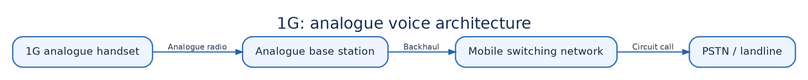

Mobile Network Generations and Architecture: 1G to 6G
Step-by-step learning guide | Mobile networks · Standards · FCAPS · Performance Management

How to use this repository: Start at Chapter 1, follow the diagrams, learn each component's role, and complete the exercises. All diagrams are normal PNG images linked using relative paths: no Mermaid renderer, browser plugin, or external diagram service is required. Keep the assets directory alongside this README.md.

Status note (November 2026): 1G–5G are historic or deployed generations. 6G is still being researched and standardised. Future capabilities described in this guide are not claims of a final 6G architecture. Some examples deliberately simplify real operator networks.

Contents
1. Foundations: how a mobile network works
2. 1G: analogue voice
3. 2G: GSM, SMS and packet data
4. 3G: UMTS and mobile internet
5. 4G: LTE and the Evolved Packet Core
6. 5G: NR, standalone and non-standalone
7. 6G: future concepts
8. Radio technologies: FDMA, GSM, CDMA, OFDMA, MIMO, ISAC
9. Why mobile standards matter
10. Standards bodies and regulators
11. FCAPS management and TMN
12. Official FCAPS and PM standards
13. Network Performance Management
14. Learning roadmap and self-tests
15. References and troubleshooting
Chapter 1 — Mobile Network Foundations
1.1 What does “G” mean?
G = Generation. Generations refer to families of mobile-network technologies that introduce different radio and network capabilities. A generation is not a single frequency, antenna type or device model.

1.2 Three main parts of a mobile network

Part	Full name	Role
UE / MS	User Equipment / Mobile Station	Sends and receives voice or data; identifies and authenticates subscribers using the relevant technology
RAN	Radio Access Network	Provides the wireless link, schedules radio resources and handles radio mobility functions
Core	Core Network	Manages subscriber access, mobility, sessions, packet routing and interconnection
External services	Internet, PSTN, IMS, cloud	Provide websites, calls, messaging, apps and other services

Step-by-step example: opening a webpage
1. The phone selects and accesses a compatible cell.
2. The radio base station exchanges wireless traffic with the phone.
3. The core authorises and establishes the necessary connectivity.
4. User data flows to the internet over the operator's network.
5. Responses return over the core, RAN and radio connection.
Vocabulary: Cell = radio coverage area; backhaul = connection from radio sites toward the network; handover = moving an active connection between serving cells; control plane = signalling and control; user plane = actual user traffic.
Chapter 2 — 1G: Analogue Voice
Objective: Trace an analogue mobile call and explain the jobs of the main network components.

2.1 Main components and roles
Component	Role
1G handset	Converts speech into an analogue signal and transmits/receives radio
Analogue base station	Serves an assigned radio cell and exchanges radio signals with handsets
Mobile switching network	Sets up circuit-switched calls and manages mobility/handoff
PSTN	Public Switched Telephone Network connecting landline calls

2.2 Step-by-step call flow
1. A subscriber dials a number on an analogue handset.
2. The handset uses an available radio channel to reach its base station.
3. The switching network routes the call to the recipient's network.
4. Speech travels through an allocated circuit during the call.
5. When a user travels between cells, handoff may move the call to another base station.
Standards: AMPS (Advanced Mobile Phone System), NMT (Nordic Mobile Telephone), TACS (Total Access Communication System). Technique: FDMA (separate frequency channels for simultaneous users). Limitations: low capacity, weak privacy/security, limited data capabilities.

Check yourself: Why did an analogue system need a switching network instead of connecting a handset directly to every other handset?
Chapter 3 — 2G: Digital Voice, SMS and GPRS/EDGE
Objective: Distinguish the GSM circuit-switched voice path from the later packet-data path.
3.1 GSM voice architecture

Component	Full form	Role
MS	Mobile Station	User handset and SIM
BTS	Base Transceiver Station	Radio transceiver serving a GSM cell
BSC	Base Station Controller	Controls multiple BTSs and radio resources
MSC	Mobile Switching Centre	Circuit-switched call control and switching
HLR / VLR	Home / Visitor Location Register	Subscriber and temporary mobility information
AuC	Authentication Centre	Provides authentication-related information
PSTN	Public Switched Telephone Network	Connectivity to traditional telephone services

GSM voice call, step by step
1. The mobile station communicates digitally with the BTS.
2. BTS traffic travels to the BSC.
3. The BSC manages radio resources and participates in mobility handling.
4. The MSC establishes and routes the circuit-switched call.
5. Subscriber databases assist with location, service and authentication procedures.
Radio methods: GSM combines frequency channels (FDMA) with time slots (TDMA). SMS uses signalling and messaging infrastructure beyond the simplified voice-path diagram.
3.2 GPRS/EDGE packet-data architecture

Component	Role
PCU	Packet Control Unit — supports packet-radio resource functions
SGSN	Serving GPRS Support Node — manages packet mobility and sessions
GGSN	Gateway GPRS Support Node — connects to external packet networks
GPRS	General Packet Radio Service — packet data extension of GSM
EDGE	Enhanced Data Rates for GSM Evolution — improves GSM packet data rates

Data access, step by step
1. The device requests packet connectivity over GSM radio.
2. BTS/BSC and the packet control functions handle radio-side packet traffic.
3. SGSN provides relevant packet mobility/session support.
4. GGSN connects the session to external data networks.
5. Internet traffic travels in packets rather than occupying a dedicated voice circuit.
Alternative 2G: IS-95/cdmaOne uses CDMA spread-spectrum access, not GSM TDMA.
Chapter 4 — 3G: UMTS and Mobile Internet
Objective: Understand NodeB, RNC and the separate 3G voice/data service paths.

Component	Role
UE	3G handset/device
NodeB	UMTS radio base station
RNC	Radio Network Controller — handles radio resources, mobility and NodeBs
MSC / circuit-switched core	Connects traditional voice services
SGSN and GGSN / packet-switched core	Supports packet-data mobility and external internet access

Step-by-step packet-data session
1. The UE transmits on a UMTS radio interface, commonly WCDMA.
2. NodeB provides radio access.
3. RNC manages NodeBs, radio resources and related handovers.
4. Packet-switched core nodes carry data toward the internet.
5. Applications use the resulting connection for email, browsing and multimedia.
3G technology families
- UMTS: 3GPP system using WCDMA for its conventional radio access network.
- WCDMA: Wideband Code Division Multiple Access radio technology — one part of UMTS, not a synonym for the entire core network.
- HSPA/HSPA+: Later UMTS packet-data enhancements.
- CDMA2000 1x / EV-DO: A separate 3G standards evolution from IS-95.
Check yourself: What role did the RNC play that is largely integrated into later LTE radio access nodes?
Chapter 5 — 4G: LTE and All-IP Mobile Broadband
Objective: Identify the eNodeB, EPC control plane and user plane, and explain how VoLTE works.

Component	Full form	Role
eNodeB	Evolved NodeB	LTE radio access, mobility and scheduling
EPC	Evolved Packet Core	LTE packet core as a whole
MME	Mobility Management Entity	Control-plane signalling and mobility
HSS	Home Subscriber Server	Subscriber information and authentication support
SGW	Serving Gateway	Forwards user-plane data within EPC
PGW	Packet Data Network Gateway	Connects the mobile packet core to external data networks
IMS	IP Multimedia Subsystem	Supports IP multimedia services, including VoLTE

LTE internet session, step by step
1. UE attaches to LTE via an eNodeB.
2. MME participates in access, authentication and mobility signalling.
3. A packet-data session and bearers are established.
4. User traffic follows UE → eNodeB → SGW → PGW → internet in a common EPC deployment.
5. IMS provides a service environment for packet-based voice such as VoLTE.
Radio techniques
- OFDMA: LTE downlink multiple access.
- SC-FDMA: Conventional LTE uplink transmission method.
- MIMO: Multiple antennas improve throughput and/or link reliability.
- Carrier aggregation (LTE-Advanced): Combines component carriers to increase available bandwidth.
Key difference from 3G: LTE has an all-IP packet core and does not use the classic 2G/3G circuit-switched core for native LTE voice.
Chapter 6 — 5G: New Radio and 5G Core
Objective: Explain 5G NR, 5GC, SA versus NSA, and the roles of core network functions.
6.1 Standalone (SA) 5G architecture

Function	Full form	Role
gNodeB (gNB)	next-generation NodeB	5G NR base station
AMF	Access and Mobility Management Function	Registration, reachability and mobility signalling
SMF	Session Management Function	Manages PDU sessions and controls UPF
UPF	User Plane Function	Forwards user traffic and supports traffic steering
UDM	Unified Data Management	Subscriber-data management
AUSF	Authentication Server Function	Authentication support
PCF	Policy Control Function	Policy decision functions
NRF	Network Repository Function	Discovers registered network-function services

5G SA data session, step by step
1. A device establishes an NR radio connection to a gNodeB.
2. AMF manages access/registration signalling.
3. SMF manages the requested PDU session.
4. A UPF is selected/configured for the user-plane path.
5. Data travels UE → gNodeB → UPF → data network; control messages travel through distinct interfaces.
6. An edge application can be reached through a suitable local user-plane path where deployed.
The 5G Core service-based architecture mainly concerns control-plane network-function services; the UPF still handles packet forwarding.
6.2 Non-Standalone (NSA) 5G architecture

An important NSA deployment model uses LTE as an anchor and adds NR capacity while retaining the EPC. The diagram is one representative arrangement, not every 5G NSA option.
Mode	Radio / anchor	Core	Typical purpose
NSA	LTE anchor with NR secondary connection	Often EPC	Introduce 5G radio while leveraging 4G infrastructure
SA	5G NR radio	5G Core	Deploy native 5G core capabilities

5G concepts to learn
- eMBB: enhanced mobile broadband.
- URLLC: ultra-reliable, low-latency communication objectives.
- mMTC: massive machine-type communications objectives.
- Massive MIMO / beamforming: use antenna arrays and directional radio techniques.
- Network slicing: logical networks tailored to different service requirements.
- MEC / edge computing: processing placed closer to devices where useful.
Check yourself: In a 5G SA data session, which function forwards user data: AMF, SMF or UPF?
Chapter 7 — 6G: Future Networks (Research)
Objective: Separate current deployments and published standards from research concepts.

This is a conceptual architecture, not a final 6G standard. The diagram illustrates research directions only.
Proposed area	Potential role
AI-assisted / AI-native functions	Support automation, resource control and optimisation
ISAC	Integrated sensing and communication, potentially using radio signals for both
NTN	Non-terrestrial networks such as satellite connectivity
Advanced RAN	New radio techniques and architectures under research
Edge/cloud intelligence	Distribute compute and intelligence near or within networks
Immersive services	Explore advanced interaction and multimedia use cases

Study 6G, step by step
1. Review the ITU-R IMT-2030 framework and identify its intended capabilities.
2. Study 5G NR and 5GC first, because future networks build on existing engineering principles.
3. Explore AI for radio/resource management and operations.
4. Learn what ISAC means and what engineering trade-offs it introduces.
5. Read about NTN integration, coverage and latency trade-offs.
6. Check future 3GPP/ITU publications before calling a proposed architecture “standardised.”
Chapter 8 — Radio Technologies and Standards
Important distinction: A standards family specifies a whole system; a multiple-access technique explains radio-resource sharing; an antenna technique improves transmission; and a research area is not yet necessarily a standard.
Term	Full name	Type	Generations / use	Main idea
FDMA	Frequency Division Multiple Access	Multiple access	Mainly analogue 1G	Assign distinct frequency channels
GSM	Global System for Mobile Communications	Cellular system	2G	Digital voice/SMS, later GPRS/EDGE
IS-95	Interim Standard 95 (cdmaOne)	Cellular standard	2G	Spread-spectrum CDMA system
UMTS	Universal Mobile Telecommunications System	Cellular system	3G	3GPP voice and data system
WCDMA	Wideband Code Division Multiple Access	Radio interface	3G UMTS	Code-spread wideband radio
CDMA2000	CDMA2000 standards family	Cellular system	3G	Evolution of IS-95; includes 1x / EV-DO
LTE	Long Term Evolution	Cellular technology	4G	All-IP mobile broadband
OFDMA	Orthogonal Frequency Division Multiple Access	Multiple access	4G downlink / 5G NR	Allocates orthogonal subcarriers/resources to users
MIMO	Multiple Input Multiple Output	Antenna technique	4G / 5G	Uses multiple Tx/Rx antennas
ISAC	Integrated Sensing and Communication	Research / system capability	Particularly 6G research	Combine communications and radio sensing

8.1 FDMA vs TDMA vs CDMA vs OFDMA
- FDMA: Users have different frequency channels.
- TDMA: Users are assigned different time slots on a radio carrier.
- CDMA: Users share a band and are distinguished using spreading codes and reception techniques.
- OFDMA: Orthogonal subcarriers and time-frequency resource units are dynamically distributed among users.
8.2 MIMO example
A 4×4 MIMO configuration has four transmit and four receive antenna paths. It may support spatial multiplexing or diversity, but four antennas do not automatically guarantee four independent data streams.
8.3 ISAC example
A future radio access system might serve a connected vehicle while analysing reflected radio signals to estimate motion or nearby objects. This remains an area of research and system design.
8.4 Mobile standards evolution
Generation	Representative systems / frameworks
1G	AMPS, NMT, TACS
2G	GSM, IS-95, IS-136; GPRS/EDGE extensions
3G	UMTS/WCDMA, CDMA2000, HSPA, EV-DO
4G	LTE and LTE-Advanced
5G	5G NR, 5G Core, 5G-Advanced
6G	IMT-2030 framework; detailed implementation work ongoing

Chapter 9 — Why We Need Mobile Standards
9.1 Main reasons
1. Interoperability: A compatible device and network can exchange information using agreed interfaces.
2. Roaming: Networks can identify and serve eligible subscribers from partner networks.
3. Security: Common authentication, ciphering and security procedures can be implemented consistently.
4. Spectrum efficiency: Technical specifications coordinate ways of using radio resources.
5. Mobility: Common protocols support cell selection, registration and handovers.
6. Economies of scale: Multiple manufacturers can build equipment for the same technology family.
7. Evolution: New releases can extend a standard rather than requiring proprietary reinvention.
Without standards: Interconnection, interoperability, device compatibility and international roaming would be much harder. With standards: Products can interoperate if they also match supported bands, features, software, provisioning and operator policies.
9.2 A real-world example
An LTE-compatible smartphone can communicate with a compatible LTE eNodeB even if the handset and base station come from different vendors, because both implement the required radio protocols. Compatibility is not guaranteed by the “4G” label alone.
Chapter 10 — Who Develops and Regulates Standards?

Organisation	Type	Main responsibility
ITU / ITU-R	UN specialised agency / radiocommunication sector	International spectrum coordination and IMT frameworks (IMT-2000, -Advanced, -2020, -2030)
3GPP	Standards partnership	Detailed cellular specifications: GSM evolution, UMTS, LTE, NR, core, management
ETSI	Regional standards organisation and 3GPP partner	European telecom standards and publication of corresponding specifications
IEEE	Technical standards organisation	Wi-Fi (802.11), Ethernet (802.3), other technical standards
IETF	Internet standards community	Internet protocols such as IP, TLS, NETCONF and SNMP-related RFCs
3GPP2	Historical standards partnership	CDMA2000-related standards
National regulators	Public regulatory authorities	Licences, spectrum authorisation, market and legal oversight

Regulators vs standards bodies: 3GPP develops technical specifications but does not issue mobile spectrum licences. National regulators such as ComReg (Ireland), Ofcom (UK) and FCC (US) administer applicable regulatory requirements.
Standards development, step by step
1. Industry identifies a need and submits requirements.
2. Research and technical proposals are evaluated.
3. Standards groups agree technical designs and interfaces.
4. Organisations publish specifications and release versions.
5. Manufacturers implement and test products.
6. Operators deploy networks under relevant authorisations.
7. Later releases improve performance, features and interoperability.
Chapter 11 — FCAPS Network Management
FCAPS is a functional way to organise operations, not a single wire protocol. It is linked to the ITU-T Telecommunications Management Network (TMN) framework.

Area	What it does	Example operational task
F — Fault	Detects, reports, correlates and resolves abnormal conditions	Investigate a cell-outage alarm
C — Configuration	Manages network settings and controlled changes	Adjust a cell's neighbour configuration
A — Accounting	Tracks resource usage and supports charging	Process usage records or charging events
P — Performance	Measures network operation with counters and KPIs	Investigate low throughput
S — Security	Manages access controls and security monitoring	Reject unauthorised OSS changes

11.1 TMN management levels

Level	Role
BML — Business	Business policies and objectives
SML — Service	End-to-end service management
NML — Network	Network-wide visibility and control
EML — Element	Equipment/element-level management
NEL — Network element	Managed hardware and virtual/software resources

TMN = management architecture principles; FCAPS = functional areas; OSS/NMS/EMS = management platforms or systems that implement relevant responsibilities.
11.2 Fault Management (F)

Step by step: detect alarm → collect in EMS/NMS → correlate and prioritise → investigate root cause → repair/restore → verify service. Relevant 3GPP sources include the TS 32.111 fault-management family. Alarm severity commonly includes critical, major, minor, warning and cleared states.
11.3 Configuration Management (C)

Step by step: request change → validate impact → approve → apply using management services/EMS → verify configuration and service → roll back if necessary. Examples: radio parameters, neighbour relations, tracking area and resource models. 3GPP TS 28.532 and TS 28.541 support modern 5G management services and network resource modelling.
11.4 Accounting Management (A)

Step by step: subscriber uses a service → network observes relevant usage → charging functions create/process events → billing/balance systems process outputs. Standards include 3GPP TS 32.240 and related charging specifications. Usage accounting, online/offline charging and final customer billing are distinct processes.
11.5 Performance Management (P)

Step by step: collect raw counters → validate and aggregate → calculate KPIs → display and analyse trends → optimise and verify. Important standards include TS 32.401, TS 32.425 (LTE), TS 28.552 (5G measurements), and TS 28.554 (5G KPIs).
11.6 Security Management (S)

Step by step: authenticate administrator → check assigned privileges → apply allowed management operation → retain audit logs → investigate abnormal behaviour. Relevant topics include RBAC, TLS/SSH, security monitoring and 3GPP security specifications (such as TS 33.501 for 5G system security).
Chapter 12 — Official FCAPS and Performance Management Standards
How to read standards: ITU-T provides foundational management guidance. 3GPP has distinct specifications for cellular measurements, interfaces, management and charging. There is no single 3GPP standard containing all FCAPS functions.
12.1 FCAPS standards map
Area	Official reference(s)	Subject
TMN / FCAPS foundation	ITU-T M.3010, ITU-T M.3400	TMN principles and management functions
General telecom management	3GPP TS 32.101, TS 32.102	Management principles and architecture
Fault	3GPP TS 32.111 series	Fault management, Alarm IRP
Configuration / resources	3GPP TS 28.532, TS 28.541	Management services and 5G NRM
Accounting / charging	3GPP TS 32.240, TS 32.298, and related charging specs	Charging principles and data records
Performance concepts	3GPP TS 32.401, TS 32.404	PM concepts and measurement definitions/templates
3G PM	3GPP TS 32.405	UTRAN measurements
4G PM	3GPP TS 32.425, TS 32.450	E-UTRAN measurements and KPIs
PM files	3GPP TS 32.432, TS 32.435	Performance file/interface and XML format specifications
5G assurance / PM	3GPP TS 28.550, TS 28.552, TS 28.554	Assurance, 5G measurements, end-to-end KPIs
Cellular security	3GPP TS 33.501	5G security architecture and procedures
Complementary management protocols	IETF RFC 6241 (NETCONF), RFC 7950 (YANG)	Configuration protocol and data modelling

Engineering rule: Verify the official specification title, release, version and applicability in the 3GPP portal before using exact counter names, normative requirements or vendor KPI mappings in production.

12.2 Which PM document should I read?
Goal	Start with
Learn FCAPS/PM theory	ITU-T M.3400 → 3GPP TS 32.401
Understand PM definitions	3GPP TS 32.404
Understand 3G UTRAN counters	3GPP TS 32.405
Understand LTE RAN counters	3GPP TS 32.425
Understand LTE KPIs	3GPP TS 32.450
Understand PM file structures	3GPP TS 32.432 and TS 32.435
Understand 5G performance assurance	3GPP TS 28.550
Understand 5G PM measurements	3GPP TS 28.552
Understand end-to-end 5G KPIs	3GPP TS 28.554

Chapter 13 — Practical Performance Management
PM counter: a raw network measurement (e.g., successful attempts). KPI: a derived performance indicator, often using multiple counters (e.g., a success rate). KQI: a measure focused on user/service quality; it may combine multiple KPIs and other data.
13.1 End-to-end collection

1. Decide which managed network objects (cells, sites, functions, slices) to monitor.
2. Select standardised or vendor counters and an appropriate collection granularity.
3. Collect data through management functions/services or EMS platforms.
4. Validate missing records, time windows and counter resets.
5. Calculate KPIs using the appropriate formulas and exclusions.
6. Compare by cell, cluster, device population or time period.
7. Investigate any deviations; avoid assuming that correlation proves root cause.
8. Apply approved optimisations and measure before/after outcomes.
13.2 Useful KPI categories
Category	Example	Interpretation
Availability	Site/cell availability	Is the resource operational?
Accessibility	RRC establishment success	Can a user start a connection?
Retainability	Unexpected bearer/connection releases	Does the connection stay up?
Mobility	Handover success rate	Are mobility transitions effective?
Capacity	PRB utilisation	How much scheduled radio resource is in use?
Integrity	Throughput / latency	How effectively is data delivered?

13.3 Illustrative KPI calculations
Simple handover success rate:
Handover success rate (%) = (successful handovers / eligible handover attempts) × 100
Example: 970 successes / 1,000 attempts = 97%
Simple RRC establishment rate:
RRC establishment rate (%) = (successful RRC establishments / valid attempts) × 100
Example: 980 / 1,000 = 98%
These are teaching calculations. A production KPI can have special counting events, exceptions, aggregation conditions and release-specific definitions.
13.4 LTE PM investigation
1. Look for active faults affecting the eNodeB or transport path.
2. Check LTE performance measurements described in TS 32.425.
3. Calculate the required KPIs using standard/operator rules (see TS 32.450).
4. Examine radio load, throughput, mobility, signal quality and recent changes.
5. Investigate congestion versus coverage versus backhaul limitations.
6. Make approved changes and compare KPIs before/after.
13.5 5G performance management

1. Collect relevant NG-RAN and 5GC measurements (see TS 28.552).
2. Use performance-assurance management concepts (TS 28.550).
3. Derive applicable end-to-end KPIs (TS 28.554).
4. Distinguish RAN radio problems from UPF/core, transport and application problems.
5. Use slice/service context where supported and relevant.
6. Verify that measurements are consistent across vendors and software versions.
13.6 Practical FCAPS incident drill
Scenario: Users in one area report 5G slowness.
FCAPS area	Question to ask
F	Are there site, transport or core alarms?
C	Were radio/core parameters changed recently?
A	Is unusual usage/charging-related traffic relevant?
P	Are throughput, PRB utilisation, latency or handover KPIs degraded?
S	Are security events or access restrictions contributing?

Not every incident requires all five categories. Prioritise evidence that relates to the reported symptoms.
Chapter 14 — Learning Roadmap and Self-Tests
14-session study plan
Session	Learn	Do
1	UE, RAN, core, control/user planes	Draw the generic network architecture
2	1G analogue calling	Trace a call to PSTN
3	2G GSM voice	Label BTS, BSC, MSC and HLR/VLR
4	GPRS/EDGE	Trace the SGSN/GGSN internet path
5	3G UMTS	Compare RNC/NodeB with LTE
6	4G LTE/EPC	Trace control and user traffic separately
7	5G NSA/SA	Explain gNodeB, AMF, SMF and UPF
8	6G research	Separate proposals from standards
9	FDMA, TDMA, CDMA, OFDMA, MIMO	Give an example for each technique
10	Standards bodies	Distinguish ITU, 3GPP, ETSI and regulator
11	FCAPS and TMN	Identify management layers and functions
12	Fault, configuration, security	Analyse an example site outage
13	Accounting and performance	Define CDR, counter, KPI and KQI
14	Official PM documents and cases	Match an engineering task to a 3GPP TS

Practice questions
1. What does “G” stand for?
2. Which components are common to 2G GSM circuit-switched voice?
3. What are SGSN and GGSN used for?
4. What do NodeB and RNC do in 3G?
5. What is the LTE user-plane path through an EPC?
6. What is the difference between 5G NSA and SA?
7. Which 5GC function forwards user packets?
8. What is the relationship between UMTS and WCDMA?
9. How do FDMA and OFDMA differ?
10. Why is 6G architecture labelled conceptual?
11. What is the difference between a technical standards body and a regulator?
12. What are the five FCAPS functions?
13. What distinguishes M.3010 from M.3400?
14. What is the difference between a PM counter and KPI?
15. Which 3GPP specifications are commonly used for LTE RAN PM and 5G PM?

Show short answer key
1. Generation.
2. MS, BTS, BSC, MSC; subscriber databases and PSTN as needed.
3. 2G/3G packet mobility/session support and packet-data gateway.
4. 3G base station and its radio network controller.
5. UE → eNodeB → SGW → PGW → internet (typical deployment).
6. NSA normally combines NR with an LTE anchor/core arrangement; SA uses NR with 5GC.
7. UPF.
8. UMTS is a system; WCDMA is its conventional 3G radio interface.
9. FDMA allocates separate channels; OFDMA schedules orthogonal subcarriers/time-frequency resources.
10. Detailed 6G implementations are not finalised.
11. One develops technical specifications; the other enforces applicable legal/spectrum requirements.
12. Fault, Configuration, Accounting, Performance, Security.
13. TMN architecture principles vs TMN management functions.
14. Raw measurement vs calculated indicator.
15. TS 32.425 / TS 32.450 for LTE; TS 28.550 / TS 28.552 / TS 28.554 for 5G.

Chapter 15 — References and Troubleshooting
15.1 Official learning references
- ITU — IMT frameworks and telecommunications recommendations.
- ITU-T M.3010 — Principles for a Telecommunications Management Network.
- ITU-T M.3400 — TMN management functions.
- 3GPP — Cellular standards development.
- 3GPP specifications portal — Search TS 32.401, 32.404, 32.425, 32.450, 28.532, 28.541, 28.550, 28.552, 28.554 and 33.501.
- ETSI — European telecommunications standards.
- IEEE Standards — IEEE networking standards.
- IETF — Internet protocol standards.
- ComReg — Communications regulator in Ireland.
15.2 Why these diagrams work on GitHub
This README deliberately does not contain Mermaid diagrams. Every diagram is a .png image created locally, and linked with ordinary Markdown syntax:

GitHub supports PNG images in Markdown. You must upload the folder structure as provided. If only README.md is uploaded, its images will be missing.
If an image is missing
1. Make sure README.md is at the repository root.
2. Make sure assets/diagrams/ and assets/mobile_network_generations_1g_to_6g.png are in the same repository.
3. Check filename capitalisation carefully; GitHub paths are case-sensitive.
4. Confirm that the GitHub branch being viewed contains the image files.
5. Open the image path directly from the GitHub repository to confirm it exists.
15.3 Repository structure
mobile-network-learning/
├── README.md
├── assets/
│   ├── mobile_network_generations_1g_to_6g.png
│   └── diagrams/
│       ├── 1g-architecture.png
│       ├── 2g-voice.png
│       ├── 2g-data.png
│       ├── 3g-architecture.png
│       ├── 4g-architecture.png
│       ├── 5g-sa.png
│       ├── 5g-nsa.png
│       ├── 6g-concept.png
│       └── ... additional management / learning diagrams
└── source-diagrams/
    └── ... Graphviz DOT sources for editing and regenerating diagrams
15.4 Editing the diagrams
Editable .dot source files are supplied in source-diagrams/. To recreate an image locally, install Graphviz and run:
dot -Tpng source-diagrams/1g-architecture.dot -o assets/diagrams/1g-architecture.png
Learning goal: Be able to explain the components, roles and architectures of each generation; identify the relevant standards; and apply FCAPS and Performance Management to real telecom operations.
Educational summary, not a replacement for official release-specific 3GPP/ITU specifications or vendor implementation documents.
