---

# Mobile Telecommunications Standards for FCAPS Network Management

## 1. What Is FCAPS?

FCAPS is a network management framework used to organise telecommunications management functions.

FCAPS stands for:

| Letter | Management Function | Main Purpose |
|---|---|---|
| F | Fault Management | Detect, report and resolve faults |
| C | Configuration Management | Configure and control network resources |
| A | Accounting Management | Track usage, charging and resource consumption |
| P | Performance Management | Measure and optimise network performance |
| S | Security Management | Protect network systems and management access |

### FCAPS Architecture

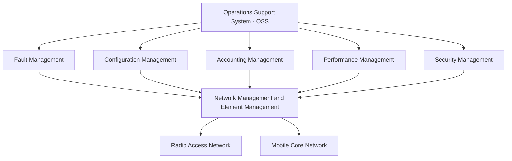

FCAPS is a functional classification, not one individual communication protocol.

---

# 2. Organisations Responsible for FCAPS Standards

Several standards organisations contribute to network management.

| Organisation | Main Responsibility | Relevant Standards |
|---|---|---|
| ITU-T | Telecommunications management frameworks | M.3010, M.3400 |
| 3GPP SA5 | Mobile network management and orchestration | TS 32-series, TS 28-series |
| 3GPP SA3 | Cellular security specifications | TS 33-series |
| ETSI | Telecom standards, NFV and automation | ETSI NFV, ZSM |
| IETF | Network management protocols and data models | SNMP, NETCONF, YANG |

### Important Difference

- **ITU-T:** Defines foundational telecom management frameworks.
- **3GPP:** Defines cellular-network-specific management capabilities.
- **ETSI:** Develops complementary telecom management and automation standards.
- **IETF:** Defines protocols and data models that can support network management.

---

# 3. Foundational FCAPS Standards

## 3.1 ITU-T M.3400 — TMN Management Functions

**Organisation:** ITU-T

**Document:** ITU-T M.3400

**Official Title:** TMN management functions

**Official Reference:**
https://www.itu.int/rec/T-REC-M.3400

### Purpose

ITU-T M.3400 defines Telecommunications Management Network (TMN) management functions.

It provides the foundational functional organisation associated with FCAPS.

### Main Areas

1. Fault Management
2. Configuration Management
3. Accounting Management
4. Performance Management
5. Security Management

### Functional Model

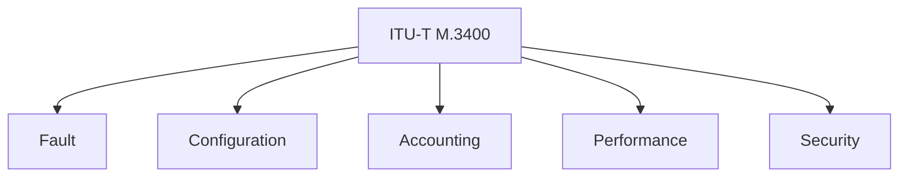

---

## 3.2 ITU-T M.3010 — TMN Architecture

**Organisation:** ITU-T

**Document:** ITU-T M.3010

**Official Subject:** Principles for a Telecommunications Management Network

**Official Reference:**
https://www.itu.int/rec/T-REC-M.3010

### Purpose

M.3010 defines principles for the Telecommunications Management Network architecture.

### Traditional Management Layers

| Layer | Name | Responsibility |
|---|---|---|
| BML | Business Management Layer | Business-level operations |
| SML | Service Management Layer | Service management |
| NML | Network Management Layer | Network-wide operations |
| EML | Element Management Layer | Network-element management |
| NEL | Network Element Layer | Managed network resources |

### TMN Layer Architecture

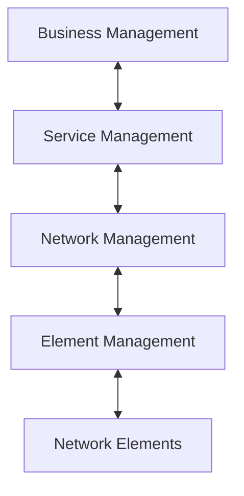

**Remember:**

- M.3010 describes management architecture principles.
- M.3400 describes management functions.

---

# 4. Fault Management Standards

## What Is Fault Management?

Fault Management detects abnormal network conditions and supports fault investigation, reporting and recovery.

### Important Standards

| Standard | Main Subject |
|---|---|
| ITU-T M.3400 | TMN fault management functions |
| 3GPP TS 32.111-1 | Fault management requirements |
| 3GPP TS 32.111-2 | Alarm IRP information service |
| 3GPP TS 32.111-6 | Alarm IRP solution-set definitions |
| 3GPP TS 28.532 | Generic management services |

### Official References

- [ITU-T M.3400](https://www.itu.int/rec/T-REC-M.3400)
- [3GPP Specifications Portal](https://portal.3gpp.org/)

## Main Fault Management Functions

- Alarm collection
- Alarm surveillance
- Alarm severity classification
- Alarm correlation
- Fault localisation
- Trouble reporting
- Service restoration verification

### Fault Management Architecture

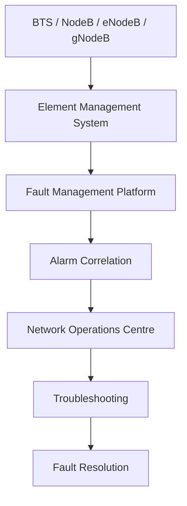

### Real-World Example

A 5G base station becomes unavailable.

1. A monitoring system detects the problem.
2. An alarm is reported.
3. The fault management system processes the alarm.
4. A NOC engineer investigates.
5. The fault is resolved.
6. Network recovery is verified.

---

# 5. Configuration Management Standards

## What Is Configuration Management?

Configuration Management controls network settings, managed resources and configuration changes.

### Important Standards

| Standard | Main Subject |
|---|---|
| ITU-T M.3400 | Configuration management functions |
| 3GPP TS 32.101 | Telecom management principles |
| 3GPP TS 32.102 | Telecom management architecture |
| 3GPP TS 28.532 | Generic management services |
| 3GPP TS 28.541 | 5G Network Resource Model |
| IETF RFC 6241 | NETCONF protocol |
| IETF RFC 7950 | YANG data modelling language |

### Main Configuration Management Functions

- Network-element configuration
- Managed-resource creation and deletion
- Configuration parameter modification
- Software configuration management
- Configuration backup and recovery
- Configuration consistency checks
- Change verification

### Configuration Management Architecture

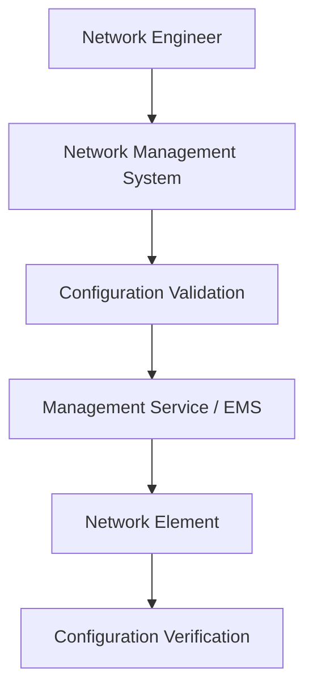

### Example: LTE Cell Configuration

A network engineer changes a cell parameter.

1. Review current configuration.
2. Prepare the proposed change.
3. Validate the new settings.
4. Apply the approved configuration.
5. Verify that the change succeeded.
6. Monitor the affected cell.
7. Roll back if necessary.

### Common Configuration Parameters

| Parameter | Purpose |
|---|---|
| Cell ID | Identifies a cell |
| PCI | Physical Cell Identity |
| EARFCN | LTE radio channel identifier |
| TAC | Tracking Area Code |
| Transmit Power | Controls radio transmission |
| Neighbour Relations | Supports handover and mobility |

---

# 6. Accounting Management Standards

## What Is Accounting Management?

Accounting Management collects information about network resource consumption and service usage.

In mobile telecommunications, accounting often works alongside charging and billing systems.

### Important Standards

| Standard | Main Subject |
|---|---|
| ITU-T M.3400 | Accounting management functions |
| 3GPP TS 32.240 | Charging architecture and principles |
| 3GPP TS 32.251 | Packet-switched domain charging |
| 3GPP TS 32.298 | Charging Data Record parameter definitions |
| 3GPP TS 32.299 | Diameter charging applications |
| 3GPP TS 32.255 | 5G data connectivity domain charging |

### Main Accounting Functions

- Usage measurement
- Service-consumption reporting
- Charging information collection
- Charging-record processing
- Billing-system integration
- Resource-usage analysis

### Accounting and Charging Architecture

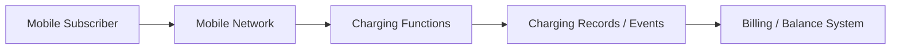

### Real-World Example

A subscriber consumes mobile data.

1. The device establishes a data session.
2. The network measures relevant usage.
3. Charging functions process the usage information.
4. Charging data is delivered to relevant systems.
5. Billing or prepaid balance processing occurs.

### Important Terms

| Term | Meaning |
|---|---|
| CDR | Charging Data Record |
| OCS | Online Charging System |
| OFCS | Offline Charging System |
| CHF | Charging Function |
| Billing | Customer charge processing |

**Important:** Charging implementations differ across mobile generations. For example, the 5G charging system uses architectures that differ from traditional EPC charging.

---

# 7. Performance Management Standards

## What Is Performance Management?

Performance Management collects and analyses network measurements to evaluate network quality and capacity.

### Important Standards

| Standard | Main Subject |
|---|---|
| ITU-T M.3400 | Performance management functions |
| 3GPP TS 32.401 | PM concepts and requirements |
| 3GPP TS 32.404 | Measurement definitions and template |
| 3GPP TS 32.405 | 3G UTRAN measurements |
| 3GPP TS 32.425 | LTE E-UTRAN measurements |
| 3GPP TS 32.450 | LTE KPI definitions |
| 3GPP TS 28.550 | Performance assurance |
| 3GPP TS 28.552 | 5G performance measurements |
| 3GPP TS 28.554 | 5G end-to-end KPIs |

### Main PM Functions

- Performance measurement collection
- KPI calculation
- Capacity monitoring
- Performance analysis
- Congestion detection
- Network quality reporting
- Network optimisation

### Performance Management Architecture

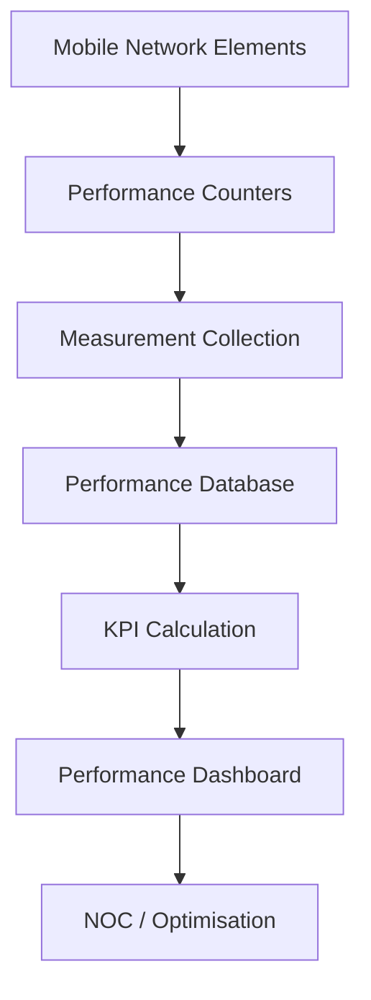

### Common Mobile Network KPIs

| KPI | Purpose |
|---|---|
| Availability | Measures operational availability |
| Accessibility | Measures connection or service establishment |
| Retainability | Measures service continuity |
| Handover Success Rate | Measures mobility performance |
| Throughput | Measures data transfer performance |
| Latency | Measures communication delay |
| PRB Utilisation | Measures radio resource usage |

### Example: Handover Success Rate

```text
Handover Success Rate (%) =

Successful Handovers
--------------------- × 100
Handover Attempts
```

Example:

- Successful handovers: 970
- Handover attempts: 1,000

```text
Handover Success Rate = (970 / 1000) × 100

Handover Success Rate = 97%
```

This is a simplified formula for learning. Operational KPI formulas must follow the applicable measurement and KPI definitions.

---

# 8. Security Management Standards

## What Is Security Management?

Security Management controls access to management systems and protects network management information and resources.

### Important Standards

| Standard | Main Subject |
|---|---|
| ITU-T M.3400 | Security management functions |
| ITU-T M.3410 | Security management system guidance |
| ITU-T M.3411 | Identity and access management requirements |
| 3GPP TS 33.501 | 5G security architecture and procedures |
| ISO/IEC 27001 | Information security management system requirements |
| IETF RFC 8446 | TLS 1.3 |
| IETF RFC 4251 | SSH protocol architecture |

### Main Security Management Functions

- Authentication
- Authorisation
- Identity management
- Role-based access control
- Security auditing
- Security-event monitoring
- Secure management communications
- Incident investigation

### Security Management Architecture

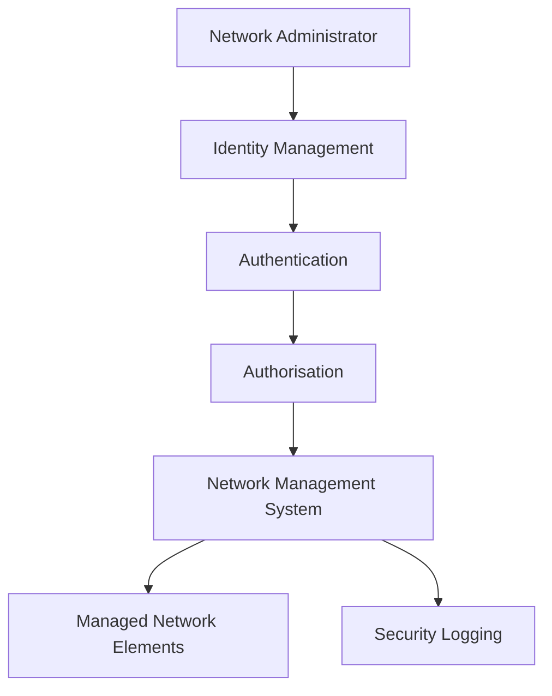

### Example: Unauthorised Configuration Change

1. A user attempts to modify a gNodeB.
2. The management platform checks their identity.
3. The platform evaluates permissions.
4. Unauthorised operations are rejected.
5. The attempt may be logged and investigated.

**Note:** 3GPP TS 33.501 addresses broader 5G system security. It complements, but does not exclusively define, FCAPS Security Management.

---

# 9. Complete FCAPS Standards Mapping

| FCAPS Function | Foundational Standard | Important 3GPP Standards | Complementary Standards |
|---|---|---|---|
| Fault | ITU-T M.3400 | TS 32.111 series, TS 28.532 | ITU-T TMN framework |
| Configuration | ITU-T M.3400 | TS 32.101, TS 32.102, TS 28.532, TS 28.541 | NETCONF, YANG |
| Accounting | ITU-T M.3400 | TS 32.240, TS 32.251, TS 32.255, TS 32.298, TS 32.299 | Charging and billing frameworks |
| Performance | ITU-T M.3400 | TS 32.401, TS 32.425, TS 28.550, TS 28.552, TS 28.554 | PM collection and reporting tools |
| Security | ITU-T M.3400 | TS 33.501 and applicable security specifications | ITU-T M.3410, M.3411, ISO/IEC 27001, TLS, SSH |

---

# 10. FCAPS Across 2G, 3G, 4G and 5G

| Generation | Common Managed Components | Management Approach |
|---|---|---|
| 2G | BTS, BSC, MSC | Traditional element and network management |
| 3G | NodeB, RNC, SGSN, GGSN | Expanded mobile-network management |
| 4G | eNodeB, MME, SGW, PGW | LTE/EPC performance and management |
| 5G | gNodeB, AMF, SMF, UPF | Service-based management and orchestration |
| 6G | Future radio and network functions | Management architecture under development |

### Evolution Diagram

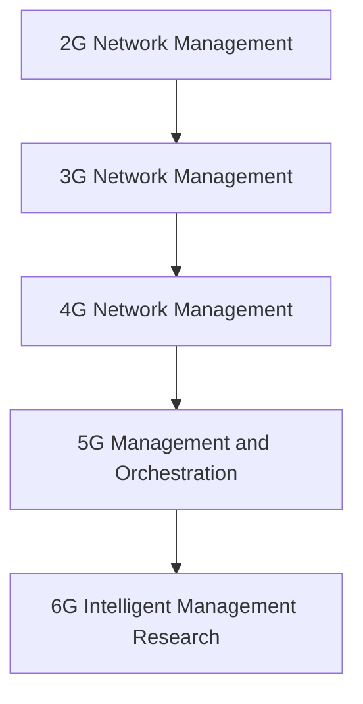

---

# 11. FCAPS in a Real Mobile Network

## Simplified End-to-End Management Architecture

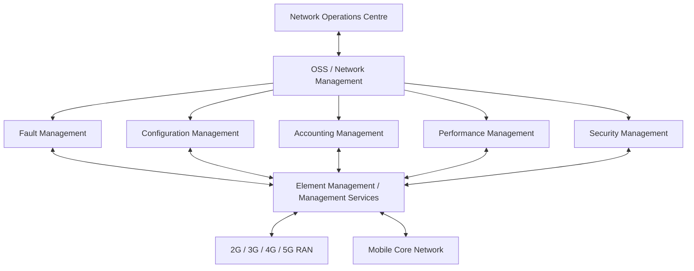

### Roles of Main Components

| Component | Role |
|---|---|
| NOC | Monitors network health and coordinates incident response |
| OSS | Supports telecommunications operations |
| NMS | Manages network-wide resources |
| EMS | Manages groups of network elements |
| RAN | Provides mobile radio connectivity |
| Core Network | Provides mobility, session control and connectivity services |
| Charging Systems | Support charging and billing |
| Security Systems | Monitor and control security-related activities |

---

# 12. Practical FCAPS Troubleshooting Example

## Scenario

Customers report that a 5G cell is experiencing poor performance.

### Fault Management

Check:

- Active alarms
- Site availability
- Transmission alarms
- Equipment faults

### Configuration Management

Review:

- Radio parameters
- Cell configuration
- Neighbour relationships
- Recent changes

### Accounting Management

Review relevant network resource or usage information if needed for the investigation.

### Performance Management

Check:

- Accessibility
- Retainability
- Throughput
- PRB utilisation
- Handover success
- Latency

### Security Management

Check relevant security or access-control events if they may be related to the incident.

## Troubleshooting Workflow

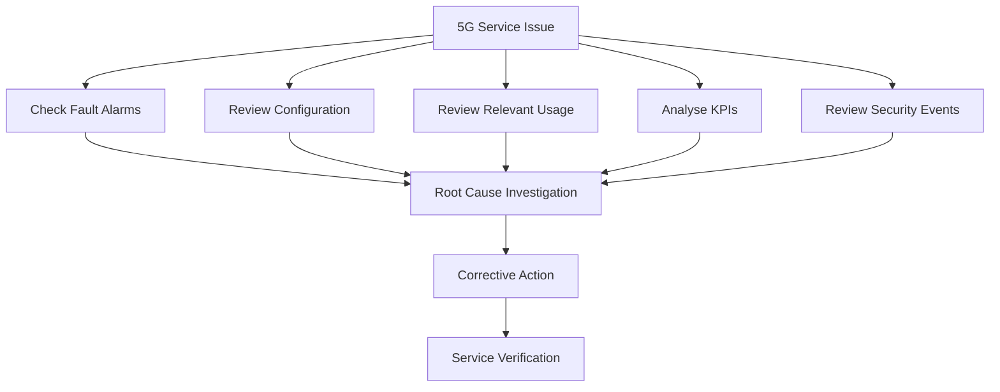

Not every incident requires all five FCAPS areas. Engineers use the functions relevant to the problem.

---

# 13. Recommended FCAPS Learning Roadmap

## Beginner

1. Learn the meaning of FCAPS.
2. Study ITU-T M.3400.
3. Understand TMN architecture and ITU-T M.3010.
4. Learn OSS, NMS and EMS terminology.

## Intermediate

5. Study Fault Management and TS 32.111.
6. Study Configuration Management and TS 28.532.
7. Study charging architecture and TS 32.240.
8. Study Performance Management and TS 32.401.
9. Study management security and access control.

## Advanced

10. Study TS 28.541 for the 5G Network Resource Model.
11. Study TS 28.552 for 5G performance measurements.
12. Study TS 28.554 for 5G end-to-end KPIs.
13. Study management automation and orchestration.
14. Analyse a real mobile-network incident using FCAPS.

---

# 14. Practice Questions

## Beginner

1. What does FCAPS stand for?
2. What is the purpose of ITU-T M.3400?
3. What is the difference between OSS and EMS?
4. What is Fault Management?
5. Why is Performance Management important?

## Intermediate

6. Which 3GPP standard family covers alarm management?
7. What is the purpose of TS 28.541?
8. How does charging differ from accounting?
9. Which standards cover 5G performance measurements?
10. How does Security Management protect an NMS?

## Advanced

11. How do ITU-T and 3GPP standards complement each other?
12. How can FCAPS functions be integrated into a telecom OSS?
13. How does 5G management differ from traditional management?
14. What is the relationship between the TMN layers and FCAPS?
15. How can FCAPS support automated network operations?

---

# 15. Official Reference Documents

## ITU-T

- [ITU-T M.3010 — TMN Principles](https://www.itu.int/rec/T-REC-M.3010)
- [ITU-T M.3400 — TMN Management Functions](https://www.itu.int/rec/T-REC-M.3400)
- [ITU-T M.3410 — Security Management](https://www.itu.int/rec/T-REC-M.3410)
- [ITU-T M.3411 — Identity and Access Management](https://www.itu.int/rec/T-REC-M.3411)

## 3GPP

- [3GPP Specifications Portal](https://portal.3gpp.org/)
- [3GPP TS 32.101 — Management Principles](https://portal.3gpp.org/)
- [3GPP TS 32.102 — Management Architecture](https://portal.3gpp.org/)
- [3GPP TS 32.111 — Fault Management](https://portal.3gpp.org/)
- [3GPP TS 32.240 — Charging Architecture](https://portal.3gpp.org/)
- [3GPP TS 32.401 — Performance Management](https://portal.3gpp.org/desktopmodules/Specifications/SpecificationDetails.aspx?specificationId=1991)
- [3GPP TS 28.532 — Generic Management Services](https://portal.3gpp.org/)
- [3GPP TS 28.541 — 5G Network Resource Model](https://portal.3gpp.org/desktopmodules/Specifications/SpecificationDetails.aspx?specificationId=3400)
- [3GPP TS 28.552 — 5G Performance Measurements](https://portal.3gpp.org/)
- [3GPP TS 33.501 — 5G Security Architecture](https://portal.3gpp.org/desktopmodules/Specifications/SpecificationDetails.aspx?specificationId=3169)

## Other References

- [ETSI](https://www.etsi.org/)
- [IETF](https://www.ietf.org/)
- [ISO](https://www.iso.org/)

**Version Note:** For implementation, always verify the applicable release, specification status and vendor support.

---

# 16. Final Learning Summary

The main standards governing FCAPS Network Management are:

**Foundational Standards**

- ITU-T M.3010 — TMN architecture
- ITU-T M.3400 — TMN management functions

**Cellular Network Management Standards**

- 3GPP TS 32.111 series — Fault Management
- 3GPP TS 28.532 / 28.541 — Management services and resource models
- 3GPP TS 32.240 series — Charging Management
- 3GPP TS 32.401 / TS 28.552 — Performance Management
- 3GPP TS 33.501 — Complementary 5G security architecture

**Learning Goal:**

Understand how ITU-T, 3GPP, ETSI and IETF standards support Fault, Configuration, Accounting, Performance and Security Management in mobile telecommunications networks.

---
